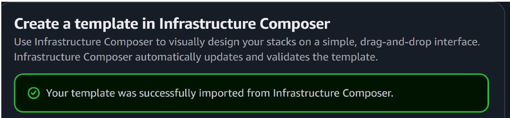

# AWS CloudFormation: Debugging, Validation & Git Versioning

## Overview

I worked with YAML templates for EC2, S3, VPC networking, and RDS. These exercises involved fixing template errors, validating imports through AWS Infrastructure Composer, and committing corrected files to GitHub.

**Tools:** CloudFormation, Infrastructure Composer, AWS S3, EC2, RDS, Git, GitHub, YAML

## Fixing an S3 Template

The S3 template contained formatting and structural errors. I corrected:

- The `AWSTemplateFormatVersion` value from `2019-09-09` to `2010-09-09`.
- Misspelled resource definitions and missing punctuation in `AWS::S3::Bucket`.
- Indentation that incorrectly placed `BucketPolicy` inside the bucket instead of defining it as a separate resource.
- Extra quotation marks and malformed YAML that led to null-value errors.

After those fixes, Infrastructure Composer imported the corrected template. I committed and pushed the working file.

## EC2 Template Changes and Git

I worked with existing EC2 templates, saved a revised version as `ec2-working.yaml`, validated its import through Infrastructure Composer, and pushed the changes to GitHub. The report includes successful Git push output and the file in the repository.

## VPC Template Review

I compared a VPC template against the requirements for AWS `us-west-2`, three Availability Zones, and the specified VPC name. The generated file also included optional resources such as an Internet Gateway, public subnets, routes, CIDR parameters, and stack outputs. I reviewed those additions rather than treating them as necessary to satisfy the original task.

## Adding RDS to a VPC Template

I merged an existing VPC template with RDS resource definitions and imported the combined template into Infrastructure Composer. A successful import confirms the template was accepted in that workflow, not that a database was successfully provisioned.

The original RDS lab used a plaintext credential in its template. That approach is not suitable for production, where I would use a managed secret, private database networking, and narrowly scoped permissions.

## Template Files

**[Three-AZ VPC CloudFormation template](templates/vpc-three-az.yaml):** Defines a VPC, three public subnets, Internet Gateway, routing, and resource outputs. It selects three Availability Zones available in the deployment Region.

**[AWS web and RDS reference design](../../projects/cloud/multicloud-infrastructure-as-code/templates/aws-web-rds-reference.yaml):** Revised from an earlier AWS architecture draft. It adds target-group and listener connections, removes an unused application security group, avoids a fixed AMI, and removes open SSH access. The example is checked for YAML structure and internal references but has not been deployed in a live AWS account.

## Template Validation Evidence

AWS Infrastructure Composer accepted the revised CloudFormation template.

## What I Verified

- Corrected S3 template imported into Infrastructure Composer.
- Revised EC2 and VPC template files were committed to Git.
- Git pushes completed.
- The combined VPC and RDS template was successfully imported.

Template import is not the same as running a full production stack. Before deployment, I would also review IAM policies, public network exposure, secrets, encryption, resource replacements and rollback behavior.

[Infrastructure as Code project](../../projects/cloud/multicloud-infrastructure-as-code/)
