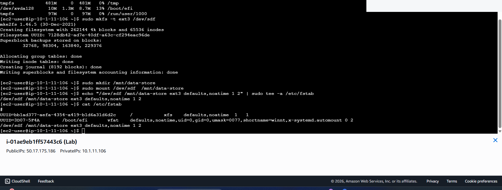
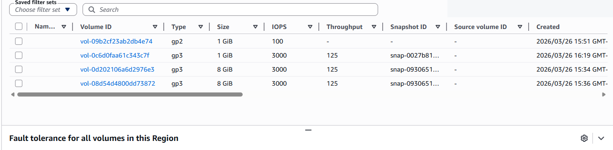

# Amazon EBS Storage, Snapshots & Volume Recovery

## Overview
I worked with Amazon Elastic Block Store (EBS) volumes attached to EC2 instances, reviewed volume properties, accessed Linux storage through the terminal, created a snapshot, and restored storage from a snapshot in an AWS training environment.

**Services:** Amazon EC2, EBS, EBS snapshots  
**Focus:** Persistent block storage, disaster recovery, Linux storage operations

## Work Completed
- Reviewed EBS volume type, size, attachment, and availability-zone information.
- Used Linux terminal commands to investigate mounted storage and files.
- Created and verified an EBS snapshot.
- Created a replacement volume from a snapshot.
- Verified the restored volume appeared in the EC2 storage inventory.
- Checked file visibility in Linux as part of the recovery procedure.

The related EC2 storage coursework also covered resizing a block volume and extending the Linux partition and filesystem. The documentation here focuses on snapshot and restore work supported by the completed lab report.

## Security & Operational Considerations
Snapshots are useful for recovery but require appropriate IAM permissions, encryption, retention controls, and documented restoration tests. Recovery planning should also account for whether data is application-consistent, not just whether a volume was successfully recreated.

## Key Takeaway
Creating a snapshot is only one part of recovery. Recreating storage and verifying accessible content are equally important.

## Screenshots

### Ebs Snapshot

### Ebs Restored Volumes

