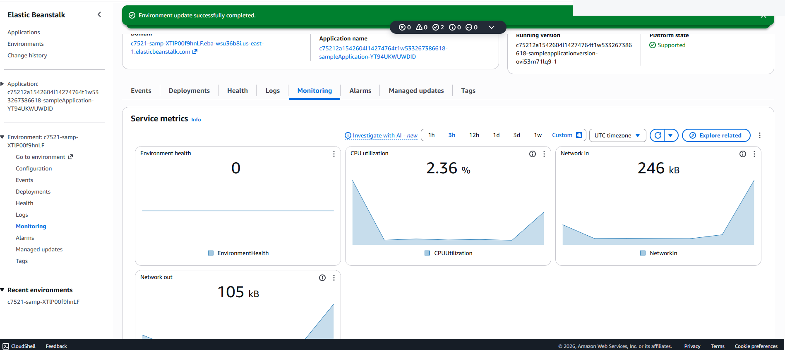

# AWS Elastic Beanstalk Deployment & Monitoring

## Overview
I worked with AWS Elastic Beanstalk to deploy a sample web application environment and review application monitoring and the underlying EC2 instances.

**Services:** AWS Elastic Beanstalk, Amazon EC2, application monitoring

## Work Performed
- Reviewed the Elastic Beanstalk environment and its state in the AWS console.
- Opened the deployed sample application endpoint and checked the resulting page.
- Reviewed Elastic Beanstalk monitoring data, including CPU utilization.
- Inspected EC2 instances associated with the environment and their status checks.

## Security & Operations
A managed deployment service reduces some orchestration burden but does not remove responsibility for application security, IAM roles, instance configuration, secrets, patching, observability, scaling policy design, and cost monitoring.

## What I Learned
I could check both application status and CPU metrics without managing every deployment step directly.

## Screenshots

### Beanstalk Monitoring

