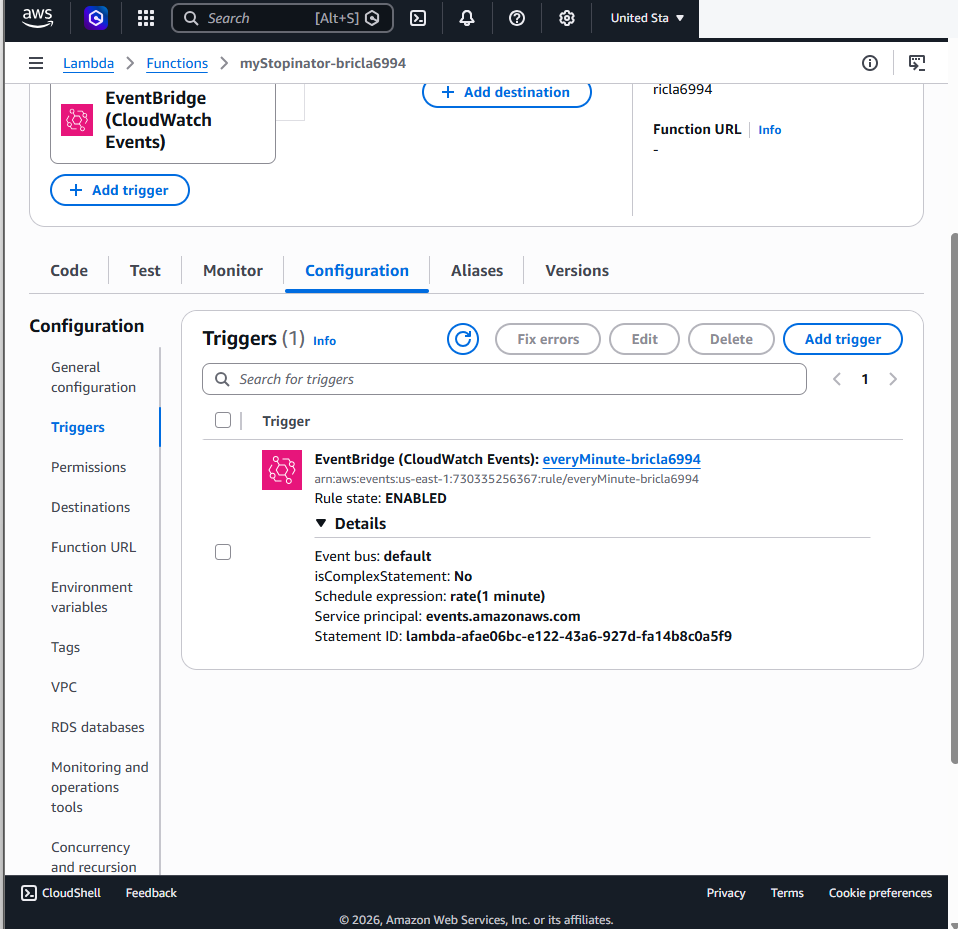
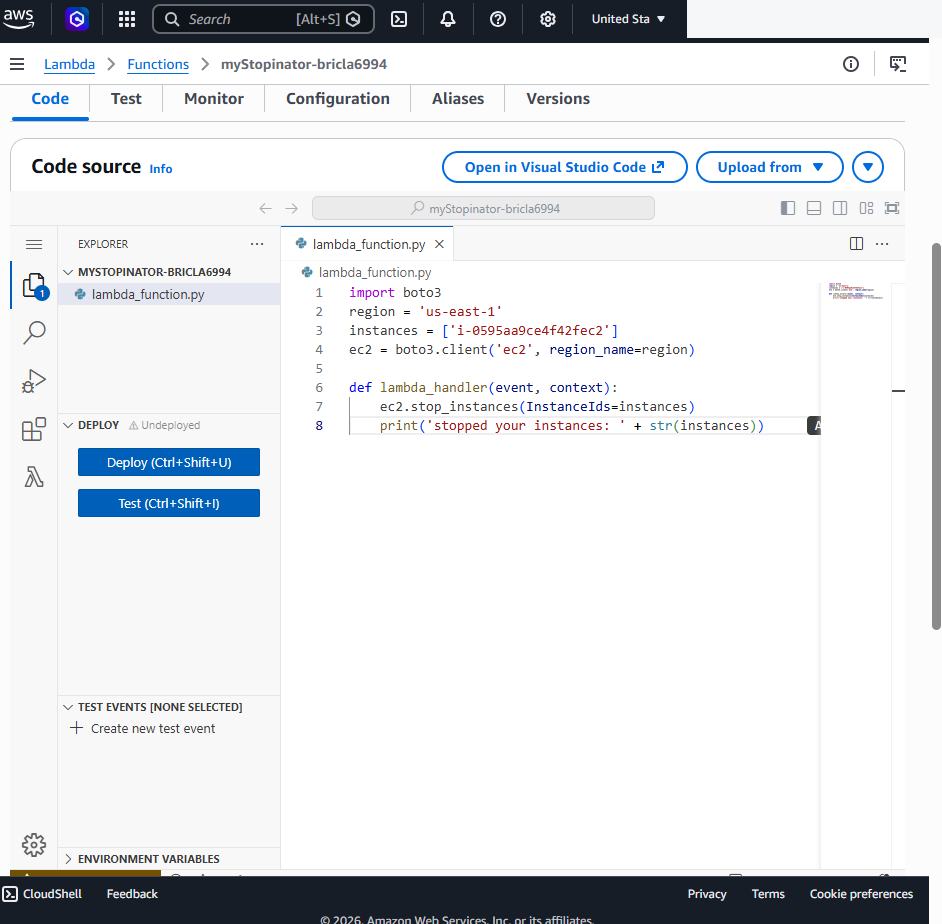

# AWS Lambda & EventBridge EC2 Automation

## Overview
This lab explored scheduled cloud automation using an AWS Lambda function written in Python and an EventBridge (CloudWatch Events) schedule. The function used Boto3 to call the EC2 API to stop a designated training instance.

**Services:** AWS Lambda, Amazon EventBridge, Amazon EC2  
**Technology:** Python, Boto3

## Implementation
- Configured a Lambda function and its execution settings.
- Set up an EventBridge rule with a recurring schedule.
- Linked the schedule to the Lambda function as a trigger.
- Updated the Python function with the designated EC2 instance identifier.
- Used the Boto3 EC2 client to request a stop action for that instance.
- Saved the function update in the Lambda console.

## Validation Scope
The report screenshots show the configured EventBridge trigger, the Boto3 function code, and confirmation that the function was updated. They do **not** independently establish that the scheduled event ran successfully or that the EC2 instance actually stopped.

## Security & Production Improvements
- Grant the Lambda execution role only the EC2 actions needed, scoped to the designated resources where supported.
- Avoid embedding fixed instance IDs or account identifiers when tags or configuration parameters are more maintainable.
- Use CloudWatch Logs and metrics to verify executions and inspect failures.
- Configure appropriate scheduling, retry, and alerting behavior.
- Use safe approval and exclusion rules before automating production instance shutdowns.

## Skills Demonstrated
Serverless event-driven automation, Lambda function configuration, Python, Boto3, EventBridge schedules, EC2 API operations, least-privilege planning.

## Screenshots

### Lambda Eventbridge Trigger

### Lambda Boto3 Code

