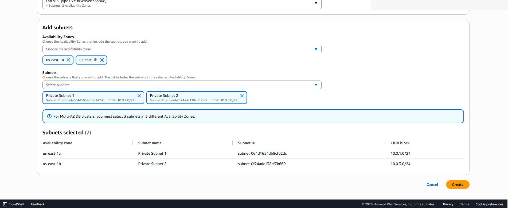
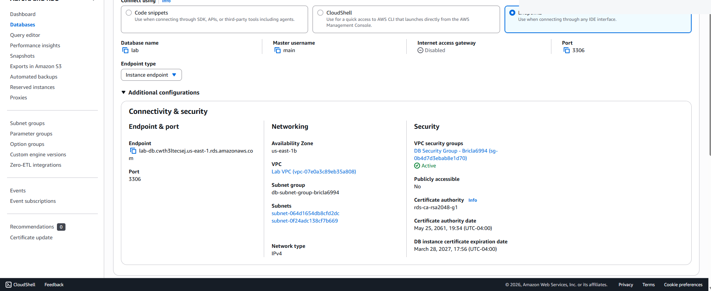
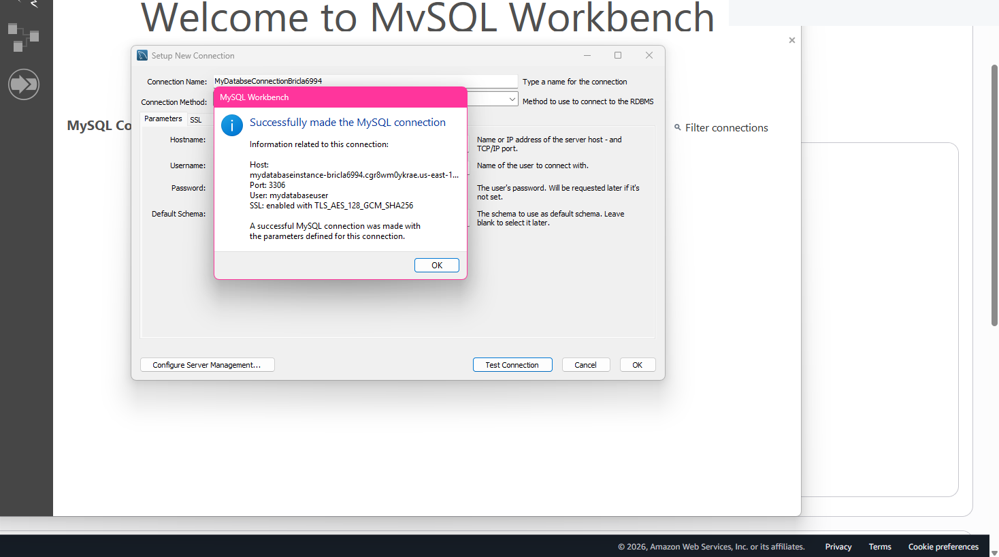

# Amazon RDS MySQL Provisioning & Connectivity

## Overview
These RDS exercises covered database instance configuration, subnet-group selection, access control, and connecting a MySQL client to an AWS-hosted relational database.

**Services:** Amazon RDS for MySQL, Amazon VPC, security groups  
**Client:** MySQL Workbench

## Work Performed
- Created or inspected database security-group settings in a training VPC.
- Configured a DB subnet group spanning subnets in multiple Availability Zones.
- Inspected database connectivity and endpoint settings.
- Worked with an RDS MySQL database instance.
- Used MySQL Workbench to configure a client connection and documented a successful connection test in the introductory RDS exercise.

## Troubleshooting Record
In the separate database server exercise, the web-server address did not load in the browser. I reviewed the AWS console configuration while troubleshooting. That attempt did not provide evidence of a successful address-book application connection.

## Security Considerations
- Keep databases in private subnets with no unnecessary public endpoint.
- Permit MySQL TCP/3306 only from designated application/client security groups.
- Enable encryption, backups, monitoring, and suitable retention policies.
- Store passwords in Secrets Manager rather than code or screenshots.
- Use Multi-AZ where availability requirements justify the cost.

## What I Learned
Database access involves more than a running RDS instance. Network routing, security-group permissions, endpoints, authentication, and client connectivity all need validation.

## Screenshots

### RDS DB Subnet Group

### RDS Connectivity

### MySQL Workbench Connection

