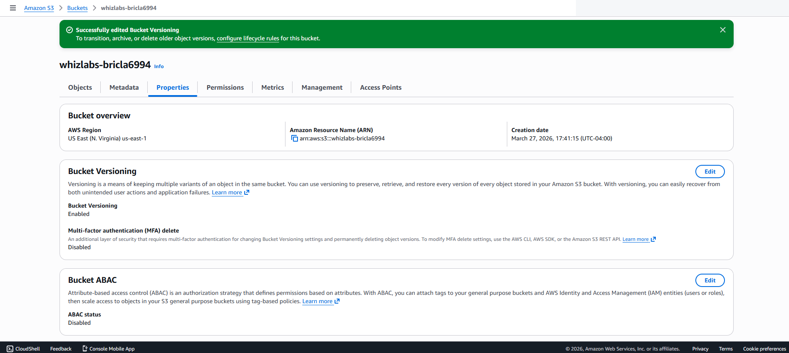
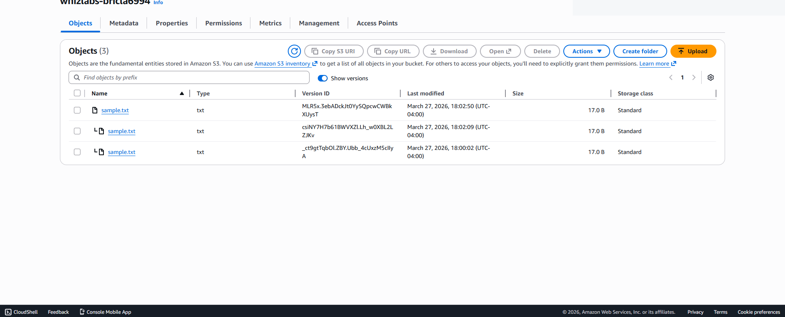

# Amazon S3 Object Storage, Permissions & Versioning

## Overview
In AWS Cloud Foundations training, I created Amazon S3 buckets, uploaded objects, investigated how bucket permissions affect access, configured bucket policies in a controlled training environment, and enabled object versioning.

**Services:** Amazon S3  
**Focus:** Object storage, access policies, version recovery, data protection

## Work Performed
- Created an S3 bucket and uploaded test objects.
- Inspected object metadata and browser-based object access.
- Tested access restrictions before changing permissions for the exercise.
- Examined S3 bucket policy configuration and temporary public-read behavior.
- Enabled S3 Versioning and uploaded modified versions of an object.
- Verified that new versions appeared and inspected version history.

## Security Findings
- S3 permissions determine who can retrieve objects. Public-read access should be a deliberate, tightly scoped exception rather than a default.
- Bucket versioning preserves previous object versions, helping recover from accidental overwrites or deletions, but increases retained storage.
- Versioning is not equivalent to a complete backup and recovery strategy. Production controls can include default Block Public Access, IAM policy review, encryption, appropriate lifecycle rules, access logging, and recovery testing.

## What I Learned
The exercise connected object availability with policy enforcement and showed how versioning protects prior content while requiring deliberate storage governance.

*AWS training account. Public-read access was used only during the controlled exercise.*

## Screenshots

### S3 Uploaded Object

### S3 Versioning Enabled

### S3 Object Versions

