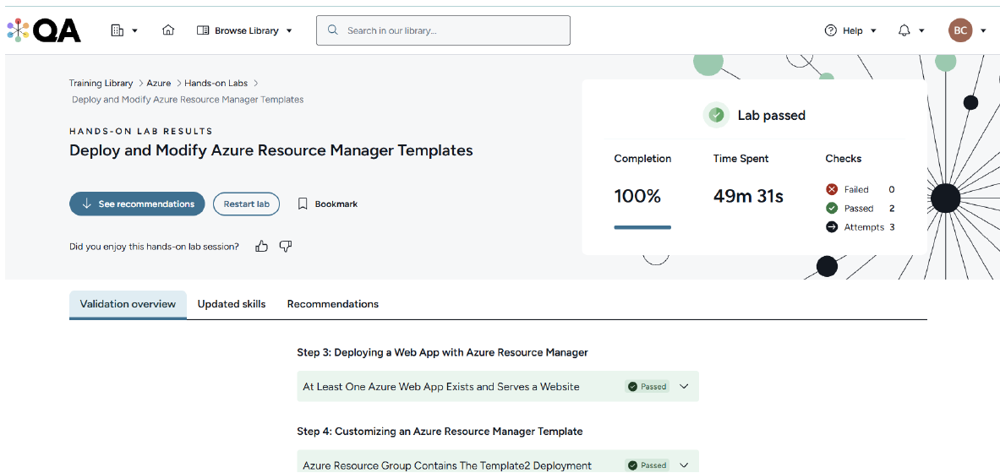
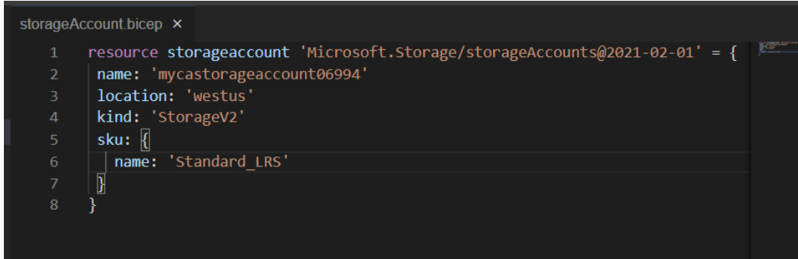
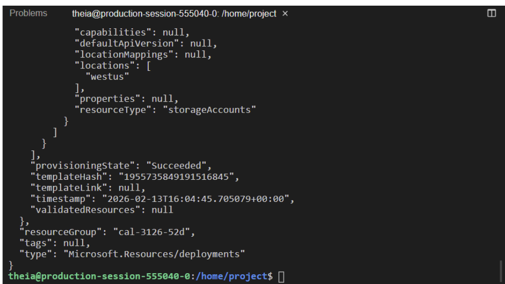

# Azure Infrastructure as Code with ARM & Bicep

## Overview

I used Azure Resource Manager (ARM) JSON templates to deploy and modify resources, then used Bicep and Azure CLI to create and verify a storage account.

**Tools:** Azure Resource Manager, ARM JSON, Azure Bicep, Azure CLI, Azure App Service, Azure Storage

## ARM: Deploying and Updating Resources

I worked with two ARM template versions, saved as `vm1-azure.json` and `vm2-azure.json` in the training workspace. After deployment, I checked the Azure App Service endpoint and the lab's resource-group validation results.

The browser displayed Azure's default message that the web app was running and waiting for content. That confirmed the App Service endpoint was available, not that a finished custom site had been deployed. The submitted ARM lab report shows two passed checks and zero failed checks.

## ARM Template

[Parameterized Azure App Service template](templates/app-service-parameterized.json)

The published JSON defines an App Service plan and web app with configurable resource names and location. It is the parameterized revision from the ARM lab; the example still uses the API versions and S1 plan size from that exercise.

The Bicep storage account deployment is documented through its training results. I did not have the original Bicep source file to publish alongside the ARM JSON.

## Bicep: Deploying Storage

I edited a Bicep storage resource using `Microsoft.Storage/storageAccounts@2021-02-01`.

| Setting | Value |
|---|---|
| Resource | Storage account |
| Kind | `StorageV2` |
| Region | `westus` |
| Replication | `Standard_LRS` |

I deployed it using Azure CLI, checked that the deployment output reported `provisioningState: Succeeded`, and queried the account to confirm its name, Region, resource group and SKU. The lab validation passed.

## Deployment Evidence

**ARM resource validation**

**Bicep storage account template**

**Bicep deployment result**

## What I Learned

- ARM and Bicep both describe Azure infrastructure declaratively, while Bicep offers more concise syntax for many resources.
- A successful deployment response should be followed by inspection of the created resources.
- A reachable App Service endpoint and a published custom application are two separate milestones.

Before production deployment, I would review Azure RBAC, secure defaults, diagnostics, encryption, storage public access, configuration drift and environment reuse.

[Infrastructure as Code project](../../projects/cloud/multicloud-infrastructure-as-code/)
