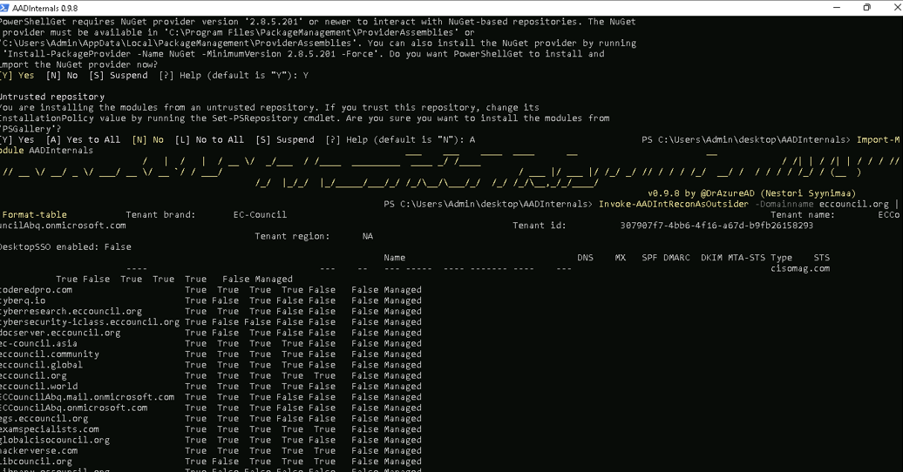
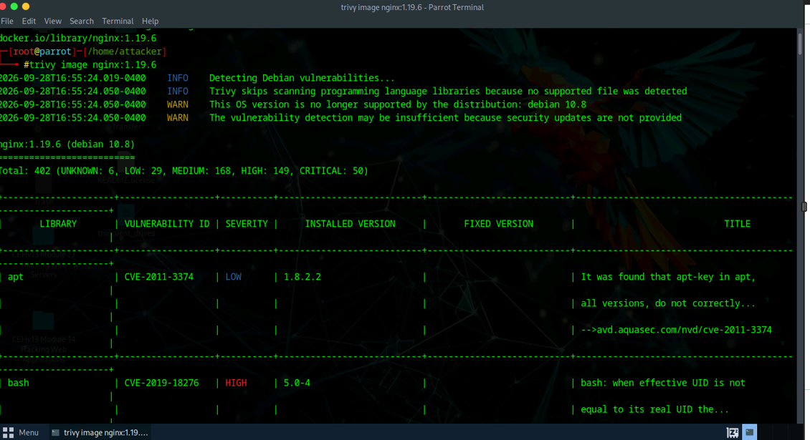
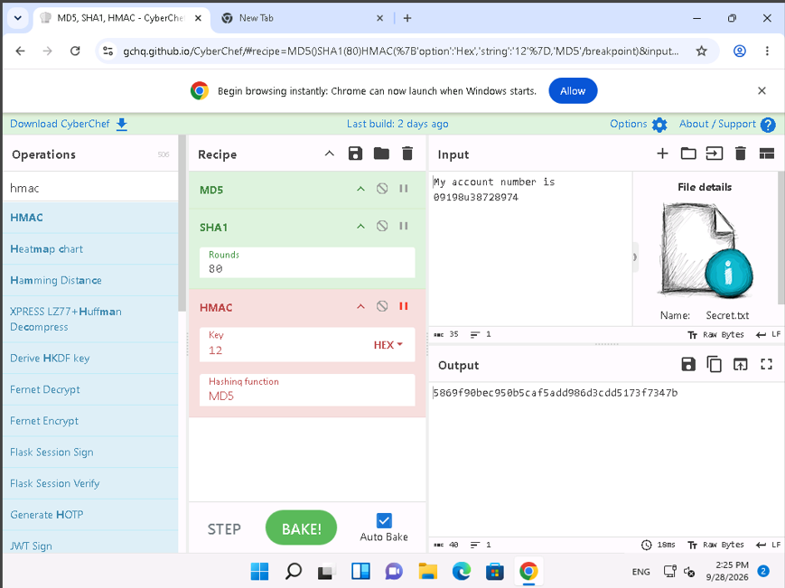
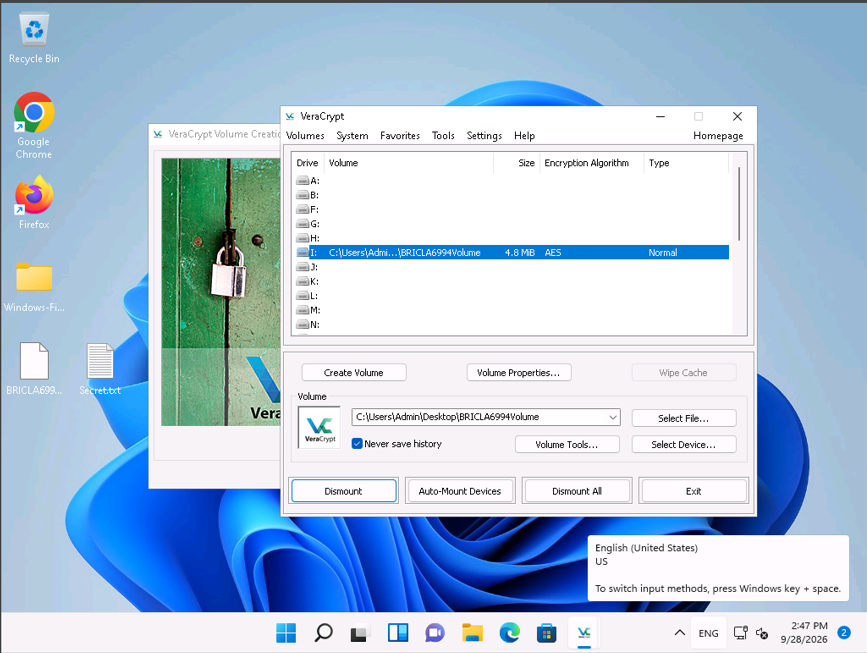

# Cloud, Container & Cryptographic Security Lab

**Azure Reconnaissance | Container Vulnerability Scanning | Multi-Layer Hashing | HTTPS Certificates | Disk Encryption**

## Overview

I completed a series of security labs covering cloud identity, container vulnerability scanning, encryption, hashing, and HTTPS certificates.

The work included Azure tenant reconnaissance with AADInternals, Docker image vulnerability assessment with Trivy, multi-layer hashing with CyberChef, self-signed HTTPS certificate deployment in IIS, AES-encrypted volume management with VeraCrypt..

The goal was to connect security assessment with defensive controls by examining how cloud and container environments expose useful security information while also practicing data-integrity, transport-encryption, and data-at-rest protections.

## Tools & Technologies

- AADInternals
- PowerShell
- Microsoft Entra ID / Azure AD
- Docker
- Trivy
- CyberChef
- IIS
- HTTPS / TLS
- VeraCrypt
- AES
- MD5
- SHA-1
- HMAC
- CRC32
- Base64
- Windows 11
- Windows Server
- Parrot Security

---

## 1. Azure Tenant Reconnaissance with AADInternals

AADInternals was used from PowerShell to perform outsider reconnaissance against the designated cloud identity environment.

The exercise gathered publicly available tenant information including the tenant name, tenant ID, verified domains, and domain-related authentication metadata. This demonstrated how cloud identity reconnaissance can help map an organization's externally visible Microsoft identity footprint.

*AADInternals displaying tenant and verified-domain information during authorized Azure reconnaissance.*

### Defensive Takeaway

Cloud identity metadata can support attack-surface mapping even when no authentication has occurred. Strong MFA, Conditional Access, phishing-resistant authentication, least privilege, and monitoring of suspicious identity activity remain important defenses against follow-on attacks.

---

## 2. Container Vulnerability Assessment with Trivy

Trivy was used to assess a Docker image based on `nginx:1.19.6`.

The scan identified a large number of package vulnerabilities across multiple severity levels, including high and critical findings. The output also highlighted that the underlying Debian release was no longer supported, which can reduce the availability of security updates.

*Trivy vulnerability assessment of the nginx 1.19.6 Docker image, including severity and CVE information.*

### Defensive Takeaway

Container images should be built from supported, minimal base images and continuously scanned in the development pipeline. Vulnerable packages should be patched or replaced, and images should be rebuilt regularly rather than treated as static artifacts.

---

## 3. Multi-Layer Hashing with CyberChef

CyberChef was used to build a multi-step hashing recipe against a sample text file.

The lab applied MD5, SHA-1, and HMAC operations in sequence to demonstrate how multiple transformations can be chained and how HMAC can add keyed integrity verification.

*CyberChef recipe demonstrating layered hashing and HMAC processing in the training environment.*

### Security Note

MD5 and SHA-1 were used here because they were specified by the lab. They are considered obsolete for modern security-sensitive hashing. Current implementations should use stronger algorithms such as SHA-256 or SHA-3, and HMAC should be paired with a modern cryptographic hash.

---

## 4. Self-Signed HTTPS Certificate Deployment

A self-signed certificate was created in IIS for the GoodShopping training site and bound to HTTPS on port 443.

The browser was then used to validate that the site was reachable over HTTPS after the certificate and site binding were configured.

*GoodShopping training site accessed over HTTPS after configuring the self-signed IIS certificate.*

### Defensive Takeaway

Self-signed certificates are useful for testing and controlled internal environments where trust is managed manually. Public production services should use certificates issued by a trusted certificate authority and maintain appropriate certificate lifecycle management.

---

## 5. AES Disk Encryption with VeraCrypt

VeraCrypt was used to create and mount an encrypted volume in Windows.

The mounted volume used AES encryption, demonstrating how encrypted containers can protect data at rest while still allowing authorized users to mount and access the protected storage when needed.

*Mounted VeraCrypt volume using AES encryption in the authorized Windows lab environment.*

### Defensive Takeaway

Encryption at rest helps protect sensitive data if storage media or a device is lost, stolen, or accessed outside the intended operating environment. Strong passphrases and secure key handling remain essential to the effectiveness of disk encryption.

---

## Security Concepts Demonstrated

- Azure / Entra ID reconnaissance
- Cloud identity attack-surface mapping
- Docker image vulnerability assessment
- CVE and severity analysis
- Unsupported base-image risk
- Multi-layer hashing
- HMAC and integrity verification
- HTTPS and TLS configuration
- Self-signed certificate deployment
- Data-at-rest encryption
- AES-encrypted volumes
- Checksums and encoding
- Defensive remediation planning

---

## Findings and Lessons

These exercises covered different parts of a defense strategy: assessing public cloud identity exposure, identifying vulnerable container packages, protecting traffic with TLS, and encrypting stored data. The Trivy results highlighted the risk of retaining unsupported image dependencies. The hashing exercise also showed why algorithm choice matters: MD5 and SHA-1 are unsuitable for modern collision-resistant security uses.

## Ethical Use

All activities documented in this project were performed in an authorized cybersecurity training environment using designated lab systems, test domains, sample files, and intentionally configured targets. No unauthorized access or testing was performed.

[Technical labs](../) | [Portfolio home](../../)
