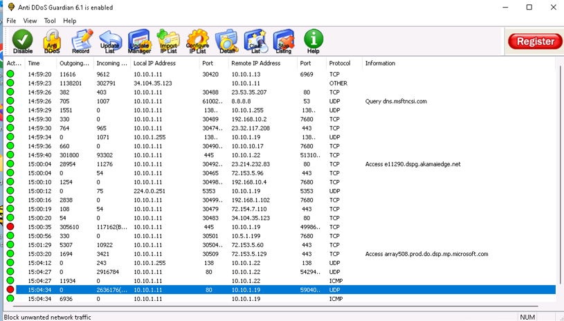
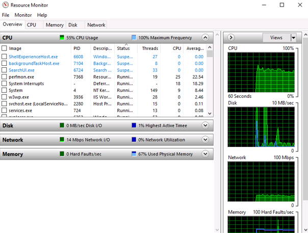

# DoS/DDoS Detection & Mitigation Lab

**Traffic Monitoring | Resource Impact Analysis | DDoS Detection | Source Blocking**

## Overview

This project documents denial-of-service testing and defensive monitoring performed in an authorized virtual lab environment.

The lab examined how high-volume network traffic can affect system resources and how a defensive monitoring tool can identify suspicious flows. The portfolio version emphasizes detection, impact analysis, and mitigation rather than attack tooling.

## Tools & Technologies

- Anti DDoS Guardian
- Windows Resource Monitor
- TCP/IP
- Network Flow Analysis
- Windows 11
- Windows Server

---

## 1. DDoS Traffic Monitoring

Anti DDoS Guardian was used on the protected Windows host to monitor incoming and outgoing network connections in real time.

The interface provided source and destination information, ports, protocols, and traffic-volume data that could be used to identify unusually high-volume sessions.

*Anti DDoS Guardian monitoring network flows during the authorized denial-of-service exercise.*

### Security Takeaway

Effective DoS/DDoS defense depends on identifying abnormal traffic patterns quickly and correlating volume, source, destination, protocol, and connection-rate information.

---

## 2. System Resource Impact Analysis

Windows Resource Monitor was used to observe system behavior while controlled high-volume traffic was generated in the lab.

The captured evidence shows elevated CPU, memory, and network activity, demonstrating how availability attacks can consume system resources even when the host remains operational.

*Windows Resource Monitor used to observe system impact during controlled high-volume traffic generation.*

---

## 3. Mitigation Workflow

The associated defensive workflow included reviewing high-volume sessions in Anti DDoS Guardian and using its blocking controls to stop suspicious source addresses.

### Defensive Takeaway

Source blocking can be useful during a contained incident, but production DDoS resilience normally requires layered controls such as upstream filtering, rate limiting, connection limits, load balancing, CDN or scrubbing services, and continuous monitoring.

---

## Skills Demonstrated

- DoS/DDoS traffic analysis
- Network flow monitoring
- Resource utilization analysis
- Availability-impact assessment
- Source and port analysis
- Defensive traffic filtering
- Incident mitigation concepts
- Security monitoring
- Technical documentation

---

## Key Takeaways

This project reinforced that availability attacks are best understood through both network telemetry and host-level resource monitoring.

High-volume traffic can degrade system performance without immediately taking a system offline. Correlating flow data with CPU, memory, and network utilization provides stronger evidence for detection and response.

## Ethical Use

All denial-of-service testing documented in this project was performed in an authorized, isolated cybersecurity training environment against designated lab systems.
