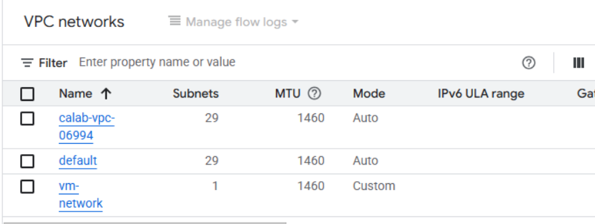
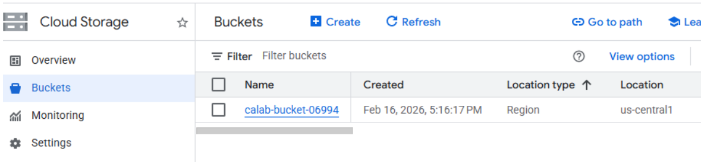

# Google Cloud: Template-Based VPC & Storage Deployment

## Overview

I used Google Cloud Deployment Manager and Jinja templates to define a VPC network and Cloud Storage bucket. I prepared the templates in the cloud terminal, deployed the configuration and inspected the resources in Google Cloud.

**Tools:** Google Cloud Deployment Manager, Cloud Shell, Jinja, YAML, VPC, Cloud Storage

## Work Completed

- Created `calab-vpc.jinja` for a Google Compute Engine network with automatic subnet creation.
- Created `calab-bucket.jinja` for a Cloud Storage bucket in `us-central1`.
- Prepared a YAML configuration referencing the templates.
- Submitted the deployment through Deployment Manager.
- Checked the VPC network and Cloud Storage bucket in the console.

The VPC appeared with automatically created subnets. The bucket was visible in `us-central1`. The lab's deployment check passed with no failed checks.

## Configuration Files

- [VPC Jinja template](templates/vpc.jinja)
- [Cloud Storage bucket Jinja template](templates/bucket.jinja)
- [Deployment Manager YAML configuration](templates/deployment.yaml)

These files preserve the resource types and structure from the completed lab. Training-only names were replaced with neutral examples, and the bucket name is derived from the Google Cloud project ID. I checked that the Jinja templates render to YAML and that the configuration references the supplied files.

**Platform status:** Google Cloud ended standard support for Deployment Manager on April 1, 2026. This is historical coursework rather than a recommended approach for a new deployment. For current infrastructure projects, I would evaluate [Google Cloud Infrastructure Manager](https://cloud.google.com/infrastructure-manager/docs) and Terraform.

## Validation

| Check | Result |
|---|---|
| Deployment Manager configuration | Deployment appeared in the console; validation passed |
| Network | Created VPC visible in the project |
| Storage | Bucket visible with its Region |

## Deployment Evidence

**VPC network created in Google Cloud**

**Cloud Storage bucket**

## Security Considerations

For a new production deployment, I would use custom subnet configuration where segmentation is required, restrict bucket access, apply least-privilege IAM, and retain audit logs. This exercise used Deployment Manager in the training environment.

[Infrastructure as Code project](../../projects/cloud/multicloud-infrastructure-as-code/)
