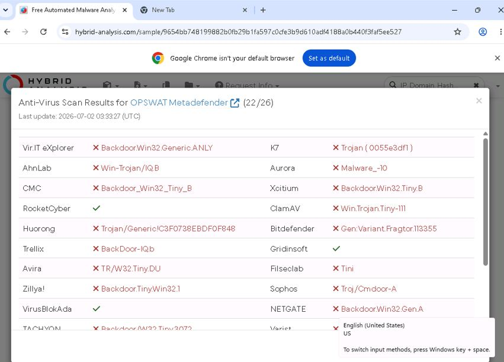
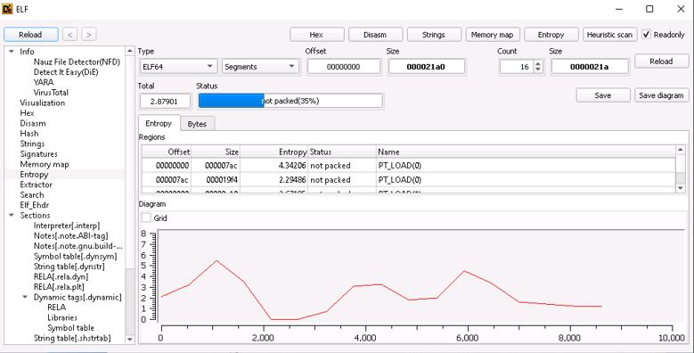
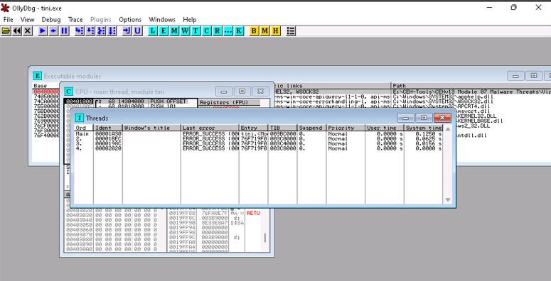
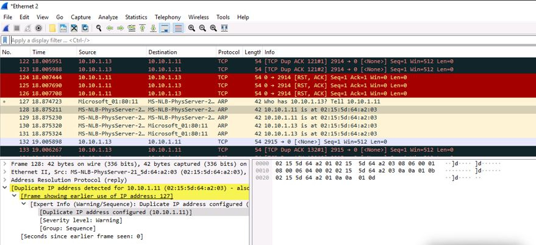
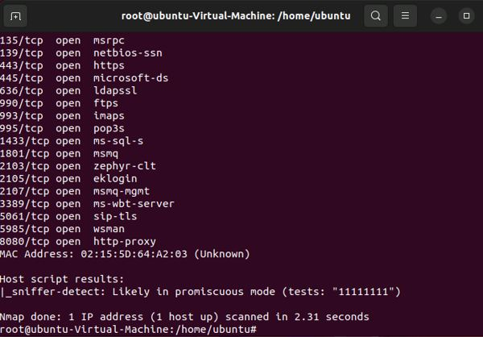
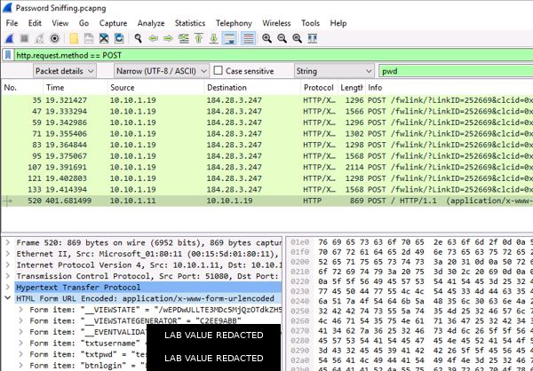

# Malware Analysis & Network Threat Detection Lab

**Static Malware Analysis | Packet Analysis | Credential Exposure | ARP Anomaly Detection | Sniffer Detection**

## Overview

This project documents selected malware-analysis and network-sniffing exercises completed in an authorized cybersecurity training environment.

The portfolio version focuses on defensive analysis and evidence interpretation rather than malware creation. The work included multi-engine malware scanning, ELF executable analysis, malware disassembly, detection of ARP anomalies and promiscuous-mode sniffers, and examination of plaintext HTTP credential exposure in captured traffic.

## Tools & Technologies

- Hybrid Analysis
- OPSWAT MetaDefender
- Detect It Easy (DIE)
- OllyDbg
- Wireshark
- Nmap Scripting Engine (NSE)
- HTTP
- ARP
- Ethernet
- Parrot Security
- Windows

---

## 1. Multi-Engine Malware Detection

Hybrid Analysis was used to examine a suspicious lab sample and compare detection results across multiple antivirus engines.

*Multi-engine malware scan results reviewed during static malware analysis.*

The results demonstrated why analysts should consider multiple detection sources rather than treating any single antivirus engine as definitive.

---

## 2. ELF Static Analysis with Detect It Easy

Detect It Easy was used to inspect an ELF executable without executing it.

The analysis included file structure and entropy information, which can help identify unusual regions, packing, or obfuscation that may warrant deeper investigation.

*ELF executable structure and entropy reviewed with Detect It Easy.*

### Defensive Takeaway

Static analysis allows an analyst to gather useful indicators while limiting the risk associated with executing an unknown sample. File type, entropy, strings, headers, imports, and packing indicators can guide later analysis.

---

## 3. Malware Disassembly with OllyDbg

OllyDbg was used to inspect a Windows executable at the binary and process level.

The exercise exposed loaded modules, threads, registers, and executable code structures used during malware reverse-engineering and behavioral investigation.

*OllyDbg used to inspect executable modules and thread activity during malware analysis.*

---

## 4. ARP Anomaly Detection with Wireshark

Wireshark was used to analyze ARP traffic in the lab and identify suspicious address-resolution behavior.

The captured traffic included a duplicate-IP warning, demonstrating how packet-level analysis can surface evidence associated with ARP poisoning or conflicting address mappings.

*Wireshark highlighting suspicious ARP behavior and a duplicate-IP condition in the authorized lab network.*

### Defensive Takeaway

ARP anomalies can indicate misconfiguration or malicious manipulation. Network monitoring, switch security controls, segmentation, and inspection of unexpected ARP changes can help detect or limit local-network attacks.

---

## 5. Promiscuous-Mode Sniffer Detection

The Nmap Scripting Engine was used to assess whether a lab system's network interface appeared to be operating in promiscuous mode.

The `sniffer-detect` script returned a result indicating that the target was likely operating promiscuously.

*Nmap NSE output indicating likely promiscuous-mode operation on an authorized lab host.*

---

## 6. Plaintext HTTP Credential Exposure

Wireshark was used to filter HTTP POST traffic and inspect form data transmitted by an intentionally insecure lab application.

The capture demonstrated that application credentials transmitted without transport encryption can be visible to anyone able to inspect the traffic.

*HTTP form data observed in packet capture. Lab credential values were redacted before publication.*

### Defensive Takeaway

Authentication data should never be transmitted over plaintext HTTP. TLS/HTTPS, secure session handling, appropriate cookie protections, and network segmentation help prevent credential exposure through packet capture.

---

## Broader Lab Scope

The associated coursework also included active-sniffing exercises such as MAC flooding and DHCP starvation, remote packet capture, Trojan and virus demonstrations, and dynamic malware analysis.

Those activities are not all shown here because this public portfolio emphasizes the strongest analytical and defensive evidence while avoiding repetitive or unnecessarily destructive examples.

---

## Skills Demonstrated

- Static malware analysis
- Multi-engine malware scanning
- ELF executable analysis
- Entropy interpretation
- Malware disassembly
- Packet capture and traffic analysis
- ARP anomaly detection
- Promiscuous-mode detection
- Nmap NSE
- HTTP POST analysis
- Plaintext credential exposure analysis
- Sensitive-data redaction
- Defensive remediation planning

---

## Key Takeaways

This project reinforced the value of analyzing threats from both the endpoint and network perspectives.

Static malware-analysis tools can reveal suspicious characteristics without executing a sample, while packet analysis can expose behaviors such as ARP manipulation, sniffing activity, and insecure application traffic.

The exercises also reinforced that technical findings are most useful when they are translated into practical defensive controls such as endpoint monitoring, secure transport encryption, network segmentation, and continuous traffic analysis.

## Ethical Use

All active testing and malware-analysis activities documented in this project were performed in an authorized, isolated cybersecurity training environment using designated lab systems, intentionally insecure applications, and training samples.
