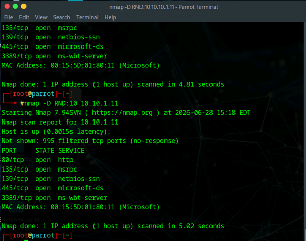
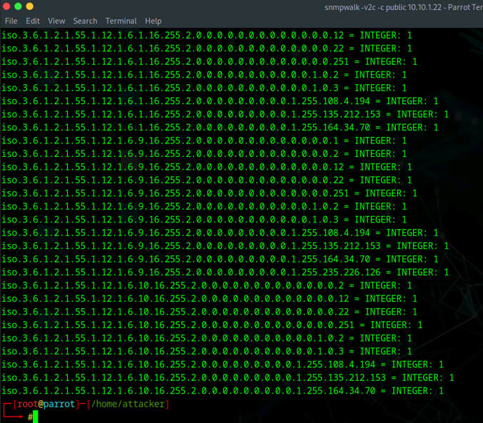
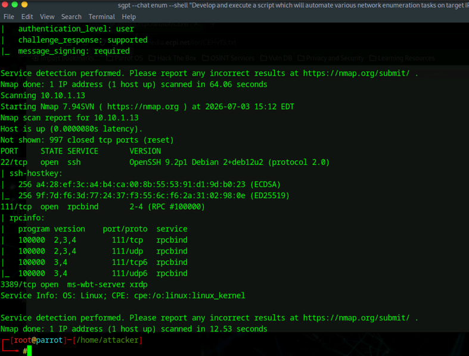

# Network Scanning, Enumeration & Evasion Lab

**Service Discovery | IDS/Firewall Evasion Testing | SNMP Enumeration | Automated Network Enumeration**

## Overview

This project documents hands-on network scanning and enumeration work completed in an authorized cybersecurity training environment.

The broader coursework covered host discovery, port and service discovery, operating-system identification, defensive-control evasion testing, protocol enumeration, and automated network assessment. This portfolio entry focuses on three representative activities that demonstrate the strongest retained evidence: Nmap decoy scanning, SNMP enumeration with SnmpWalk, and automated network enumeration.

## Tools & Technologies

- Nmap
- SnmpWalk
- ShellGPT
- Parrot Security
- TCP/IP
- SNMP
- SSH
- RPC

---

## 1. IDS/Firewall Evasion Testing with Nmap

A controlled Nmap decoy scan was used against a lab target to examine how decoy source addresses can complicate scan attribution in network monitoring and defensive logs.

The scan identified exposed services on the Windows target, including HTTP, Microsoft RPC, NetBIOS/SMB-related services, and RDP.

*Nmap decoy scan performed against an authorized Windows lab target.*

### Security Takeaway

Decoy scanning does not make a scan invisible. It demonstrates why defenders should correlate multiple telemetry sources instead of relying only on a single observed source address when investigating reconnaissance activity.

---

## 2. SNMP Enumeration with SnmpWalk

SnmpWalk was used to query a lab system through SNMPv2c using the configured community string.

The returned OID data demonstrated how SNMP can expose detailed system and management information when it is enabled and insufficiently restricted.

*SNMPv2c enumeration showing returned OIDs and values from the authorized target.*

### Security Takeaway

SNMP should be restricted to trusted management systems, unnecessary versions should be disabled, and legacy community-string configurations should be replaced with stronger authentication and encryption where supported.

---

## 3. Automated Network Enumeration

An automated enumeration workflow was executed in the lab to collect service information across the training network.

The captured output shows service detection against a Linux host, including SSH, RPC, and an additional exposed service. This demonstrated how automation can accelerate repetitive reconnaissance while still requiring the analyst to interpret and validate the results.

*Automated enumeration output identifying open ports, services, and service versions on an authorized Linux lab host.*

### Security Takeaway

Automation improves coverage and speed, but scan results should still be validated manually. Service versions, exposed management protocols, and unnecessary listening services are especially important to review during attack-surface analysis.

---

## Broader Lab Scope

The associated scanning and enumeration modules also covered:

- Host discovery and live-system identification
- TCP and UDP port scanning
- Service and version detection
- OS fingerprinting with Nmap and NSE
- Packet fragmentation and other IDS/firewall assessment techniques
- NetBIOS enumeration
- LDAP and Active Directory enumeration
- NFS and RPC enumeration
- DNS enumeration and zone-transfer testing
- SMTP enumeration
- Network inventory and service discovery

The portfolio uses only representative screenshots to keep the project concise and focused.

---

## Skills Demonstrated

- Network reconnaissance
- Port and service discovery
- Nmap scan interpretation
- IDS/firewall evasion assessment
- SNMP enumeration
- OID analysis
- Service-version identification
- Linux and Windows target analysis
- Attack-surface mapping
- Automated enumeration
- Defensive remediation analysis
- Technical documentation

---

## Key Takeaways

This project reinforced the progression from basic host discovery to deeper service enumeration.

Open ports alone provide limited context. Combining service detection, protocol-specific enumeration, and defensive-control testing produces a more useful picture of a system's externally visible attack surface.

The lab also reinforced the importance of validating automated results and interpreting reconnaissance from both offensive and defensive perspectives.

## Ethical Use

All scanning and enumeration activities documented in this project were performed in an authorized, isolated cybersecurity training environment against designated lab systems.
