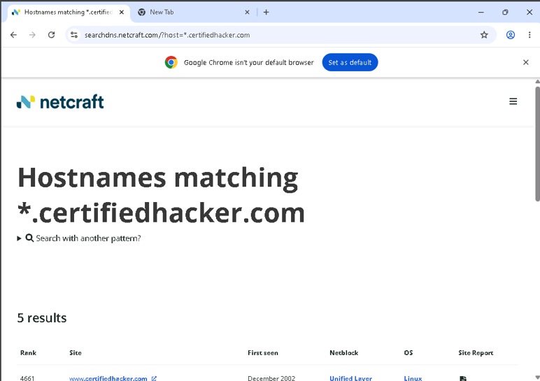
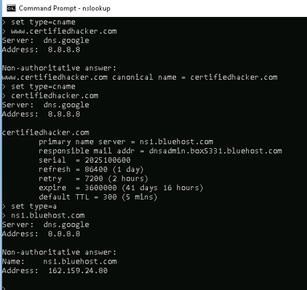
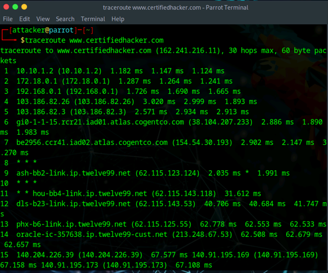
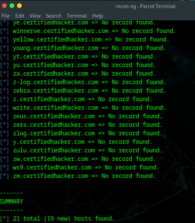
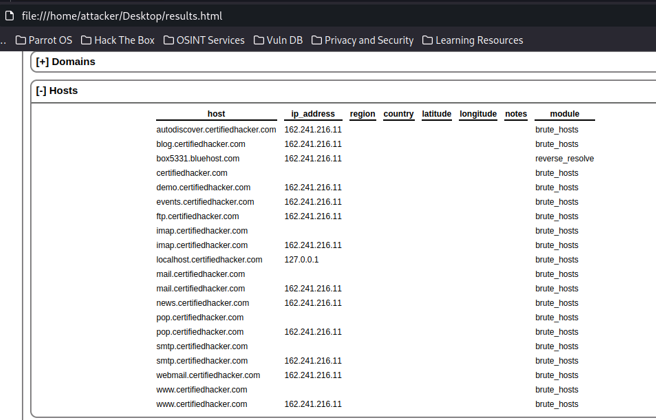

# OSINT & Network Reconnaissance Lab

**Passive Footprinting | DNS & WHOIS Analysis | Network Path Mapping | Recon-ng Automation | Reporting**

## Overview

I used a structured reconnaissance workflow to collect and compare DNS, WHOIS, subdomain, and network-path information in an authorized lab.

The lab combined passive and active information-gathering techniques to build a technical profile of a designated training target. Activities included subdomain discovery, WHOIS analysis, DNS enumeration, network tracerouting, automated host discovery with Recon-ng, and report generation.

## Tools & Technologies

- Netcraft
- DomainTools
- nslookup
- traceroute
- Recon-ng
- DNS
- WHOIS
- HTML reporting
- Windows 11
- Parrot Security

---

## 1. Subdomain & Infrastructure Discovery

Netcraft was used to identify hostnames and subdomains associated with the designated training domain.

The results provided externally visible infrastructure information that could be used to build an attack-surface inventory, including discovered hostnames and related hosting details.

*Netcraft results used to identify public hostnames associated with the authorized training target.*

### Defensive Takeaway

Organizations should maintain an accurate inventory of Internet-facing assets and periodically review public DNS and hosting information for forgotten, outdated, or unintended exposure.

---

## 2. WHOIS & DNS Enumeration

WHOIS information was reviewed to understand domain registration and name-server data associated with the target.

*WHOIS information reviewed during passive domain reconnaissance.*

The Windows `nslookup` utility was then used to query DNS records and identify the target's authoritative name-server information.

*DNS enumeration with nslookup showing record and authoritative name-server information.*

### Defensive Takeaway

WHOIS and DNS data can reveal relationships between domains, infrastructure providers, mail systems, and externally reachable services. Defenders should review exposed DNS records regularly and remove unnecessary or stale entries.

---

## 3. Network Path Mapping with Traceroute

Traceroute was used from a Linux security environment to observe the network path between the lab system and the designated target.

The output revealed intermediate hops and routing information, demonstrating how network path analysis can support infrastructure mapping.

*Traceroute output used to examine the network path to the authorized target.*

### Defensive Takeaway

Network-path information can help an assessor understand routing and external dependencies. From a defensive perspective, architecture should not rely on obscurity, and exposed services should remain securely configured regardless of how much routing information can be inferred.

---

## 4. Automated Reconnaissance with Recon-ng

Recon-ng was used to create a reconnaissance workspace, add the target domain, and run host-discovery modules.

The host-enumeration workflow identified multiple subdomains and related hosts, demonstrating how reconnaissance frameworks can organize collected information into a repeatable assessment process.

*Recon-ng host discovery results from the authorized training target.*

---

## 5. Reconnaissance Reporting

Recon-ng's reporting functionality was used to generate an HTML report containing the harvested hosts.

This step demonstrated the importance of turning raw reconnaissance output into organized, reviewable documentation that can support later assessment phases.

*HTML reconnaissance report generated from the collected host data.*

---

## Additional Techniques Completed

The full lab also included advanced search-engine queries, social-network username discovery, email-header tracing, online DNS research, and AI-assisted footprinting.

Those activities are not all displayed here because several were either redundant with stronger evidence above or involved third-party public information that did not add enough professional value to justify including it in a public portfolio.

---

## Security Concepts Demonstrated

- Passive and active reconnaissance
- OSINT methodology
- Subdomain and hostname discovery
- WHOIS analysis
- DNS enumeration
- Authoritative name-server identification
- Network tracerouting
- External attack-surface mapping
- Recon-ng workspaces and modules
- Automated host discovery
- Reconnaissance reporting
- Documentation and evidence organization

---

## Lessons Learned

This project reinforced that reconnaissance is most useful when individual data points are combined into a structured view of the target environment.

Publicly available domain information, DNS records, routing information, and automated discovery results can reveal meaningful relationships between systems before vulnerability testing begins.

The lab also reinforced the value of documenting reconnaissance results clearly so that later testing can remain scoped, repeatable, and evidence-driven.

## Ethical Use

All activities documented in this project were performed in an authorized cybersecurity training environment using designated training targets and publicly accessible information. No unauthorized exploitation was performed.
