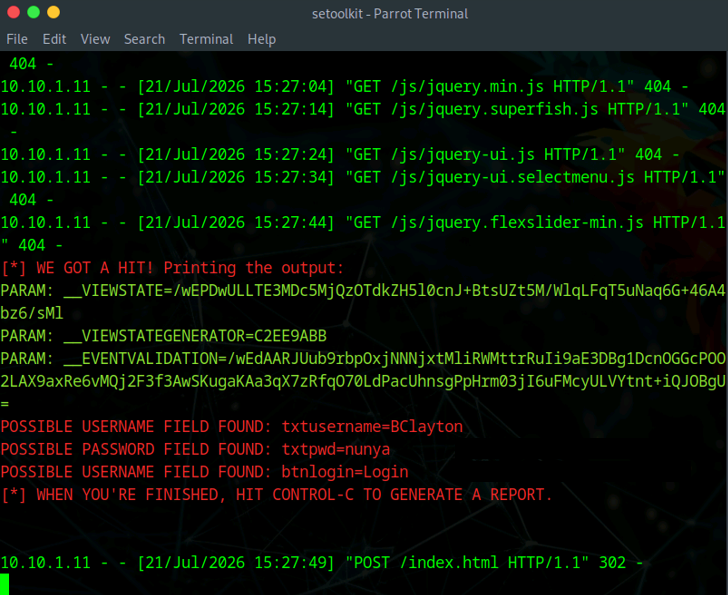
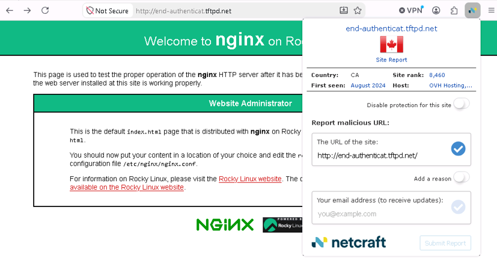

# Phishing Simulation & Social Engineering Defense Lab

**Credential Harvesting Simulation | Phishing Detection | Browser-Based Defense | Security Awareness**

## Overview

This project documents an authorized social-engineering assessment completed in a controlled cybersecurity training environment.

The lab combined an offensive phishing simulation with defensive phishing detection. The offensive portion used the Social-Engineer Toolkit (SET) to clone a training login page and demonstrate how credentials can be captured when a user submits information to a fraudulent site. The defensive portion used the Netcraft browser extension to inspect and identify a known phishing site.

The portfolio version focuses on the security lessons from both sides of the exercise: how phishing succeeds, what evidence it produces, and how layered defenses can reduce risk.

## Tools & Technologies

- Social-Engineer Toolkit (SET)
- Credential Harvester Attack Method
- Site Cloner
- Netcraft Browser Extension
- Parrot Security
- Windows 11
- HTTP / Web Forms

---

## 1. Controlled Credential-Harvesting Simulation

SET was used in an isolated lab to clone the designated MovieScope training site and host a credential-harvesting page.

A test user submitted credentials to the cloned page, and SET captured the form fields in the lab environment.

*SET credential-harvesting output from the authorized lab. Test credential values were redacted before publication.*

### Security Takeaway

A visually convincing login page can still be malicious. Users should verify the actual destination URL before entering credentials, while organizations should reinforce phishing awareness, MFA, browser protections, secure email controls, and rapid reporting procedures.

---

## 2. Phishing Detection with Netcraft

The Netcraft browser extension was used to examine a phishing demonstration site and surface site information and phishing-related warnings.

*Netcraft browser protection used to inspect a phishing demonstration site.*

### Security Takeaway

Browser reputation and anti-phishing controls provide useful warning signals, but they should complement rather than replace user awareness and identity protections. Strong MFA, phishing-resistant authentication, URL inspection, and email security controls provide additional layers of defense.

---

## Broader Lab Scope

The associated social-engineering module also covered phishing-email creation, cloned-site delivery, security-awareness concepts, and AI-assisted phishing simulations.

Those activities are not all shown here because this public portfolio focuses on the strongest technical evidence and avoids publishing unnecessary deceptive-message content.

---

## Skills Demonstrated

- Social-engineering assessment
- Phishing simulation
- Credential-harvesting analysis
- Web-form security awareness
- Phishing detection
- Browser security controls
- Evidence redaction
- Human-factor security analysis
- Defensive remediation planning

---

## Key Takeaways

This project demonstrated how social-engineering attacks can bypass otherwise strong technical controls by targeting user behavior.

The exercise also reinforced the value of layered defenses. User education, phishing-resistant authentication, browser reputation services, secure email filtering, and clear reporting procedures work together to reduce both the likelihood and impact of credential-phishing attacks.

## Ethical Use

All phishing and credential-harvesting activities documented in this project were performed in an authorized cybersecurity training environment using designated lab systems and test credentials. No real users or external accounts were targeted.
