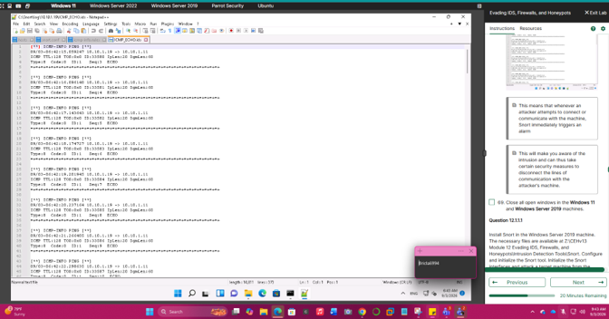
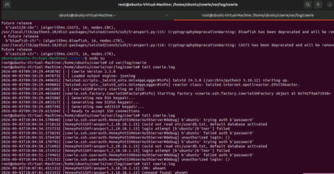
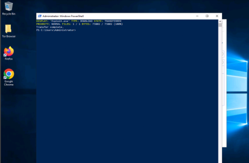

# Network Attack, Detection & Evasion Lab

**Session Hijacking | Network Traffic Analysis | Intrusion Detection | Honeypots | Firewall Evasion**

## Overview

This project documents a series of hands-on cybersecurity exercises completed in an authorized virtual lab environment. The activities explored network attacks and defensive monitoring from both offensive and defensive perspectives.

I used web interception proxies, packet analysis tools, intrusion detection systems, honeypots, and Windows administration utilities to examine how suspicious network activity can be generated, observed, detected, and investigated.

The project included:

- Session hijacking and HTTP traffic interception
- Network traffic and ARP analysis
- Intrusion detection with Snort
- SSH honeypot monitoring with Cowrie
- Controlled Windows BITS file-transfer and firewall-evasion exercises

## Tools & Technologies

- Caido
- Hetty
- Bettercap
- Wireshark
- Snort
- Cowrie
- Nmap
- BITSAdmin
- Windows 11
- Windows Server
- Ubuntu
- Parrot Security
- HTTP
- ARP
- ICMP
- SSH

---

## 1. Session Hijacking & HTTP Traffic Interception

### Caido

Caido was used as an interception proxy to examine and modify HTTP requests traveling between a client and web server.

This demonstrated how web traffic could be observed or manipulated when an attacker is positioned between communicating systems and appropriate protections are not in place.

*Intercepted HTTP requests viewed through Caido during the controlled lab exercise.*

### Hetty

Hetty was used to capture and inspect HTTP requests generated by the target system.

I examined individual requests, including POST traffic and request-body data, to better understand how application-layer information can be exposed when transmitted insecurely.

*HTTP POST traffic examined through Hetty's proxy logging interface.*

---

## 2. Network Activity & Session Hijacking Detection

### Bettercap

Bettercap was used in the controlled network environment for network discovery and traffic sniffing.

The exercise provided visibility into how network reconnaissance and traffic monitoring can be performed from an attacker perspective.

*Bettercap performing network probing, reconnaissance, and traffic sniffing in the isolated lab environment.*

### Wireshark

Wireshark was used from the defensive perspective to inspect traffic generated during the session hijacking exercise.

The packet capture showed a high volume of ARP traffic associated with the simulated attack. Examining packet sources, destinations, protocols, and packet details demonstrated how abnormal ARP behavior can help identify possible man-in-the-middle activity.

*Wireshark analysis of ARP traffic generated during the controlled session hijacking exercise.*

---

## 3. Intrusion Detection with Snort

Snort was configured and used as a network intrusion detection system.

I configured network variables and detection rules, monitored network traffic, generated controlled ICMP traffic from another lab system, and reviewed the resulting detection output and log entries.

This exercise demonstrated how signature-based intrusion detection can identify traffic matching configured rules and provide analysts with evidence for further investigation.

*Snort IDS log output generated from controlled ICMP network traffic.*

---

## 4. Honeypot Monitoring with Cowrie

Cowrie was deployed in an Ubuntu environment as an SSH honeypot.

Incoming SSH activity was directed toward the honeypot so connection attempts and actions inside the simulated environment could be logged without exposing the underlying SSH service.

I reviewed Cowrie logs to observe attempted authentication and commands performed within the honeypot environment.

*Cowrie logs recording activity performed within the controlled SSH honeypot environment.*

---

## 5. Windows BITS File Transfer & Firewall Evasion

The final exercise explored how Windows Background Intelligent Transfer Service can be used to transfer files between systems.

Using BITSAdmin in the controlled lab environment demonstrated how a legitimate Windows service intended for background file transfers can potentially be misused during malicious activity.

This reinforced the importance of monitoring trusted operating-system utilities in addition to traditional malicious executables.

*Controlled BITSAdmin file transfer performed between systems in the isolated training environment.*

---

## Security Concepts Demonstrated

- Session hijacking
- Man-in-the-middle concepts
- HTTP traffic interception
- HTTP GET and POST analysis
- Packet capture and analysis
- ARP traffic analysis
- Network reconnaissance
- Intrusion detection
- Signature-based IDS rules
- Security event logging
- SSH honeypots
- Attacker activity monitoring
- Living-off-the-land techniques
- Firewall and IDS evasion concepts
- Defensive network monitoring

---

## Key Takeaways

These exercises demonstrated the value of examining security activity from both attacker and defender perspectives.

The offensive exercises helped me understand how web traffic, network communications, and legitimate operating-system utilities can potentially be abused. The defensive exercises demonstrated how Wireshark, Snort, and Cowrie can provide evidence of suspicious behavior through packet analysis, IDS alerts, and activity logs.

The project reinforced the importance of layered security controls, encrypted communications, secure session management, network monitoring, logging, and traffic analysis when detecting and responding to suspicious activity.

## Ethical Use

All activities documented in this project were performed in an authorized cybersecurity training environment using designated virtual systems. No testing was performed against external or unauthorized systems.
