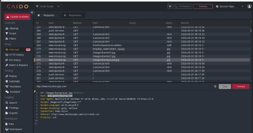
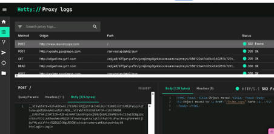
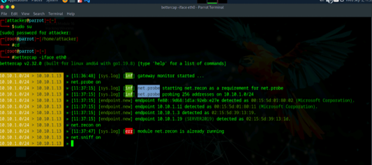
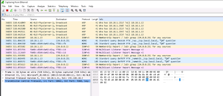

# Session Hijacking & Network Traffic Analysis Lab

## Overview

This lab provided hands-on experience with both offensive and defensive techniques related to session hijacking and network traffic analysis.

Working in an authorized training environment, I used Caido and Hetty to intercept and analyze web traffic, Bettercap to generate network activity associated with a simulated man-in-the-middle scenario, and Wireshark to examine the resulting traffic for indicators of suspicious behavior.

## Objectives

- Understand how session hijacking attacks work
- Intercept and analyze HTTP traffic
- Examine HTTP GET and POST requests
- Observe network activity associated with a man-in-the-middle attack
- Analyze ARP traffic for signs of suspicious behavior
- Practice identifying session hijacking activity from both attacker and defender perspectives

## Tools Used

- Caido
- Hetty
- Bettercap
- Wireshark
- Windows 11
- Windows Server
- Linux security environment

---

## Web Traffic Interception with Caido

Caido was used as an interception proxy to observe and modify HTTP requests traveling between the client and web server.

During the exercise, captured requests were reviewed before being forwarded to the destination. This demonstrated how an attacker positioned between a client and server could potentially manipulate web traffic when proper protections are not in place.

*Caido displaying intercepted HTTP requests during the controlled session hijacking exercise.*

---

## HTTP Request Analysis with Hetty

Hetty was used to capture and inspect HTTP traffic generated by the target system.

The proxy logs allowed individual requests to be examined in greater detail, including POST requests and their associated request bodies. This demonstrated how application-layer traffic can expose sensitive information when it is transmitted insecurely.

*HTTP POST request examined through Hetty's proxy logging interface.*

---

## Network Activity with Bettercap

Bettercap was used in the controlled lab environment to generate and observe network activity associated with the session hijacking exercise.

Network discovery and sniffing functionality were enabled to identify hosts and monitor traffic on the lab network.

*Bettercap running network probing, reconnaissance, and sniffing functions in the isolated lab environment.*

---

## Detecting Suspicious ARP Activity with Wireshark

Wireshark was used from the defensive perspective to inspect the network traffic generated during the exercise.

The packet capture showed a large volume of ARP traffic associated with the simulated attack activity. Examining the source, destination, protocol, and packet details demonstrated how abnormal ARP behavior can help identify possible man-in-the-middle activity.

*Wireshark packet capture showing ARP activity generated during the controlled session hijacking exercise.*

---

## Key Skills Demonstrated

- HTTP traffic interception
- Web proxy configuration
- HTTP request and response analysis
- POST request inspection
- Packet capture and analysis
- ARP traffic analysis
- Network reconnaissance
- Man-in-the-middle attack concepts
- Session hijacking detection
- Offensive and defensive security analysis

## Key Takeaways

This lab helped demonstrate how the same network activity can be examined from both offensive and defensive perspectives.

From the offensive side, interception proxies and network monitoring tools demonstrated how traffic can be observed or manipulated when communications are not adequately protected.

From the defensive side, Wireshark showed how packet-level analysis can reveal abnormal behavior, including unusual ARP activity that may indicate an attempted man-in-the-middle attack.

The exercise reinforced the importance of encrypted communications, secure session management, network monitoring, and packet analysis when protecting systems from session hijacking.

## Ethical Use

All activities documented in this project were performed in an authorized cybersecurity training environment using designated lab systems. No testing was performed against external or unauthorized systems.

## Ethical Use

All activities were performed in an authorized cybersecurity training environment using designated lab systems. No testing was performed against external or unauthorized systems.
