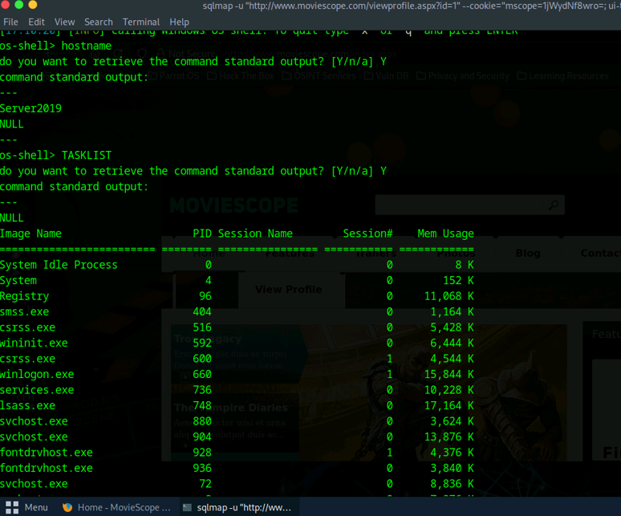
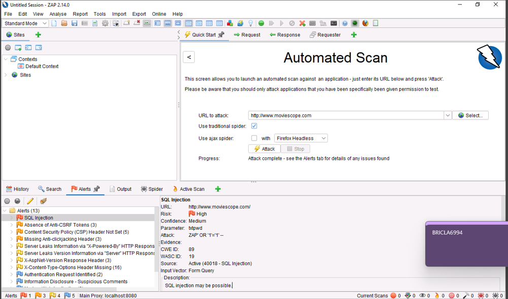
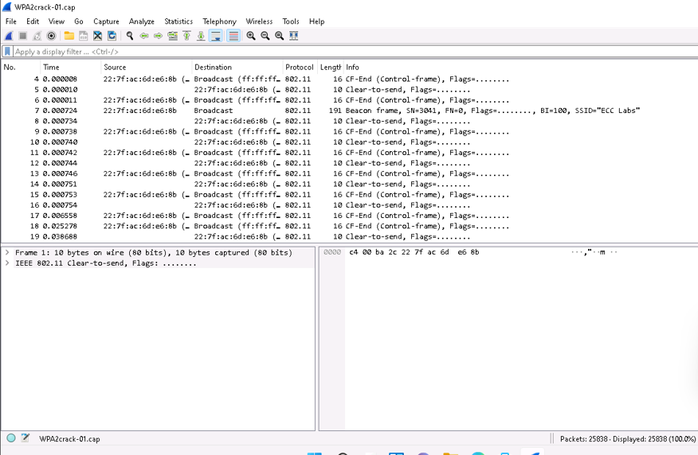
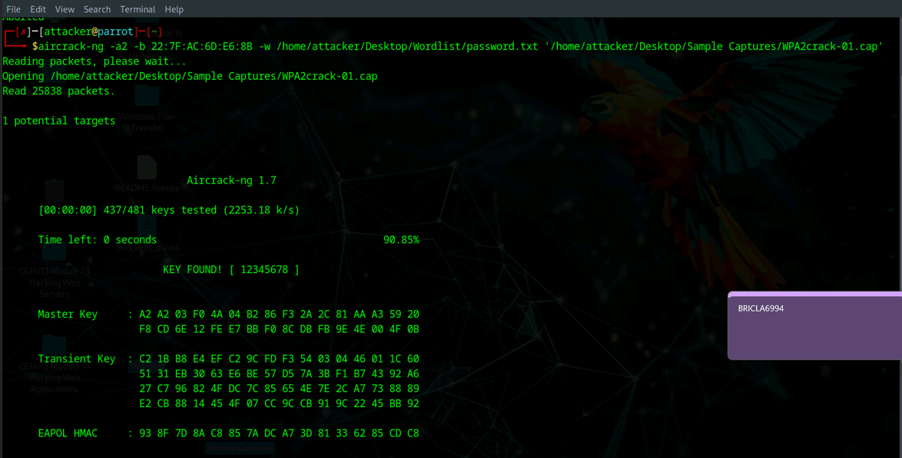

# SQL Injection & Wireless Security Assessment Lab

**SQL Injection | Vulnerability Detection | OS Command Execution | 802.11 Analysis | WPA2 Security Testing**

## Overview

This project documents hands-on security testing performed in an authorized virtual lab environment across two attack surfaces: a database-driven web application and a WPA2 wireless network capture.

The web application portion focused on identifying and validating SQL injection weaknesses using sqlmap and OWASP ZAP. The wireless portion focused on analyzing IEEE 802.11 traffic with Wireshark and testing the strength of a WPA2 pre-shared key with Aircrack-ng against a provided capture file.

The goal was to connect vulnerability discovery with controlled impact validation while documenting the defensive lessons from each exercise.

## Tools & Technologies

- sqlmap
- OWASP ZAP
- Wireshark
- Aircrack-ng
- Microsoft SQL Server
- Windows Server
- Parrot Security
- HTTP
- SQL
- IEEE 802.11
- WPA2-PSK

---

## 1. SQL Injection Exploitation with sqlmap

sqlmap was used against an intentionally vulnerable MovieScope web application to test a parameter for SQL injection.

The exercise included identifying the Microsoft SQL Server backend, enumerating database information, examining the application database, and validating the potential impact of the vulnerability in the controlled environment.

### OS Command Execution Validation

After sqlmap identified the injection point, its OS shell capability was used in the lab to validate whether the SQL injection weakness could reach the underlying operating system.

The screenshot below shows the controlled shell returning the target hostname and executing `TASKLIST`, demonstrating that the issue extended beyond database disclosure to operating-system command execution.

*sqlmap OS shell validating command execution on the authorized Windows Server lab target.*

### Security Impact

Successful SQL injection can expose application data, bypass intended access controls, and, depending on database privileges and configuration, enable operating-system command execution.

Key defensive controls include parameterized queries, strict input validation, least-privilege database accounts, secure error handling, and continuous application security testing.

---

## 2. SQL Injection Detection with OWASP ZAP

OWASP ZAP was used to perform an automated security assessment of the MovieScope web application.

The scanner identified a **High** risk SQL Injection finding and provided supporting information including the affected URL, parameter, attack input, confidence level, CWE ID, and WASC ID.

*OWASP ZAP identifying a high-risk SQL injection vulnerability in the authorized lab application.*

This exercise demonstrated the value of combining automated vulnerability discovery with manual validation rather than treating scanner output as proof by itself.

---

## 3. Wireless Packet Analysis with Wireshark

Wireshark was used to analyze a provided WPA2 packet capture from the training environment.

The capture contained IEEE 802.11 management and control traffic, allowing examination of frame types, MAC addresses, broadcast traffic, and other wireless protocol information.

*IEEE 802.11 wireless traffic examined in Wireshark from the provided training capture.*

The exercise reinforced how packet analysis can reveal wireless network characteristics and provide evidence for later security testing.

---

## 4. WPA2 Security Testing with Aircrack-ng

Aircrack-ng was used against the provided WPA2 capture and lab wordlist to evaluate the strength of the pre-shared key configured for the training access point.

The test successfully recovered the deliberately weak lab key, demonstrating how password strength directly affects the resistance of WPA2-PSK networks to offline dictionary attacks when a valid handshake is available.

*Aircrack-ng validating the weakness of the deliberately configured WPA2-PSK lab credential.*

### Security Impact

The exercise reinforced several wireless security practices:

- Use long, unique, high-entropy Wi-Fi credentials
- Avoid predictable or default pre-shared keys
- Prefer WPA3 where supported
- Separate guest and internal wireless networks
- Monitor for unauthorized access points and suspicious wireless activity

---

## Security Concepts Demonstrated

- SQL injection detection and exploitation
- Database enumeration
- MSSQL security testing
- Web application vulnerability scanning
- OS command execution validation
- Vulnerability impact analysis
- IEEE 802.11 packet analysis
- Wireless frame inspection
- WPA2 handshake analysis
- Offline WPA2-PSK dictionary testing
- Credential strength assessment
- Offensive security validation
- Defensive remediation planning

---

## Key Takeaways

This project demonstrated how security testing moves from discovery to validation.

For the web application, OWASP ZAP identified a SQL injection weakness and sqlmap was used to validate the potential impact in the authorized environment. The exercise showed why automated findings should be confirmed and why SQL injection can become significantly more serious when database privileges permit access to operating-system functionality.

For wireless security, Wireshark provided visibility into 802.11 traffic while Aircrack-ng demonstrated the risk created by a weak WPA2 pre-shared key. The wireless exercise used a provided packet capture because direct wireless capture was not available in the virtual lab.

Together, the exercises reinforced the importance of secure coding, least privilege, strong authentication credentials, protocol-level analysis, and validation of security controls.

## Ethical Use

All testing documented in this project was performed in an authorized cybersecurity training environment against designated lab systems, intentionally vulnerable applications, and provided sample capture files. No testing was performed against external or unauthorized systems.
