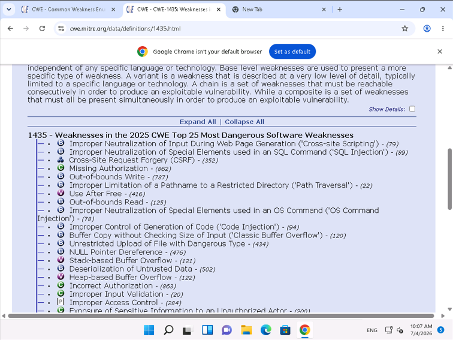
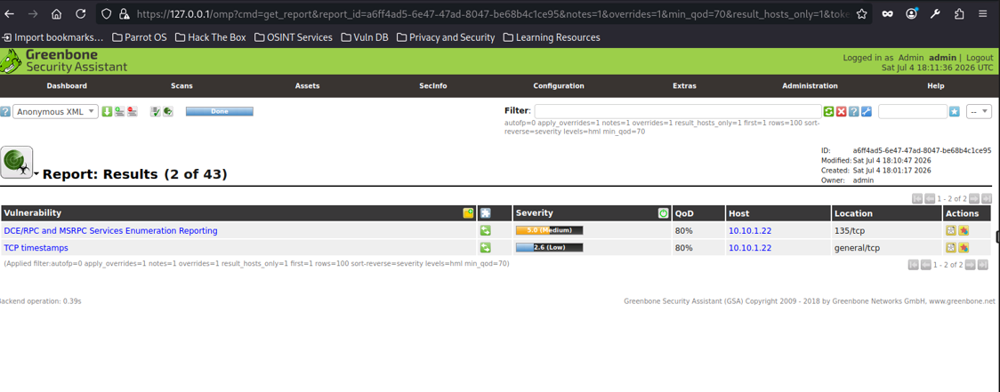
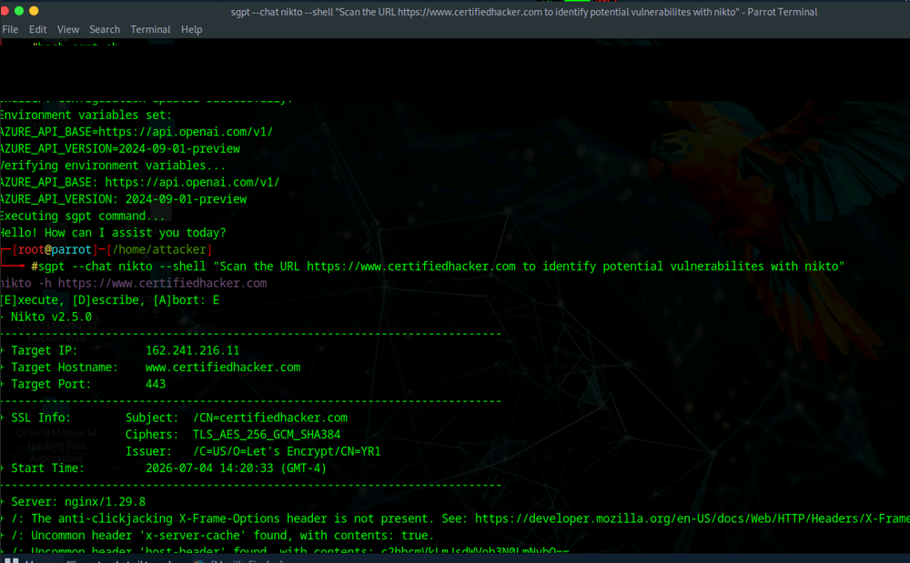

# Vulnerability Research & Assessment Lab

**CWE Research | OpenVAS / Greenbone | Nikto | Vulnerability Prioritization**

## Overview

This project documents a hands-on vulnerability assessment workflow completed as part of an authorized cybersecurity training lab.

The work focused on three stages of vulnerability analysis: researching common software weaknesses, scanning a Windows server with OpenVAS/Greenbone, and reviewing web-server findings generated by Nikto. The goal was not simply to run scanners, but to interpret what the findings mean and connect them to defensive remediation.

## Tools & Technologies

- MITRE Common Weakness Enumeration (CWE)
- Greenbone Security Assistant / OpenVAS
- Nikto
- Parrot Security
- Windows Server
- HTTP/HTTPS
- TCP/IP

---

## 1. Vulnerability Research with MITRE CWE

The first portion of the lab used the MITRE CWE catalog to research software weakness categories and review the CWE Top 25.

This exercise reinforced the difference between a **weakness category** and a specific vulnerability. CWE provides a structured way to describe recurring classes of software-security flaws such as cross-site scripting, SQL injection, improper access control, path traversal, and command injection.

*Reviewing high-impact software weakness categories in the MITRE CWE Top 25.*

### Security Takeaway

A scanner finding is more useful when it can be mapped to an underlying weakness class. CWE research helps analysts understand root causes and communicate remediation in a way that applies beyond a single product or CVE.

---

## 2. Vulnerability Assessment with OpenVAS

Greenbone Security Assistant / OpenVAS was used to assess an authorized Windows Server target.

The report view shown below contains representative findings from the scan, including DCE/RPC and MSRPC service enumeration exposure and TCP timestamp information. Severity and Quality of Detection (QoD) values were reviewed as part of interpreting the scanner results.

*Filtered OpenVAS report showing representative findings, severity, target host, and affected service location.*

### Security Takeaway

Automated vulnerability scanners provide valuable coverage, but their findings still require analyst review. Severity, confidence, exposed service, business context, and manual validation should all be considered before remediation is prioritized.

---

## 3. Web Vulnerability Scanning with Nikto

Nikto was used against the designated web-security training target to inspect the exposed HTTPS service and identify configuration weaknesses.

The scan output identified security-relevant HTTP findings, including a missing anti-clickjacking `X-Frame-Options` header and uncommon response headers that warranted further review.

*Nikto output from the authorized training exercise. An activation credential visible in the original terminal capture was permanently redacted before publication.*

### Security Takeaway

Web-server assessment is not limited to software versions. Security headers, TLS configuration, information disclosure, enabled methods, and unnecessary response metadata can all contribute to the attack surface.

---

## Assessment Methodology

The workflow demonstrated a practical vulnerability-management sequence:

1. Research relevant weakness categories.
2. Run an authorized vulnerability scan.
3. Review severity and detection confidence.
4. Inspect the affected service or application.
5. Validate findings where appropriate.
6. Prioritize remediation based on technical risk and exposure.
7. Document evidence clearly for technical and non-technical stakeholders.

---

## Skills Demonstrated

- Vulnerability research
- CWE interpretation
- Network vulnerability scanning
- OpenVAS / Greenbone report analysis
- Severity and QoD interpretation
- Service exposure analysis
- Web-server vulnerability scanning
- HTTP security-header analysis
- Finding validation
- Remediation prioritization
- Evidence handling and sensitive-data redaction
- Technical documentation

---

## Key Takeaways

This lab reinforced that vulnerability assessment is more than generating a list of scanner findings.

A useful assessment connects scanner output to the underlying weakness, validates the context of the finding, considers the exposed service and attack surface, and produces actionable remediation guidance.

The project also reinforced an important documentation practice: evidence should be reviewed for credentials or other sensitive information before it is published or shared.

## Ethical Use

All activities documented in this project were performed as part of an authorized cybersecurity training exercise using designated lab systems and course-provided targets.
