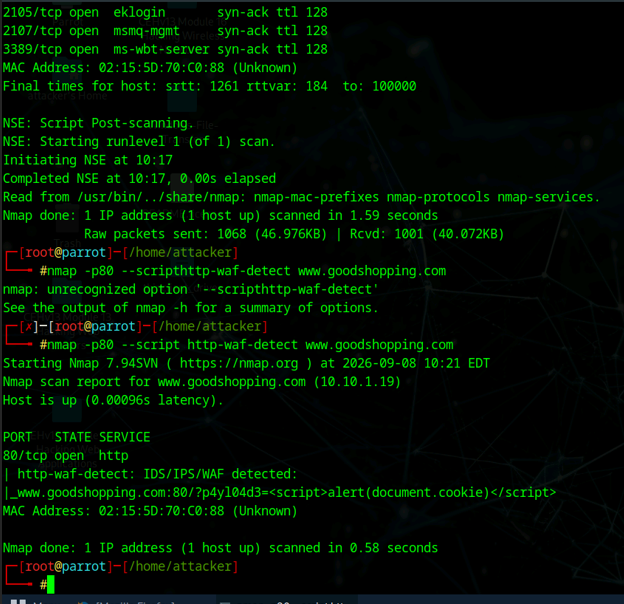
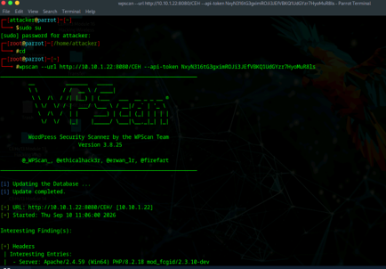

# Web Server & Application Penetration Testing Lab

**Reconnaissance | Enumeration | Vulnerability Assessment | Exploitation | Validation**

## Overview

I assessed deliberately vulnerable web servers and applications in an authorized lab. I moved from service discovery and attack-surface mapping to credential testing, vulnerability assessment, and controlled exploitation. I used server responses and command output to verify findings rather than relying on automated scan results alone.

## Tools & Technologies

- Nmap
- Nmap Scripting Engine (NSE)
- Netcat
- Telnet
- THC Hydra
- OWASP ZAP
- SmartScanner
- Burp Suite
- WPScan
- Wapiti
- Docker
- Apache Tomcat
- WordPress
- FTP
- HTTP
- Linux / Parrot Security
- Ubuntu
- Windows Server

---

## 1. Web Server Reconnaissance

### Banner Grabbing with Telnet

Telnet was used to connect directly to the target web server over HTTP and inspect the server response.

The returned HTTP headers provided information about the underlying web server technology, demonstrating how banner grabbing can reveal useful infrastructure details during reconnaissance.

*HTTP response headers collected during controlled web server reconnaissance.*

---

## 2. Web Application Firewall Detection with Nmap NSE

Nmap and the Nmap Scripting Engine were used to examine the target web server and test whether a web application firewall or similar security control was present.

The `http-waf-detect` NSE script generated test traffic and analyzed the server response for indicators of filtering or inspection.

*Nmap NSE output used to investigate web application firewall protection in the lab environment.*

---

## 3. Credential Security Testing

A controlled dictionary attack was performed against an FTP service using THC Hydra and lab-provided wordlists.

After valid credentials were identified, authorized access to the FTP service was validated by remotely creating a directory on the target system.

*Remote directory creation on the lab FTP server used to validate successful authorized access.*

This exercise demonstrated how weak or predictable credentials can expose remotely accessible services.

---

## 4. Log4j Remote Code Execution Validation

A deliberately vulnerable Apache Tomcat application was deployed in the lab to examine the impact of the Log4j vulnerability associated with CVE-2021-44228.

The vulnerable application was tested from a separate security-testing system. Successful exploitation resulted in a reverse shell within the isolated lab environment.

The execution context was validated by checking the current working directory and user account.

*Reverse shell used to validate remote code execution against the deliberately vulnerable lab application.*

This exercise reinforced the importance of patch management, dependency management, vulnerability identification, and rapid remediation of critical server-side vulnerabilities.

---

## 5. Web Application Attack Surface Mapping

OWASP ZAP was used to spider the target web application and enumerate accessible URLs and application resources.

This demonstrated how automated crawling can help map an application's attack surface and identify areas that may require additional security testing.

*OWASP ZAP spider results used to map accessible application resources.*

---

## 6. Web Application Vulnerability Assessment

SmartScanner was used to analyze the target application for security weaknesses.

The assessment identified multiple security-related findings, including missing HTTP security headers. Individual findings were reviewed along with their descriptions and recommended remediation.

*SmartScanner finding showing a missing X-Content-Type-Options security header and recommended remediation.*

Wapiti was also used during the lab to perform black-box web application vulnerability testing and review common web application weaknesses.

---

## 7. WordPress Security Assessment

WPScan was used to enumerate a WordPress application and investigate information related to the installed web server and application components.

The exercise demonstrated how specialized security tools can identify information that may be useful when assessing WordPress installations for vulnerable components.

*WPScan performing enumeration against an authorized WordPress lab application.*

Findings from the WordPress assessment were further investigated and selected vulnerabilities were validated within the controlled environment.

---

## Security Concepts Demonstrated

- Web server reconnaissance
- Banner grabbing
- Service enumeration
- HTTP header analysis
- Nmap Scripting Engine
- Web application firewall detection
- Credential security testing
- Web application spidering
- Attack surface mapping
- Vulnerability scanning
- HTTP security headers
- WordPress security assessment
- Remote code execution
- Log4j / CVE-2021-44228
- Black-box web application testing
- Vulnerability validation

---

## Findings and Lessons

The results ranged from missing HTTP security headers to successful remote command execution on an intentionally vulnerable Log4j application. The most important distinction was between a tool reporting a possible weakness and a test demonstrating its actual effect. I used that distinction to prioritize verification and connect findings to concrete defenses such as patching, stronger credentials, and safer web-server configuration.

## Ethical Use

All activities documented in this project were performed in an authorized cybersecurity training environment using designated virtual systems and intentionally vulnerable applications. No testing was performed against external or unauthorized systems.

[Technical labs](../) | [Portfolio home](../../)
