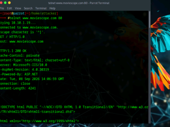
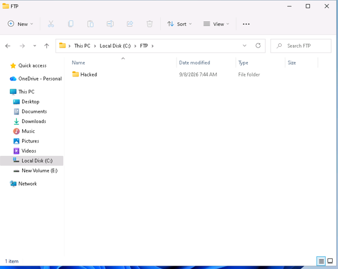
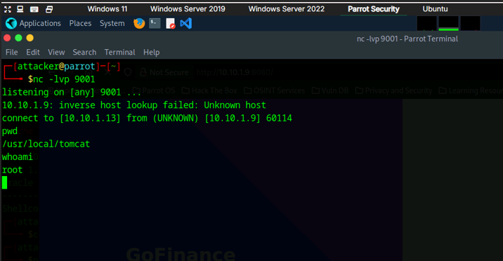
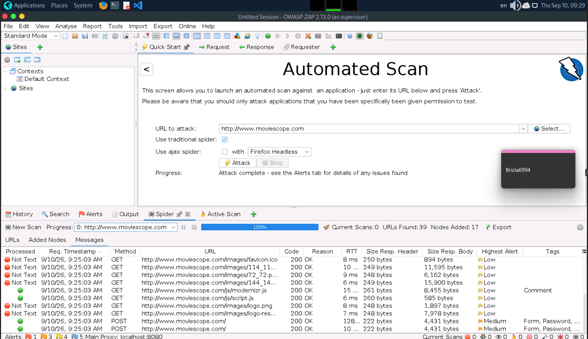
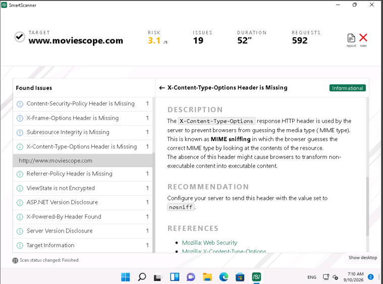

# Web Server & Application Penetration Testing Lab

**Reconnaissance | Enumeration | Vulnerability Scanning | Exploitation | Validation**

## Overview

This project documents a series of hands-on web server and web application security exercises completed in an authorized virtual lab environment.

The exercises followed a structured penetration testing workflow that included reconnaissance, service enumeration, vulnerability discovery, authentication testing, exploitation, and validation.

I used multiple security tools to identify exposed services, analyze web technologies, map application attack surfaces, test authentication controls, identify vulnerabilities, and validate selected findings in a controlled environment.

## Tools & Technologies

- Nmap
- Nmap Scripting Engine (NSE)
- Netcat
- Telnet
- THC Hydra
- OWASP ZAP
- Burp Suite
- SmartScanner
- WPScan
- Wapiti
- ShellGPT
- Docker
- Apache Tomcat
- FTP
- HTTP
- Linux / Parrot Security
- Ubuntu
- Windows Server
- WordPress

---

## 1. Web Server Reconnaissance & Enumeration

I used Netcat, Telnet, Nmap, and the Nmap Scripting Engine to gather information about target web servers.

The exercises included identifying open ports and services, reviewing HTTP response headers, performing banner grabbing, enumerating web server information, and examining technologies exposed by the target.

*HTTP response headers and web server information collected during controlled banner-grabbing analysis.*

### Nmap & NSE

Nmap and NSE were used to identify running services and gather additional information about the web infrastructure.

The exercises demonstrated how enumeration can identify exposed services and information that may influence later security testing.

*Nmap Scripting Engine output used during web server enumeration.*

---

## 2. Credential Security Testing

A controlled dictionary attack was performed against an FTP service using THC Hydra and lab-provided wordlists.

The exercise demonstrated how weak or predictable credentials can expose remotely accessible services. Successful access was validated within the authorized lab environment.

*Validation of remote FTP access after controlled credential testing.*

---

## 3. Log4j Remote Code Execution Validation

A deliberately vulnerable web server was deployed in the lab to examine the security impact of the Log4j vulnerability associated with CVE-2021-44228.

Nmap was first used to identify the exposed web service. The vulnerable application was then tested in the isolated environment to demonstrate how successful exploitation could result in remote command execution.

*Remote shell access obtained during the authorized Log4j vulnerability exercise.*

This exercise reinforced the importance of patch management, dependency management, vulnerability scanning, and timely remediation of critical server-side vulnerabilities.

---

## 4. Web Application Reconnaissance & Attack Surface Mapping

Nmap and Telnet were used to identify server technologies, ports, services, and HTTP response information associated with the target web application.

OWASP ZAP was then used to spider the application and identify URLs, resources, and functionality exposed by the site.

*OWASP ZAP spider results used to map the web application's accessible content and attack surface.*

---

## 5. Web Application Vulnerability Scanning

SmartScanner was used to examine the target application for security weaknesses.

The scan identified issues involving insecure HTTP communication and missing security headers. The exercise also included reviewing vulnerability descriptions and recommended remediation rather than relying only on automated scan results.

*Web application findings reviewed during vulnerability scanning.*

Wapiti was also used to perform black-box web application vulnerability scanning and review common application security weaknesses.

*Black-box web application security assessment performed with Wapiti.*

---

## 6. Authentication & Application Security Testing

Burp Suite was used to intercept and analyze HTTP requests during controlled authentication testing against a WordPress application.

The exercise demonstrated how intercepted application requests can be examined and manipulated during an authorized web application security assessment.

WPScan was also used to identify a vulnerable WordPress component. The finding was validated within the lab environment by testing the associated remote code execution vulnerability.

*WPScan output used while investigating and validating a vulnerable WordPress component.*

---

## 7. AI-Assisted Security Testing

ShellGPT was used during selected reconnaissance and vulnerability-testing exercises to explore how AI-generated commands can assist with security workflows.

Generated commands and output were reviewed and validated rather than treated as automatically trustworthy.

This exercise demonstrated the importance of combining automation with analyst judgment and technical verification.

---

## Security Concepts Demonstrated

- Web server reconnaissance
- Service enumeration
- Banner grabbing
- HTTP header analysis
- Nmap Scripting Engine
- Web application spidering
- Attack surface mapping
- Vulnerability scanning
- Credential security testing
- HTTP request analysis
- Authentication testing
- WordPress security assessment
- Remote code execution
- Log4j / CVE-2021-44228
- Black-box web application testing
- Vulnerability validation
- AI-assisted security testing

---

## Key Takeaways

This project demonstrated how reconnaissance, enumeration, vulnerability scanning, exploitation, and validation fit together during a structured penetration testing process.

Using multiple tools also reinforced the importance of validating findings rather than relying on a single automated scanner. Reconnaissance tools provided information about the attack surface, vulnerability scanners identified potential weaknesses, and controlled exploitation demonstrated the potential impact of selected findings.

The exercises strengthened my understanding of both web server and web application security and the importance of translating technical findings into practical remediation priorities.

## Ethical Use

All activities documented in this project were performed in an authorized cybersecurity training environment using designated virtual systems and intentionally vulnerable applications. No testing was performed against external or unauthorized systems.
