# Container Incident Investigation: Network Forensics & Isolation Forest

**CST440 | AI/Machine Learning | August 2026**  
**Environment:** Four Ubuntu Docker containers in the VCASTLE training lab  
**Tools:** Nmap, TShark, tcpdump, Docker, Linux, `ps`, `ss`, `lsof`, `strace`, Python, pandas, scikit-learn, PCA

I investigated repeated internal HTTP requests in a four-container lab network, traced them to a background Bash script, and used Isolation Forest to examine new packet captures. The most useful part of the exercise was comparing what the model flagged with what I could verify through logs, packet analysis, and host evidence.

The activity was part of a simulated incident. I confirmed what the script did and how it was started, but the available evidence did not establish an external intrusion or a successful compromise of the three systems it contacted.

## Key results

- Identified recurring requests to `/admin` and `/.git/config` on TCP port 8888.
- Located `/workspace/system-check.sh` running as root under PID 7 in the **support** container.
- Traced the script's startup to `launch.sh` and verified its network and logging behavior.
- Examined **4,042 captured packet records** across four observation points in the final investigation.
- Used Isolation Forest to flag **203 unusual records** across the four captures, then checked selected packets with TShark.
- Identified two benign IPv6 mDNS packets that the model flagged because its features did not properly represent that traffic.

## Investigation timeline

| Phase | Work performed | Evidence |
|---|---|---|
| Aug 1: Baseline | Mapped containers, verified operating systems and HTTP services, reviewed initial logs | Nmap, Docker inspection, application logs |
| Aug 5: Traffic | Captured five minutes of network traffic and inspected HTTP exchanges | TShark, packet capture |
| Aug 16: Host forensics | Examined processes, files, connections, and repeated log activity | `ps`, `/proc`, `ss`, `lsof`, `scan.log` |
| Aug 21: Script analysis | Inspected the scanning loop, startup behavior, hashes, and live traffic | `strings`, hashes, `strace`, `tcpdump` |
| Aug 29: ML review | Collected new captures, scored packets with Isolation Forest, and validated model findings | Python, scikit-learn, TShark, PCA |

The containers were assigned different Docker IP addresses during different sessions. I used the container names to correlate findings rather than treating any one `172.18.0.x` address as a permanent identifier.

## 1. Network discovery and initial alert

Network discovery found four Ubuntu 22.04.5 LTS containers. Nmap identified **Tornado httpd 6.5.1** listening on **TCP 8888**, the normal Jupyter service in this environment. A scan of the active lab subnet also identified the Docker gateway.

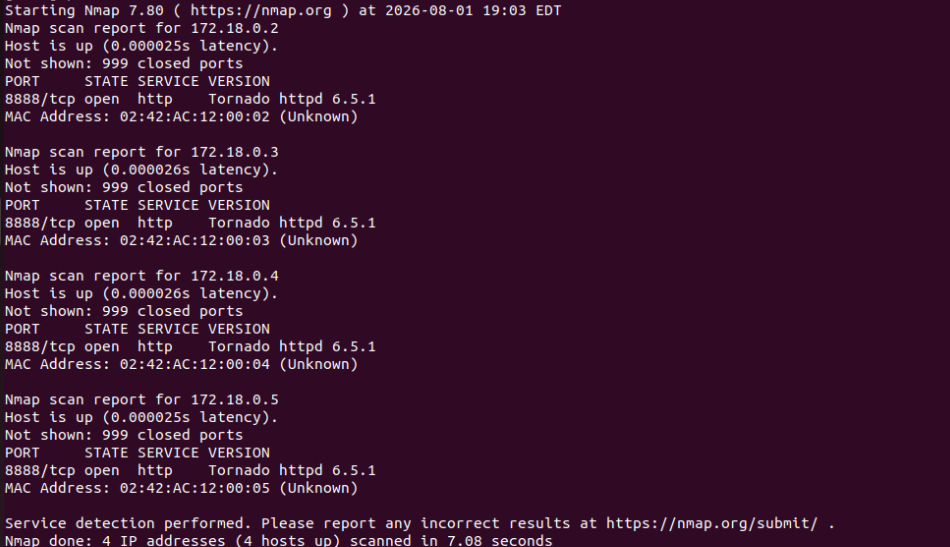

While reviewing the analysis container's HTTP logs, I noticed repeated requests from support for `/admin` and `/.git/config`. The requests returned **404 Not Found**. These paths were worth investigating, but a 404 response did not indicate successful access.

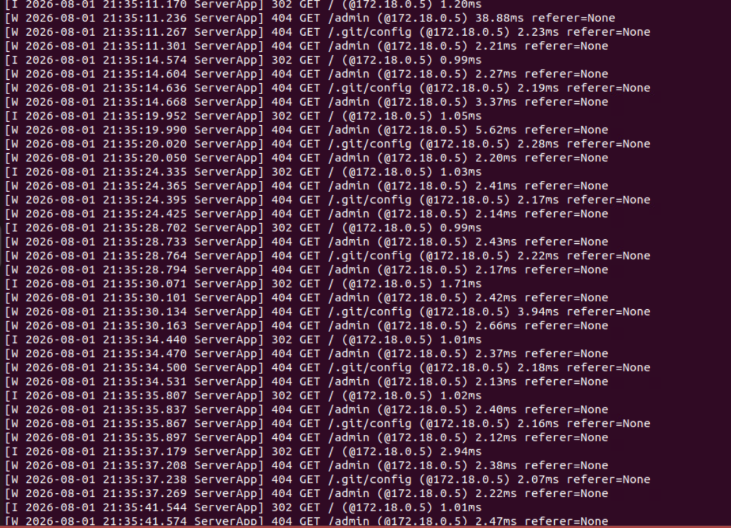

## 2. Packet-level confirmation

A five-minute TShark capture contained **3,600 TCP packets**, including **720 HTTP packets**. The packet trace confirmed internal HTTP traffic on port 8888, including a `GET /admin` request followed by a 404 response.

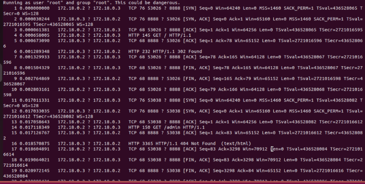

This connected the application-log entries to actual network requests. It still did not explain which process generated them.

## 3. Host forensics and source identification

Process inspection on the support container identified **PID 7**, running `bash /workspace/system-check.sh` as root. Connection and file inspection tied this process to the repeated network activity. The `scan.log` file contained **3,351 entries** during the Week 3 review.

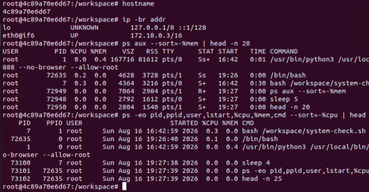

Those log entries show repeated execution of the script's logging command. They should not be counted as 3,351 individually verified HTTP requests.

## 4. Static and dynamic script analysis

The script contained a continuous loop targeting `analysis`, `notebook-a`, and `notebook-b`. For each target, it requested `/`, `/admin`, and `/.git/config`, then made an additional `/admin` request with a `Mozilla/5.0` user agent. It wrote to `scan.log`, slept for a random one to five seconds, and repeated.

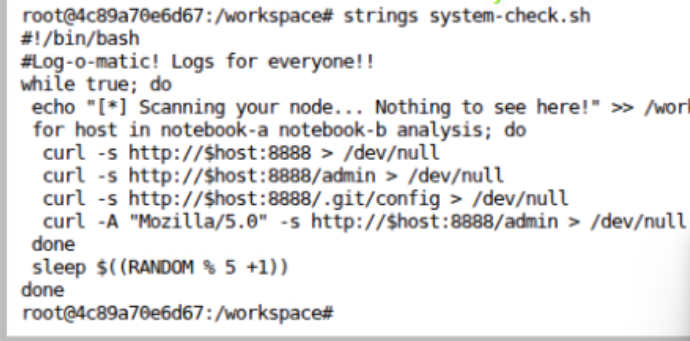

The container's `launch.sh` script started `system-check.sh` in the background with `nohup` before launching JupyterLab. This explained why the process returned when the lab container started.

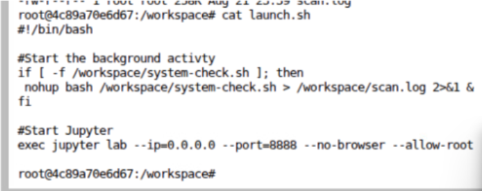

I collected MD5, SHA-1, and SHA-256 hashes. The **SHA-256** matched the value collected in Week 3, confirming that the examined script's contents were unchanged between those checks:

```text
d68d1863682d2bd59947f5ea62164a5442986146818e9bb09fa7682e48cdf49e
```

Additional `lsof`, `tcpdump`, process, and controlled `strace` observations supported the same activity. By Week 4, `scan.log` had grown to **5,608 entries**. I could document automated internal reconnaissance, but I found no evidence of self-propagation, encryption, data theft, or successful exploitation of a peer container.

## 5. Isolation Forest on fresh packet captures

For the final stage, I collected approximately one minute of traffic from each container and exported packet fields to CSV. These are observations from separate capture points, so the combined record count does not represent 4,042 unique network packets. The model used five features: numeric IPv4 source and destination addresses, TCP source and destination ports, and frame length. I applied `StandardScaler` and configured Isolation Forest with **100 estimators**, **0.05 contamination**, and **`random_state=42`**.

| Capture location | Records | Flagged | Not flagged |
|---|---:|---:|---:|
| analysis | 720 | 36 | 684 |
| support | 1,920 | 96 | 1,824 |
| notebook-a | 722 | 37 | 685 |
| notebook-b | 680 | 34 | 646 |
| **Total** | **4,042** | **203** | **3,839** |

**These are anomaly counts, not confirmed attack detections.** The contamination setting was chosen in advance to flag roughly 5% of each capture, and the data did not have verified attack labels for calculating precision or recall.

### Correlating model results with HTTP traffic

In the support capture, TShark counted **48 requests for `/`**, **48 for `/.git/config`**, and **96 for `/admin`**. That 1:1:2 pattern matched the four requests in the Bash loop and showed the activity was still occurring during the final collection.

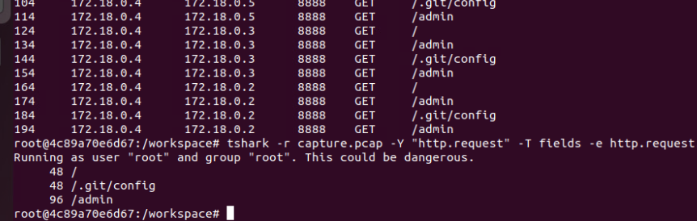

The support model's lowest anomaly scores included large HTTP responses from its peers, making those packets useful candidates for manual inspection.

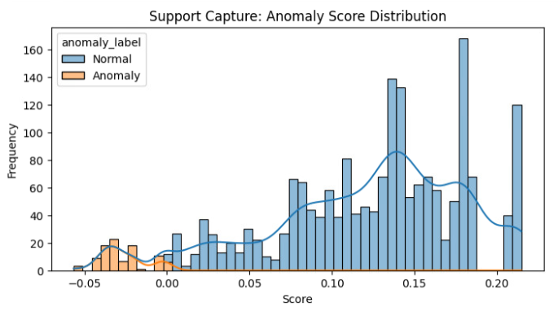

The notebook-b capture offered a clearer example. The model flagged **34 of 680 records**. Examination of flagged **frame 16** identified a **3,363-byte HTTP 404 response**. TShark linked it to **frame 14**, a `GET /admin` request sent by support.

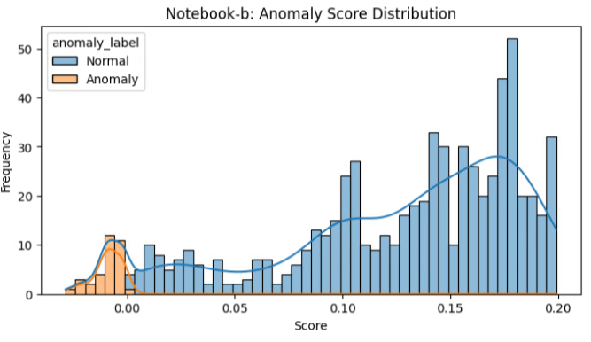

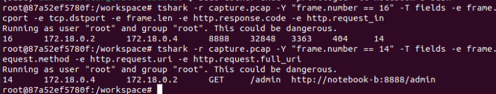

### Investigating a false positive

The two lowest-scoring records in the notebook-a capture were **frames 561 and 562**, with anomaly scores of **-0.118856**. They were benign **IPv6 mDNS** packets, not requests from the scanning script.

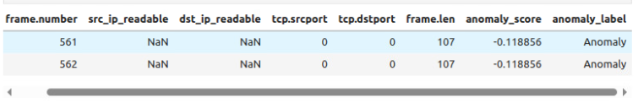

The preprocessing converted missing IPv4 and TCP fields to zero. Those zero-filled records became extreme outliers in the feature space, as the PCA projection also showed.

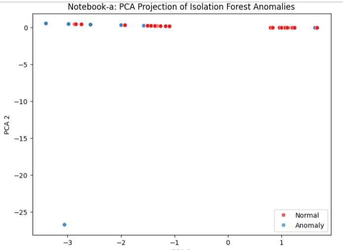

This exposed a weakness in the feature selection. The model had no understanding of HTTP request paths, protocol-specific fields, or whether a packet was benign. Packet inspection was necessary to interpret its results.

## Assessment and next steps

The strongest evidence was the agreement between the repeated HTTP requests, the running Bash process, the script contents, its startup configuration, and packet captures from several containers. Isolation Forest helped prioritize unusual packet records, but it did not identify the script, explain its root privileges, or determine whether a security incident had occurred.

If this were an operational incident, I would preserve the script, startup file, logs, and packet captures first, then investigate whether the scanner was authorized. Subject to that determination, the recommended actions would be to disable unexpected startup behavior, restrict unnecessary container-to-container access, and alert on repeated requests for sensitive paths.

For a more useful detection model, I would add HTTP methods, URIs, response codes, request rates, protocol-aware IPv6/UDP handling, and flow-level timing. I would also separate protocol families instead of converting missing fields to zero and validate results against labeled or independently reviewed examples.

The response considerations align with the **Detect, Respond, Recover, and continuous-improvement** emphasis in [NIST SP 800-61 Rev. 3](https://doi.org/10.6028/NIST.SP.800-61r3). Response actions above are recommendations, not actions claimed to have been completed.

**Related coursework:** [Supervised and unsupervised MitM traffic model comparison](mitm-model-comparison.md). These experiments used separate synthetic datasets and were not used to classify the VCASTLE packet captures.

*All investigation activity was performed in an authorized training environment.*