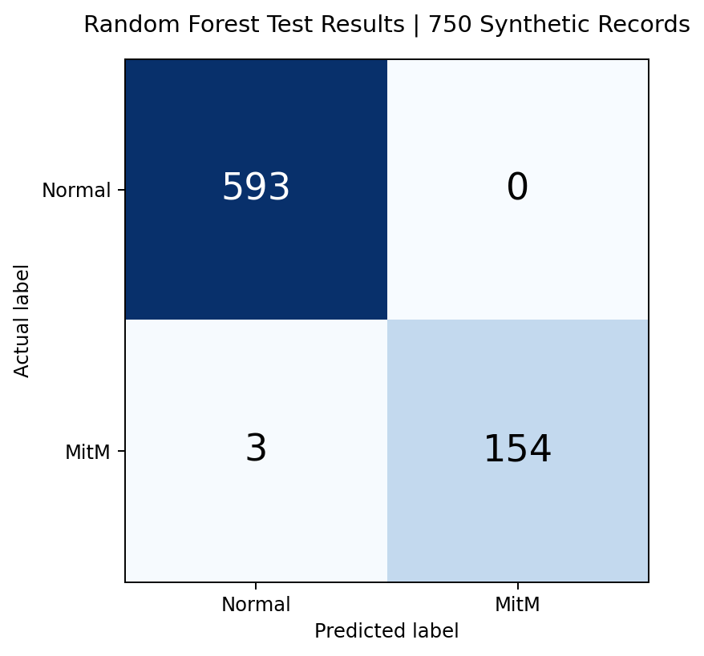
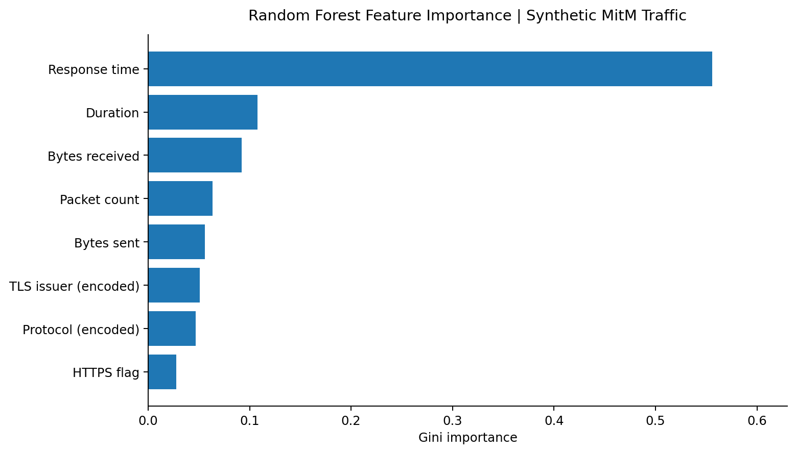
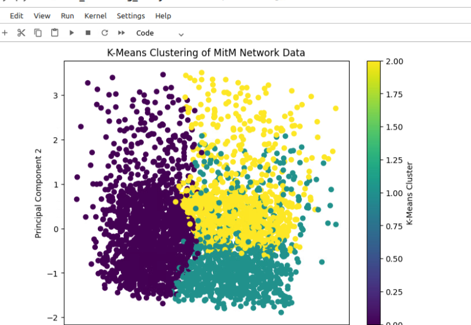
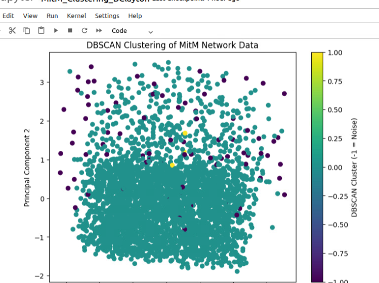

# MitM Traffic: Comparing Machine Learning Approaches

**Network traffic analytics | August 2026**

I compared supervised classification and unsupervised clustering using **synthetic network traffic**, not captures from the [container incident investigation](README.md). The aim was to see what labeled examples can teach a model and what can be learned when attack labels are unavailable.

## Random Forest: Labeled network traffic

The supervised exercise used **2,500 synthetic records**, including **2,000 labeled normal** and **500 labeled MitM**. Preprocessing converted response times to milliseconds, encoded categorical protocol and TLS-issuer fields, and prepared numeric network-traffic features.

Using a Random Forest configuration (100 estimators, random state 42, 70/30 split), I reproduced the following test results from the saved CSV:

| Metric | Result |
|---|---:|
| Training records | 1,750 |
| Test records | 750 |
| Correct predictions | 747 |
| Accuracy | 99.6% |
| MitM precision | 100% |
| MitM recall | 98.1% |
| Missed MitM records | 3 |

The confusion matrix contained **593 true negatives**, **154 true positives**, **0 false positives**, and **3 false negatives**.

Response time accounted for approximately **55.6%** of the model's impurity-based feature importance. In the dataset, MitM examples were designed to have abnormal response timing, so the strong performance was partly a consequence of how the traffic was generated.

**Limitation:** This score does not establish performance on real attacks. The exercise code fitted preprocessing to the complete dataset before splitting it, rather than fitting the preprocessing steps on training data only. A stronger evaluation would use a leak-resistant pipeline, an independent dataset, and realistic variations in benign latency and attacker behavior.

## K-Means and DBSCAN: Unlabeled traffic

For the unsupervised comparison, I analyzed **3,500 simulated traffic records** using five numeric features: bytes sent, bytes received, duration, packet count, and response time.

K-Means (`k=3`) assigned every record to one of three groups containing **1,507**, **978**, and **1,015** records. The PCA plot showed where those groups overlapped.

The recorded results showed **86 DBSCAN noise records**. I reviewed the resulting visualization and investigated the unusual entries, but the original 3,500-record CSV is no longer available, so I cannot independently reproduce the cluster counts or use them as a model-performance benchmark.

The follow-up review identified **26 HTTPS noise records** with suspicious-looking TLS issuer names, including `NullSigner`, `FakeCA Ltd`, and `CompromisedCert Inc`. The clustering model did **not** directly examine the issuer strings; they were reviewed after the noise records were identified. Unusual timing, certificate metadata, or an outlier label is a reason to investigate, not proof of interception.

## What I learned

The labeled Random Forest exercise measured how well a model recognized patterns intentionally built into synthetic attacks. K-Means grouped observations by similarity, while DBSCAN helped narrow the records needing review without assigning every observation to a cluster.

The [container investigation](README.md) showed why those distinctions matter: its Isolation Forest results required packet-level validation, and some of the strongest anomalies were ordinary mDNS traffic that had been poorly represented by preprocessing. Machine learning can help prioritize investigation, but the surrounding security evidence determines what a flag means.

*Both datasets were synthetic. These results are not measures of real-world attack-detection performance.*