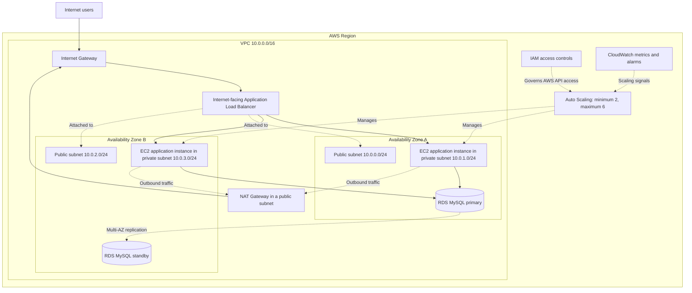
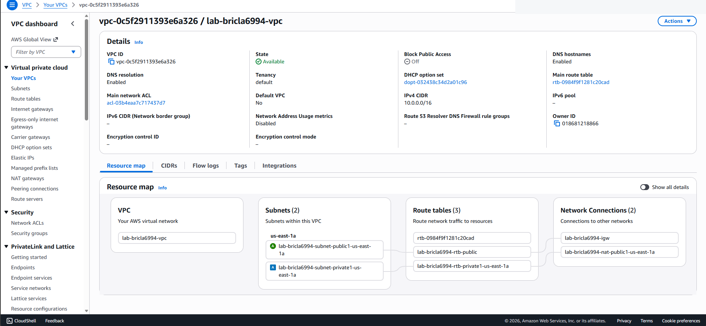
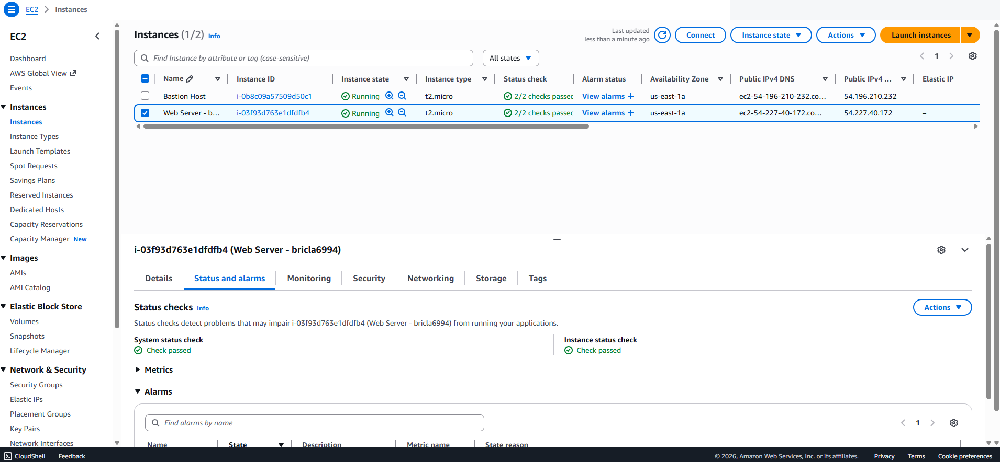
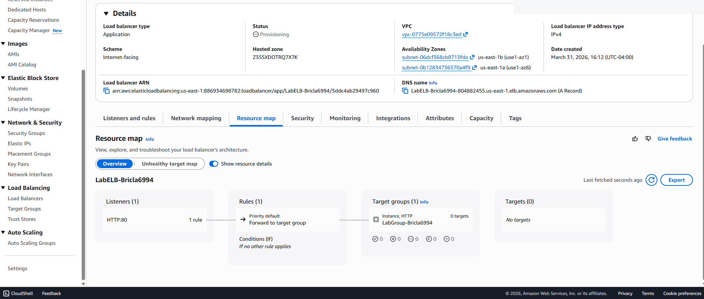
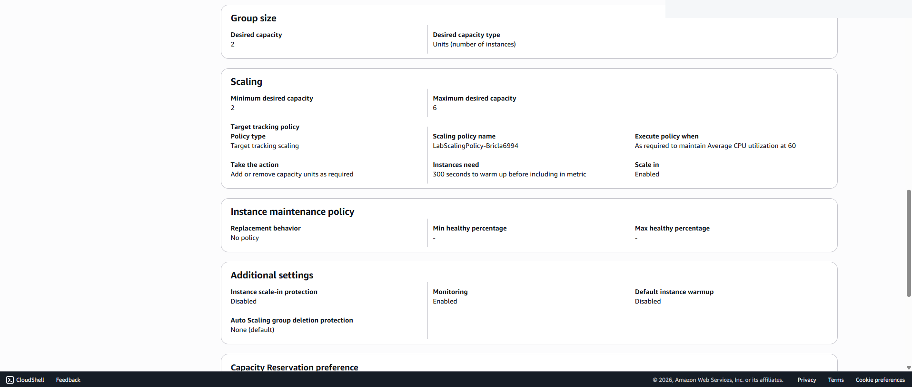
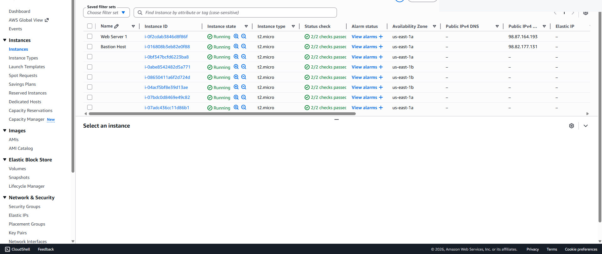
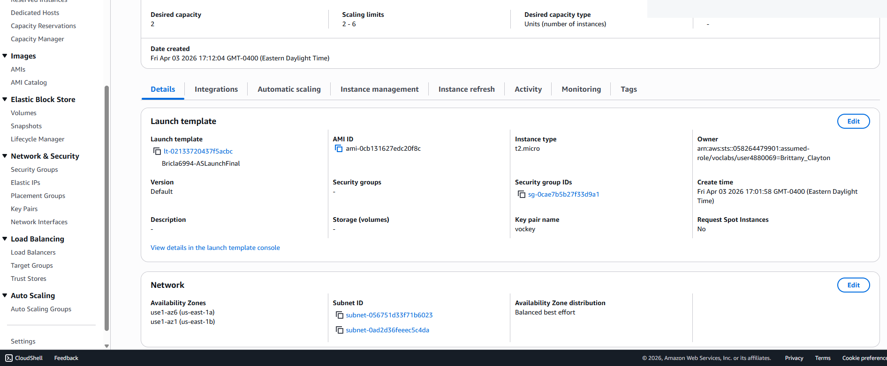

# AWS Secure & Scalable Web Architecture

## Overview

I built and tested AWS infrastructure across several cloud labs, including VPC networking, EC2 web servers, RDS for MySQL, load balancing, Auto Scaling, and CloudWatch monitoring. I also configured IAM permissions and tested what different users could and could not access.

These were separate training environments. The architecture diagram below brings the work together to show how I would connect the services in a single web application.

**AWS services:** IAM, VPC, EC2, EBS, RDS for MySQL, Elastic Load Balancing, EC2 Auto Scaling, CloudWatch

[View configuration and test screenshots](#configuration-and-test-evidence)

## Architecture

This diagram shows how the services from the separate labs fit into a web application architecture. It is a reference design, not a screenshot of one running deployment.

## Work Completed

### 1. Identity and Access Management

I reviewed IAM users, groups, AWS managed policies, and an inline policy, then assigned users to groups based on job function. I validated both allowed and denied actions across Amazon S3 and EC2.

### 2. Multi-AZ VPC Networking

I built a VPC using the `10.0.0.0/16` address space and configured public and private subnets across two Availability Zones.

The network included:

- Public subnet: `10.0.0.0/24`
- Private subnet: `10.0.1.0/24`
- Second public subnet: `10.0.2.0/24`
- Second private subnet: `10.0.3.0/24`
- Internet Gateway for public internet connectivity
- NAT Gateway for outbound internet access from private subnets
- Public and private route tables
- Security groups controlling application traffic

I used route tables and gateways to separate internet-facing resources from private subnets, with security groups controlling inbound traffic.

### 3. EC2 Deployment and Operations

I launched Amazon Linux 2023 EC2 instances, configured networking and storage, and used EC2 user data to automate web server setup.

I also worked with:

- EC2 status checks
- CloudWatch instance metrics
- System logs and instance screenshots for troubleshooting
- Security group changes to permit HTTP traffic
- Termination protection and stop protection
- Instance type resizing
- EBS volume expansion
- Service quotas
- AMI creation for repeatable instance deployment

### 4. RDS Database Architecture

I configured an RDS for MySQL database, its subnet group, and network permissions. I also tested database connectivity with MySQL Workbench in a separate exercise.

The database configuration included:

- DB subnet group spanning two Availability Zones
- Multi-AZ deployment for database availability
- A dedicated database security group
- MySQL traffic on TCP 3306 permitted from the web security group
- RDS endpoint and connection settings

Using a security group as the source for the database rule demonstrated service-to-service access control without opening the database to arbitrary internet addresses.

### 5. Load Balancing and Auto Scaling

I created an Application Load Balancer and target group, then built a launch template from a reusable web server AMI.

The Auto Scaling configuration used:

- Desired capacity: 2 instances
- Minimum capacity: 2 instances
- Maximum capacity: 6 instances
- Private subnets across two Availability Zones
- Target tracking based on average CPU utilization
- 60% CPU target
- CloudWatch group metrics and alarms

I checked target health and used the training application's load-test function to observe CloudWatch alarms and additional instances launched by Auto Scaling.

## Security Engineering Decisions

| Control area | Implementation | Security value |
|---|---|---|
| Identity | IAM groups and scoped policies | Reduces unnecessary user permissions |
| Network segmentation | Public and private subnets | Separates internet-facing and internal resources |
| Egress | NAT Gateway for private subnets | Allows outbound access without direct public exposure |
| Web access | Security-group-controlled HTTP | Restricts inbound traffic to defined services |
| Database access | RDS security group trusts the web security group on TCP 3306 | Limits database connectivity to approved application instances |
| Availability | Multi-AZ RDS, two Availability Zones, load balancing | Reduces dependence on a single instance or zone |
| Elasticity | Auto Scaling with CPU target tracking | Adds and removes compute capacity based on demand |
| Operations | EC2 protections, status checks, CloudWatch | Improves resilience and visibility |

## Testing and Results

I verified the environment through functional and security-focused tests:

- Confirmed IAM users could access only the services and actions assigned to them
- Confirmed the web server was inaccessible before HTTP was allowed by the security group
- Verified successful HTTP access after the rule was added
- Confirmed EC2 system and instance reachability checks passed
- Configured an RDS endpoint and tested MySQL client connectivity in a separate lab
- Confirmed load balancer targets became healthy
- Accessed the application through the load balancer DNS name
- Generated load and observed Auto Scaling launch additional instances after the CloudWatch threshold was reached

## Production Security Improvements

Some settings in the training labs were intentionally simplified for speed. For a production deployment, I would strengthen the architecture in the following areas:

- Enable RDS encryption at rest with AWS KMS
- Enable automated RDS backups and define an appropriate retention period
- Store database credentials in AWS Secrets Manager instead of application configuration or plaintext
- Use HTTPS on the Application Load Balancer with an ACM certificate
- Separate the load balancer security group from the application instance security group and allow application traffic only from the load balancer
- Use IAM roles and temporary credentials for workloads
- Prefer AWS Systems Manager Session Manager for administrative access when possible
- Enable CloudTrail and centralized log retention for auditability
- Add GuardDuty, Security Hub, and AWS Config for stronger detection and configuration visibility
- Evaluate AWS WAF for internet-facing application protection
- Add alarms for availability, error rates, latency, database health, and capacity in addition to CPU

## Related Labs

- [AWS IAM Policy Testing](../../../labs/aws-iam-access-control/)
- [VPC and EC2 Networking](../../../labs/aws-vpc-ec2-infrastructure/)
- [RDS MySQL Connectivity](../../../labs/aws-rds-mysql-connectivity/)
- [EBS Snapshot Recovery](../../../labs/aws-ebs-snapshot-recovery/)
- [Cloud Infrastructure Portfolio](../)

*Completed across separate AWS training environments. The architecture diagram is a reference design.*

## Configuration and Test Evidence

### VPC Resource Map

### EC2 Status Checks

### Application Load Balancer

### Auto Scaling Capacity

### Auto Scaling EC2 Instances

### Auto Scaling Configuration from the Final Practical

