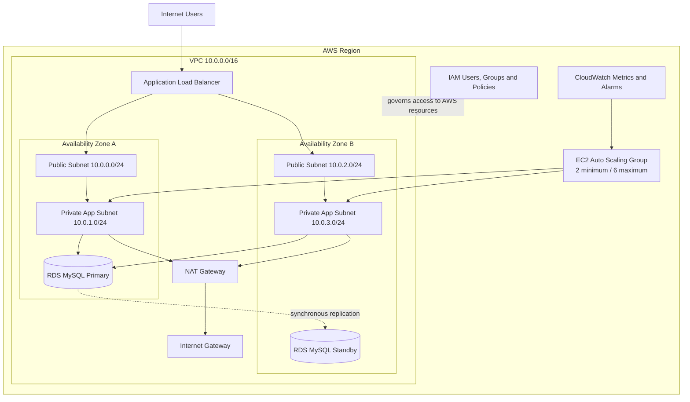

# AWS Secure & Scalable Web Architecture

## Project Overview

This project is a portfolio synthesis of five completed AWS labs covering identity and access management, EC2 operations, VPC networking, relational database deployment, load balancing, Auto Scaling, and CloudWatch monitoring.

The work was completed across separate AWS training lab sessions. This documentation connects those hands-on exercises into a single cloud architecture story while clearly separating completed implementation from production hardening recommendations.

**Cloud platform:** Amazon Web Services  
**Primary services:** IAM, Amazon VPC, EC2, EBS, RDS for MySQL, Elastic Load Balancing, EC2 Auto Scaling, CloudWatch  
**Architecture themes:** least privilege, network segmentation, high availability, elasticity, service-to-service access control, monitoring

## Architecture

The reference architecture below is an original synthesis of the components I configured across the completed labs.

## What I Implemented

### 1. Identity and Access Management

I reviewed IAM users, groups, AWS managed policies, and an inline policy, then assigned users to groups based on job function. I validated both allowed and denied actions across Amazon S3 and EC2.

This exercise reinforced least privilege, role-based access patterns, and the importance of testing effective permissions rather than assuming that a policy attachment works as intended.

### 2. Multi-AZ VPC Networking

I built a VPC using the `10.0.0.0/16` address space and configured public and private subnets across two Availability Zones.

The network included:

- Public subnet: `10.0.0.0/24`
- Private subnet: `10.0.1.0/24`
- Second public subnet: `10.0.2.0/24`
- Second private subnet: `10.0.3.0/24`
- Internet Gateway for public internet connectivity
- NAT Gateway for outbound internet access from private subnets
- Public and private route tables
- Security groups controlling application traffic

This design demonstrated how route tables, gateways, subnet placement, and security groups work together to control reachability.

### 3. EC2 Deployment and Operations

I launched Amazon Linux 2023 EC2 instances, configured networking and storage, and used EC2 user data to automate web server setup.

I also worked with:

- EC2 status checks
- CloudWatch instance metrics
- System logs and instance screenshots for troubleshooting
- Security group changes to permit HTTP traffic
- Termination protection and stop protection
- Instance type resizing
- EBS volume expansion
- Service quotas
- AMI creation for repeatable instance deployment

The operational portion of the lab went beyond simply launching a virtual machine and included monitoring, troubleshooting, lifecycle protection, and scaling preparation.

### 4. RDS Database Architecture

I created an Amazon RDS for MySQL deployment and connected it to a web application.

The database configuration included:

- DB subnet group spanning two Availability Zones
- Multi-AZ deployment for database availability
- A dedicated database security group
- MySQL traffic on TCP 3306 permitted from the web security group
- Application connection through the RDS endpoint
- Create, edit, and delete operations to confirm data persistence

Using a security group as the source for the database rule demonstrated service-to-service access control without opening the database to arbitrary internet addresses.

### 5. Load Balancing and Auto Scaling

I created an Application Load Balancer and target group, then built a launch template from a reusable web server AMI.

The Auto Scaling configuration used:

- Desired capacity: 2 instances
- Minimum capacity: 2 instances
- Maximum capacity: 6 instances
- Private subnets across two Availability Zones
- Target tracking based on average CPU utilization
- 60% CPU target
- CloudWatch group metrics and alarms

I verified that the load balancer routed traffic only to healthy targets and used a load test to trigger CPU growth, CloudWatch alarm activity, and automatic instance scale-out.

## Security Engineering Decisions

| Control area | Implementation | Security value |
|---|---|---|
| Identity | IAM groups and scoped policies | Reduces unnecessary user permissions |
| Network segmentation | Public and private subnets | Separates internet-facing and internal resources |
| Egress | NAT Gateway for private subnets | Allows outbound access without direct public exposure |
| Web access | Security-group-controlled HTTP | Restricts inbound traffic to defined services |
| Database access | RDS security group trusts the web security group on TCP 3306 | Limits database connectivity to approved application instances |
| Availability | Multi-AZ RDS, two Availability Zones, load balancing | Reduces dependence on a single instance or zone |
| Elasticity | Auto Scaling with CPU target tracking | Adds and removes compute capacity based on demand |
| Operations | EC2 protections, status checks, CloudWatch | Improves resilience and visibility |

## Validation Performed

I verified the environment through functional and security-focused tests:

- Confirmed IAM users could access only the services and actions assigned to them
- Confirmed the web server was inaccessible before HTTP was allowed by the security group
- Verified successful HTTP access after the rule was added
- Confirmed EC2 system and instance reachability checks passed
- Confirmed the web application connected to the RDS endpoint
- Added, modified, and removed application records to validate database persistence
- Confirmed load balancer targets became healthy
- Accessed the application through the load balancer DNS name
- Generated load and observed Auto Scaling launch additional instances after the CloudWatch threshold was reached

## Production Hardening I Would Apply

Some settings in the training labs were intentionally simplified for speed. For a production deployment, I would strengthen the architecture in the following areas:

- Enable RDS encryption at rest with AWS KMS
- Enable automated RDS backups and define an appropriate retention period
- Store database credentials in AWS Secrets Manager instead of application configuration or plaintext
- Use HTTPS on the Application Load Balancer with an ACM certificate
- Separate the load balancer security group from the application instance security group and allow application traffic only from the load balancer
- Use IAM roles and temporary credentials for workloads
- Prefer AWS Systems Manager Session Manager for administrative access when possible
- Enable CloudTrail and centralized log retention for auditability
- Add GuardDuty, Security Hub, and AWS Config for stronger detection and configuration visibility
- Evaluate AWS WAF for internet-facing application protection
- Add alarms for availability, error rates, latency, database health, and capacity in addition to CPU

## Skills Demonstrated

AWS IAM, Amazon VPC, CIDR planning, public and private subnets, route tables, Internet Gateway, NAT Gateway, security groups, Amazon EC2, Amazon Linux, user data, EBS, AMIs, launch templates, Amazon RDS for MySQL, Multi-AZ, DB subnet groups, Application Load Balancer, target groups, health checks, EC2 Auto Scaling, CloudWatch metrics, CloudWatch alarms, least privilege, network segmentation, high availability, elasticity, cloud troubleshooting

## Completed Lab Areas Incorporated

- AWS IAM access control and policy testing
- EC2 deployment, monitoring, protection, storage, and resizing
- VPC creation with public/private subnet architecture
- RDS Multi-AZ database deployment and application integration
- Elastic Load Balancing, Auto Scaling, and CloudWatch-driven scaling

## Related Work

- [Cloud Infrastructure & Security Portfolio](../)
- [AWS IAM Access Control & Policy Validation Lab](../../../labs/aws-iam-access-control/)

> This project documents work completed in AWS training environments. It does not include account identifiers, passwords, access keys, or restricted course lab instructions.
