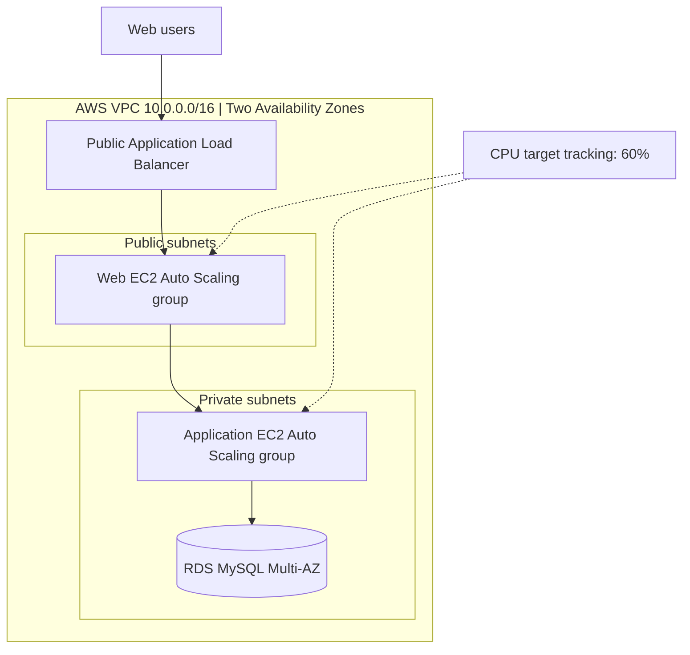
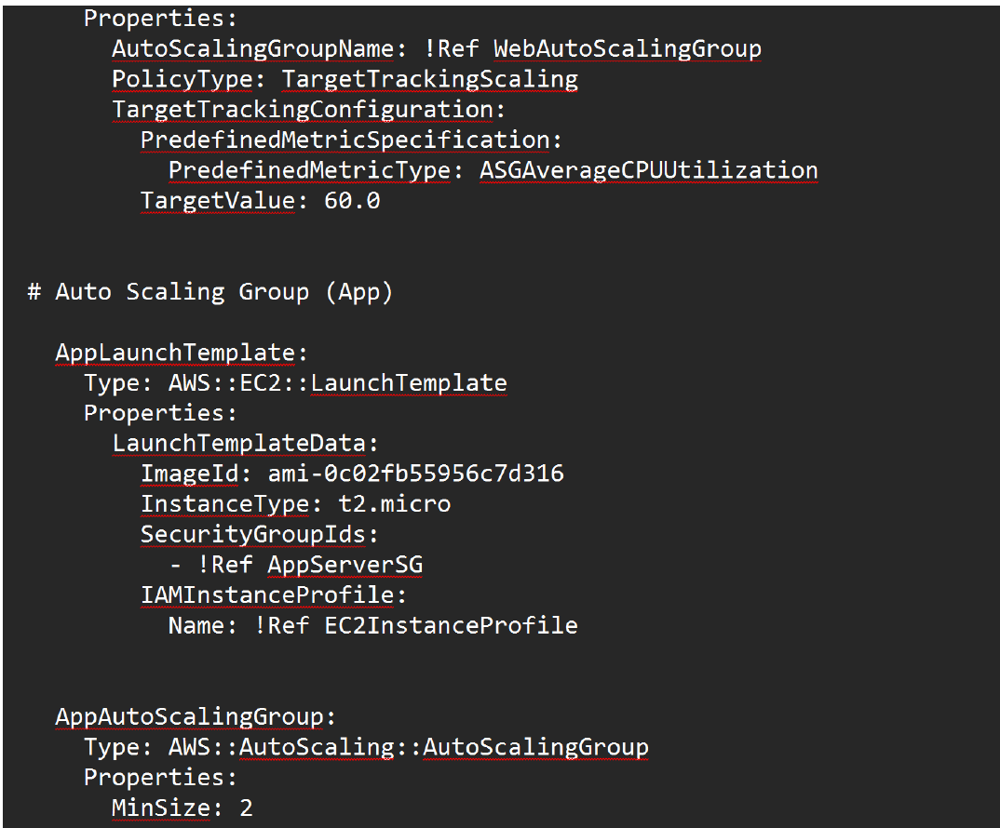
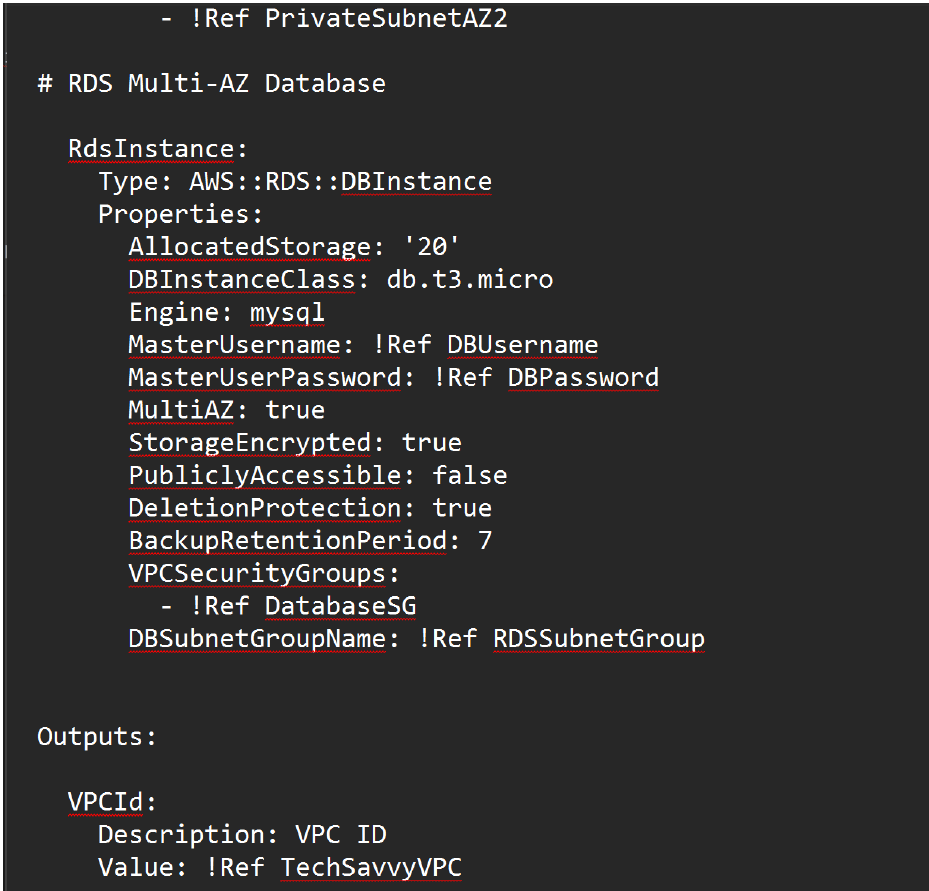

# Infrastructure as Code Across AWS, Azure & Google Cloud

**Cloud infrastructure | Git versioning | Template debugging | Deployment validation**

## Overview

I worked with infrastructure templates across AWS, Microsoft Azure, and Google Cloud to configure resources, fix deployment errors, and check the results. I worked from existing templates, changed their resource settings, resolved configuration problems, and used Git to keep track of revisions.

For my final AWS assignment, I designed a multi-tier web application in CloudFormation with network separation, load balancing, Auto Scaling, and an RDS database. The final assignment includes a detailed infrastructure design. I have not included deployment or failover results that weren't recorded in the lab.

| Platform | Tools | What I worked on |
|---|---|---|
| AWS | CloudFormation, Infrastructure Composer, Git | Debugged YAML templates, verified imports, committed revisions, and developed a scalable web architecture |
| Azure | ARM, Bicep, Azure CLI | Deployed and modified ARM resources, checked an App Service endpoint, and provisioned a storage account |
| Google Cloud | Deployment Manager, Jinja, Cloud Shell | Defined and deployed a VPC and Cloud Storage bucket, then checked the created resources |

## Final AWS Architecture

The final CloudFormation assignment focused on an e-commerce application with separate web, application, and database tiers.

This diagram represents the planned architecture. The report documents the template configuration rather than a completed deployment of the entire application.

| Area | Template configuration |
|---|---|
| Network | VPC `10.0.0.0/16`, two public and two private subnets across two Availability Zones |
| Web tier | Internet-facing Application Load Balancer, HTTP listener, instance target group |
| Access control | Security groups separate load balancer, web, application, and database traffic |
| Scaling | Web and application Auto Scaling groups; minimum 2 and maximum 4 instances; 60% CPU target |
| Database | MySQL RDS instance, `db.t3.micro`, 20 GiB, Multi-AZ, not publicly accessible |
| Data protection | Encrypted RDS storage, seven-day backup retention and deletion protection |
| Instance access | EC2 instance profile with Systems Manager permissions |

### Security Review

The design limits database access to the application security group and keeps the database from being directly publicly accessible. The RDS resource also specifies encryption, backups, and deletion protection.

Before using the template in production I would:

- Use HTTPS with an ACM certificate rather than public HTTP.
- Restrict SSH and favor Systems Manager Session Manager.
- Use a managed database secret; CloudFormation `NoEcho` masks parameter display but does not replace proper secrets management.
- Avoid hard-coding a Region-specific AMI identifier.
- Review NAT availability, logging, patch management and cost.
- Test the full application, scaling, failover, and restoration before making uptime claims.

## Verified Work Versus Design

**Lab results:** Infrastructure Composer accepted the revised CloudFormation templates, Git pushes completed, the Azure ARM checks passed, the Bicep deployment returned `Succeeded`, and Google Cloud displayed the deployed VPC and bucket.

**AWS architecture design:** The final report shows Auto Scaling and RDS configuration in the template. It does not contain a complete deployment, failover, or recovery test.

## Selected Infrastructure Templates

The linked templates include the configurations I worked with during the labs and a revised AWS reference example. Local syntax checks are not substitutes for deploying and testing the resources.

| Platform | Template | Scope |
|---|---|---|
| AWS | [Web and RDS reference](templates/aws-web-rds-reference.yaml) | Two-tier variation with ALB, EC2 Auto Scaling and a private RDS database |
| AWS | [Three-AZ VPC](../../../labs/aws-cloudformation-iac/templates/vpc-three-az.yaml) | VPC, Internet Gateway, three public subnets, routes and outputs |
| Azure | [Parameterized App Service ARM template](../../../labs/azure-arm-bicep-iac/templates/app-service-parameterized.json) | App Service plan and web app with configurable name and location |
| Google Cloud | [Deployment configuration](../../../labs/google-cloud-deployment-manager/templates/deployment.yaml) | Jinja-based network and bucket definitions |

The [AWS reference YAML](templates/aws-web-rds-reference.yaml) is a simplified two-tier revision of the coursework design. It is **not** the complete three-tier final architecture shown above, and I have not claimed it was deployed. It includes a basic web-server bootstrap for the load balancer's HTTP health checks; it does not contain a complete e-commerce application.

## AWS Template Evidence

The screenshots below show configuration from the final CloudFormation assignment. They document the design, not the result of a full stack deployment.

**Web Auto Scaling configuration**

**RDS network and database configuration**

## Related Labs

- [AWS CloudFormation Debugging & Version Control](../../../labs/aws-cloudformation-iac/)
- [Azure ARM & Bicep Deployment](../../../labs/azure-arm-bicep-iac/)
- [Google Cloud Deployment Manager](../../../labs/google-cloud-deployment-manager/)

**Skills:** AWS CloudFormation, Azure Resource Manager, Bicep, Google Cloud Deployment Manager, Jinja, YAML, JSON, Git, GitHub, template debugging, network segmentation, cloud security, deployment testing.

*Completed in authorized cloud training environments.*
