# Linux Infrastructure, Service Deployment & Security Operations

**Focus:** Linux administration, virtualization, network services, containers, system hardening, monitoring, and automation  
**Environment:** Controlled Linux lab using Ubuntu, AlmaLinux, Linux Mint, QEMU/KVM, and Docker

## Project overview

I worked through a series of connected Linux infrastructure and security exercises, starting with virtual machines and network configuration and moving into application hosting, file services, logging, firewall administration, and automated system checks.

The goal was to do more than get software installed. I wanted to understand how the pieces fit together: how Linux machines communicate, how services become available to users, how administrators check that those services work, and how to reduce the risk created when a system is connected to a network.

The work was completed across several lab environments rather than one continuous production deployment. This case study brings the strongest results together and explains the technical decisions, test evidence, and limits of each exercise.

### At a glance

| Area | Work demonstrated | Why it matters |
| --- | --- | --- |
| Infrastructure | Built and managed AlmaLinux and Linux Mint virtual machines with QEMU/KVM and virt-manager | Supports repeatable testing without additional physical hardware |
| Networking | Configured virtual adapters, IP settings, and connectivity between Linux hosts | Establishes the foundation for service availability and troubleshooting |
| Storage and recovery | Managed an additional virtual disk, resized a partition, shared files with Samba, and synchronized data with Rsync | Keeps storage usable and supports controlled file access and recovery |
| Application services | Deployed Nginx and Redis containers; configured Apache, PHP, MySQL, and HTTPS in separate exercises | Demonstrates both containerized and traditional Linux service administration |
| Host security | Reviewed services, configured UFW and firewalld, and tested the effect of network rules | Reduces unnecessary exposure and makes network access intentional |
| Visibility | Configured cross-host Rsyslog, inspected journal entries, and monitored processes and network traffic | Provides evidence for troubleshooting and security investigations |
| Automation | Wrote a Bash disk-check script, registered a custom systemd unit, and checked its output and exit status | Replaces a manual administrative check with a managed task |

## 1. Building the Linux environment

The starting point was an Ubuntu host with **virt-manager and QEMU/KVM** for running multiple Linux operating systems. I configured AlmaLinux and Linux Mint guests, checked their resources and network interfaces, performed updates, and practiced local user and group administration.

Virtual machines were useful here because each system could have its own operating system, network settings, and services without requiring another physical computer. The lab also used VM clones to test configurations while preserving the original machines.

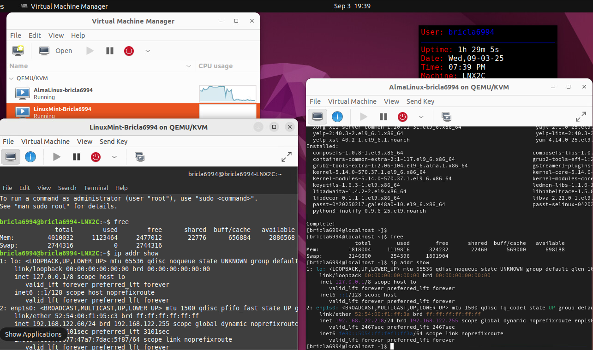

*Ubuntu host with AlmaLinux and Linux Mint guests managed in virt-manager.*


I used commands including:

```bash
ip addr show
free -h
sudo dnf update
sudo apt update && sudo apt upgrade
```

I worked with both network-assigned addresses and manually configured IPv4 settings, then checked communication with `ping`. One completed test documented successful responses from two Linux systems, with **four replies from each and no packet loss** during those tests.

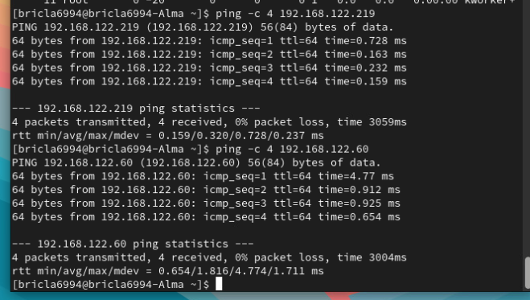

*Both network destinations returned four replies without packet loss in this test.*


**Why it matters:** A web server or security tool is only useful if its underlying operating system, network interfaces, and addressing are working. Establishing a reliable baseline makes later troubleshooting much faster.

## 2. Storage management, file sharing, and backup

### Managing a secondary Linux disk

Using **GParted**, I worked with a separate virtual disk instead of changing the operating system partition. The exercise involved identifying the correct device, unmounting its filesystem, resizing the partition, remounting it, and checking that the mounted storage remained accessible.

The disk was approximately **20 GiB**. The partition view after resizing showed a partition of about **15.64 GiB** and roughly **4.36 GiB of unallocated space**. A subsequent command-line check showed the resized filesystem still mounted at `/home/NewDrive`.

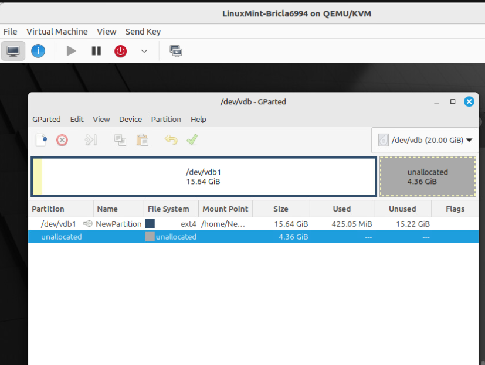

*GParted shows a roughly 15.64 GiB partition and 4.36 GiB unallocated on the second disk.*


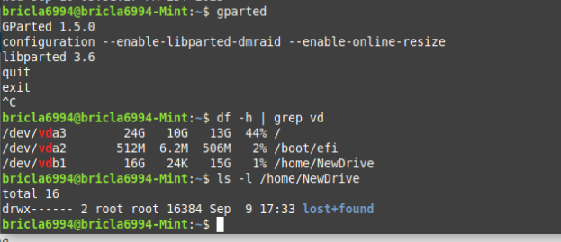

*The resized filesystem remained mounted at /home/NewDrive.*


```bash
df -h
ls -l /home/NewDrive
```

This was a resize exercise, not a demonstration that the unallocated space had been configured as a new filesystem.

### Samba access and Rsync synchronization

In a separate Linux file-services exercise, I installed and configured **Samba** with public and private share definitions. I created the share directories, adjusted ownership and permissions, added a Samba account, checked the configuration, and restarted the service.

From a Linux Mint client, I used `smbclient` to enumerate the available shares. The client output displayed **Public** and **Private** shares, demonstrating that the server's SMB configuration was visible over the network.

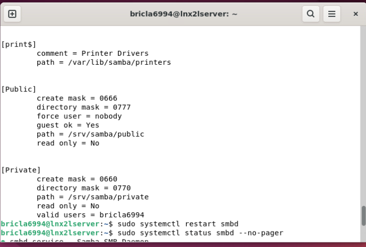

*Samba share definitions on the lab server. The guest-access configuration was for testing, not a recommended production setting.*


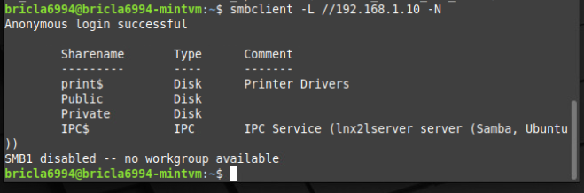

*The Linux Mint client discovered the two shares on the server.*


I then created approximately **100 test files** and synchronized the public-share contents to a backup directory with **Rsync**:

```bash
sudo rsync -av --progress /srv/samba/public/ ~/public_backup/
ls -l ~/public_backup/ | head -20
ls -l ~/public_backup/ | wc -l
```

The destination listing and count confirmed the test files were present.

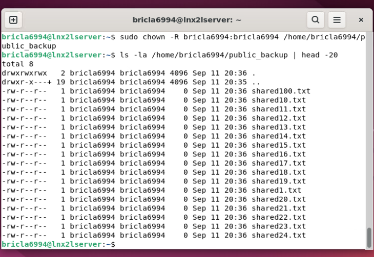

*Files are present in the synchronization destination. A separate [file-count check](screenshots/screenshots/09-rsync-file-count.png) provides additional verification.*
 This was a local synchronization demonstration, not a complete off-site backup or disaster-recovery test.

**Security consideration:** The public share in the exercise used permissive access settings to demonstrate guest connectivity. For a real organization, I would restrict write permissions, use authenticated access for sensitive files, and verify that backups are recoverable.

## 3. Deploying applications with Docker

I worked with containers to run services independently of the host's normal package installation. Containers are useful for packaging applications with their dependencies and simplifying deployment, testing, and removal.

### Nginx web service

I pulled an Nginx image, served static HTML content from a container, and mapped **container port 80 to host port 8080**. I checked the container and accessed its web page through a browser.

The page was stored outside the container and mounted into it. This made it possible to change the site files without rebuilding the image.

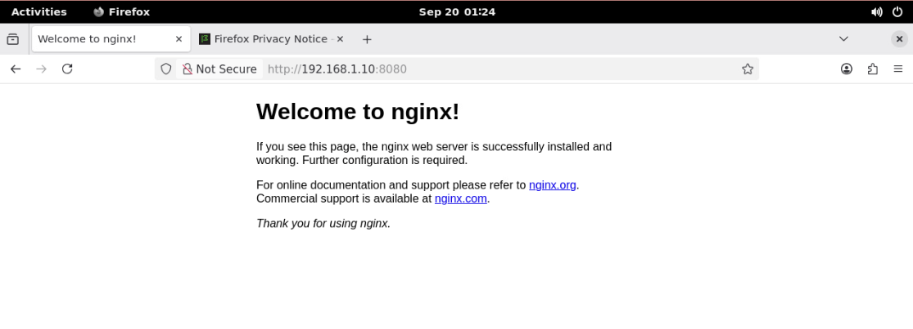

*The Nginx container responded to a browser request over the mapped HTTP port.*


### Redis data service

For a different type of service, I deployed **Redis**, an in-memory key-value store often used for caching and session data. I checked the container using its command-line client:

```bash
docker exec -it my-redis redis-cli PING
# PONG

docker exec -it my-redis redis-cli SET myKey "Hello from the Linux lab"
docker exec -it my-redis redis-cli GET myKey
```

The screenshots document the `PONG` response and the sample value being written and retrieved. These tests demonstrate service availability and basic data operations, not performance, persistence, or authentication testing.


*Redis answered the basic health check.*


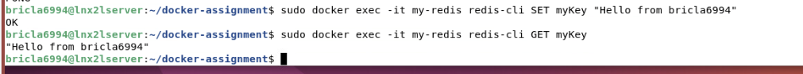

*A sample key was written and retrieved through the Redis container.*


### LAMP in a container and on a Linux host

I also worked with the **LAMP stack**, which combines Linux, Apache, MySQL, and PHP. In one exercise, I ran a LAMP container and viewed a custom web page from another virtual machine. In a separate exercise, I installed and configured the components directly on Linux.

Working with both approaches helped illustrate a practical difference: a container packages the runtime into a deployable unit, while a traditional installation requires the administrator to configure and maintain each service on the host.

**Security consideration:** Publishing container ports on all host interfaces may expose services beyond the intended clients. Redis in particular should not be publicly accessible without appropriate network restrictions and security controls.

## 4. Apache, PHP, MySQL, and HTTPS

In the direct-installation exercise, I configured an Apache web server, checked that it was running, and edited the site content.

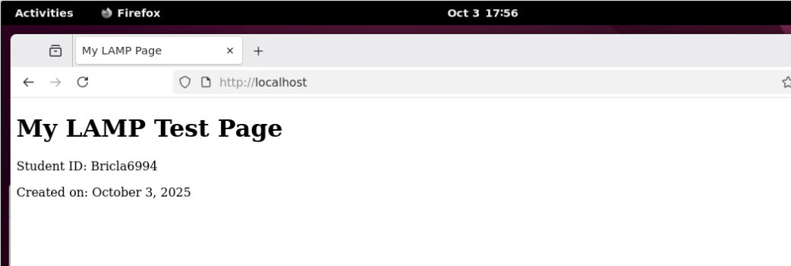

*The Apache server displayed the edited test page.*
 I then installed PHP and confirmed that a simple script returned **Hello World**.

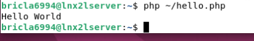

*PHP executed a short script successfully from the command line.*


For MySQL, I installed the server, worked through its security setup, created an example database and user, and confirmed access from the MySQL command-line client. I also checked database listings.

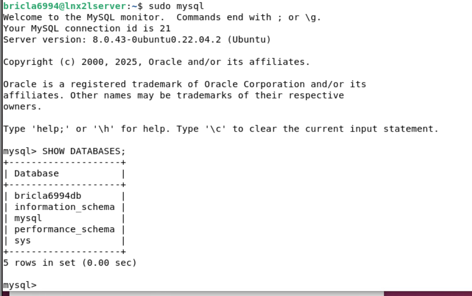

*MySQL accepted the SQL command and displayed the available databases.*


For HTTPS, I generated a **self-signed certificate**, configured the Apache SSL site, and opened the site through HTTPS. The browser displayed a certificate warning, which is expected when a certificate is not trusted by the browser.

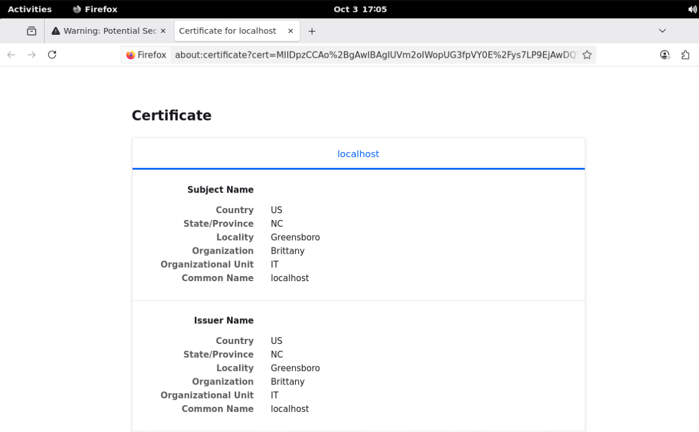

*The HTTPS exercise used a self-signed certificate. It is not evidence of a publicly trusted certificate.*


I then used UFW to allow the web service's HTTP and HTTPS ports and inspected the resulting rules.

**What this demonstrates:** I could get the individual application components running, test the web and database services, and configure encrypted web transport. A self-signed certificate is useful in a lab, but a public-facing service should use a valid certificate from a trusted certificate authority.

## 5. Linux firewall administration and host hardening

I explored two Linux firewall interfaces in different exercises.

### UFW: controlling exposed services

With **UFW**, I reviewed listening services, adjusted inbound rules, removed permissions no longer needed, and inspected the final rule set.

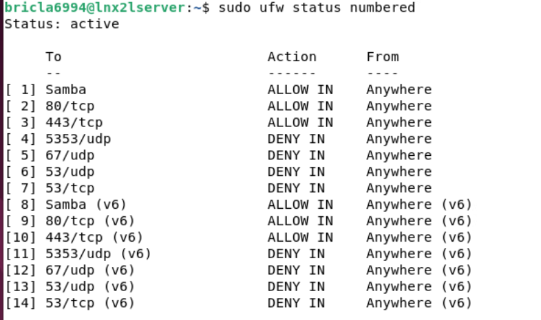

*The rules show allowed web and Samba traffic alongside denied DNS ports. Broadly accessible services would need further restrictions in production.*
 I used `systemctl`, `ss` or `netstat`, and firewall status commands to understand which services could accept connections.

A firewall cannot repair a vulnerable application, but it can reduce the number of services exposed to other systems. This is an important part of a defense-in-depth approach.

### firewalld: assigning policies by network zone

With **firewalld**, I inspected available zones and configured interfaces associated with different levels of network trust. I reviewed `public`, `internal`, and `external` settings and tested connectivity after changes.

The screenshots show interface-to-zone reassignment and a later **network-unreachable result** in a connectivity test. That result demonstrates that policy and interface changes affected the lab's connectivity. It is not, by itself, proof of a complete or correctly hardened network design.

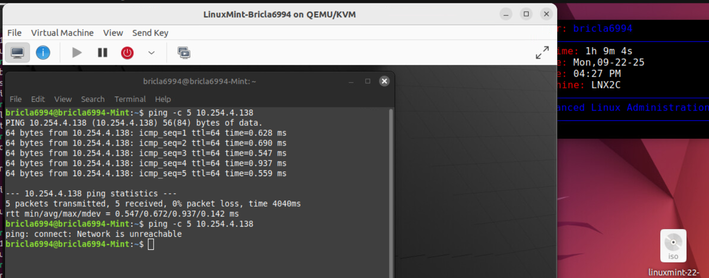

*The connectivity result changed after network/firewall policy adjustments.*


```bash
sudo firewall-cmd --get-active-zones
sudo firewall-cmd --zone=public --list-all
sudo ufw status verbose
```

I treated firewall administration as both a security exercise and a troubleshooting exercise: a rule can stop unwanted traffic, but a mistaken rule can also block legitimate access.

## 6. Centralized logging and system monitoring

### Collecting logs from another Linux machine

One of the most useful exercises was configuring **Rsyslog** on AlmaLinux to receive messages from a Linux Mint client using **TCP port 514**.

The work included starting and enabling the logging service, backing up its configuration, enabling TCP input, adjusting firewall access, and configuring the Mint client to forward messages to the server.

I then generated a test event from Mint:

```bash
logger "test log message from the Mint client"
```

On AlmaLinux, I searched the collected logs:

```bash
grep "Mint client" /var/log/messages
```

The server output included the message generated on Mint.

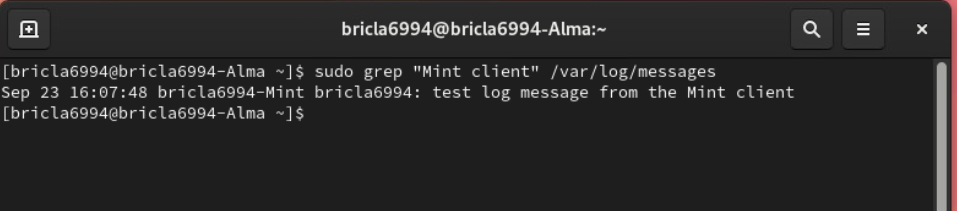

*The test event originating on Mint appeared in the AlmaLinux server log.*
 This was the clearest evidence of cross-host log delivery in the project.

Centralizing logs matters because administrators should not have to sign in to every device individually to look for errors, unexpected behavior, or events related to an incident.

**Security consideration:** Basic syslog over TCP does not encrypt the content. Production log forwarding should use appropriate TLS protection and access controls where supported.

### Looking for resource problems and unusual activity

I used Linux tools to inspect process activity, resource consumption, network traffic, and operating system messages:

| Tool | What I used it to examine |
| --- | --- |
| `top`, `htop`, `ps` | Running processes and CPU or memory consumption |
| `free`, `df`, `vmstat` | Memory, filesystem utilization, and system activity |
| `iptraf-ng` | Traffic statistics on an individual network interface |
| `journalctl` | Service history, warnings, and events within selected time ranges |
| `systemctl` | Whether a service was running and configured to start automatically |

I also reviewed unnecessary services and used service-management commands during the hardening work. These checks do not constitute a full security monitoring platform, but they are the basic skills needed to investigate a slow system, a failed service, or suspicious network behavior.

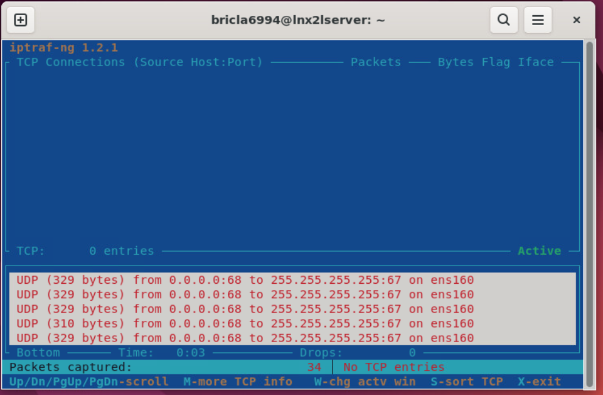

*IPTraf-ng provided interface-level traffic visibility during the lab.*


## 7. Automating a disk-usage check with systemd

To move beyond manual commands, I created a Bash script that gathered disk utilization information and wrote it to a report under `/root`:

```bash
#!/bin/bash
date
df -h > /root/df_report.txt
```

The script printed the date separately and redirected the disk-usage table into the report file. I registered the script with a custom `df-check.service` unit in `/etc/systemd/system/`, set the requested file permissions, reloaded the service manager, enabled the unit, and started it.

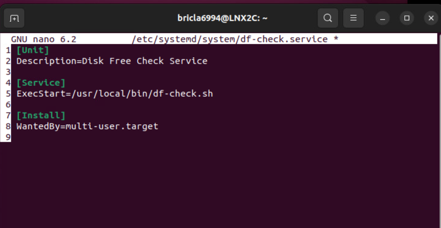

*The service unit points systemd to the Bash disk-check program.*


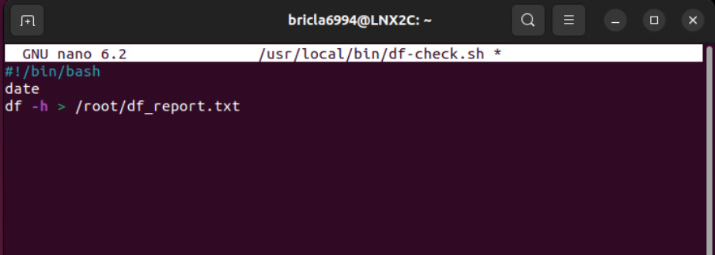

*The script writes the filesystem utilization table into a text report.*


```bash
sudo systemctl daemon-reload
sudo systemctl enable df-check
sudo systemctl start df-check
sudo systemctl status df-check
sudo cat /root/df_report.txt
```

The service status recorded **`status=0/SUCCESS`** and the report contained filesystem utilization data. The unit showed **`inactive (dead)` after the command completed**, which is consistent with a short task that exits.

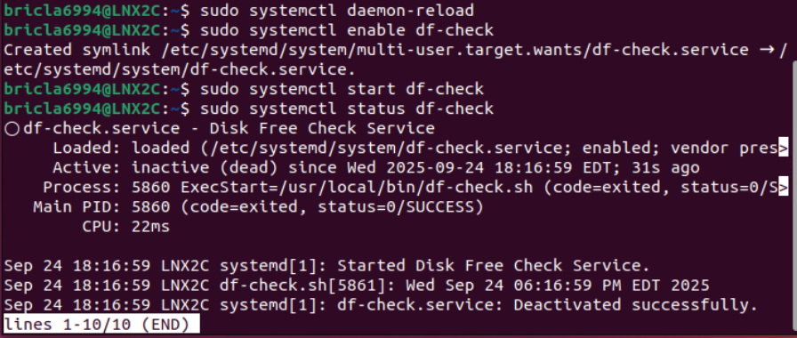

*Systemd recorded a completed run with status 0/SUCCESS.*


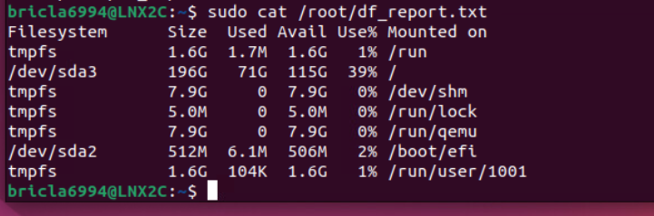

*The text report contains filesystem usage information from the disk-check script.*
 This was not a continuously running monitoring daemon.

After testing, I stopped and disabled the unit.

For a longer-term implementation, I would explicitly define the service as `Type=oneshot`, use a `systemd` timer for recurring execution, and restrict the unit file to root-controlled permissions.

## 8. Additional secure-access work

I also documented installation and configuration steps for **WireGuard** and **vsftpd**, including VPN key generation, interface settings, IP forwarding, and firewall changes.

The WireGuard screenshots show interfaces configured and activated, but the available client status showed traffic sent with **no bytes received and no confirmed handshake**. I have therefore not counted the VPN as a verified working tunnel. The FTP exercise demonstrates service configuration, but does not establish a secure, TLS-protected file-transfer session.

These exercises helped reinforce how important it is to distinguish a service that starts from a service that has been securely configured and tested end to end.

## What I would improve before a production deployment

This lab intentionally included permissive configurations, self-signed certificates, and locally exposed services to make the exercises testable. I would address the following before using a similar design for a business:

1. Replace permissive Samba access with authenticated users, role-based permissions, and tested backup restores.
2. Restrict published container ports; isolate Redis from untrusted networks and enable appropriate authentication.
3. Use trusted TLS certificates for web services and encrypted transport for centralized logs.
4. Review firewall rules against a documented service inventory and test both allowed and denied connections.
5. Run recurring disk checks with a systemd timer, keep their output in a managed location, and alert on thresholds.
6. Re-test VPN connectivity with a confirmed peer handshake, route checks, and packet-transfer evidence before calling the tunnel operational.

## Results and skills demonstrated

The strongest outcome is the combination of **configuration and proof**. I did not just install services. I tested a Linux client's access to shared resources, checked files after synchronization, opened web content served from containers and Apache, confirmed Redis requests, inspected firewall effects, traced a log event across two machines, and reviewed the output of a custom systemd task.

This project demonstrates practical work in Linux administration, service deployment, network troubleshooting, storage management, host security, logging, and automation. It also shows why verification and honest reporting of limitations matter just as much as a successful installation.

**Lab boundary:** All activity was performed in authorized training environments. This repository does not publish passwords, VPN private keys, or restricted course materials.

[Back to Linux projects](../) | [All projects](../../) | [Portfolio home](../../../)
