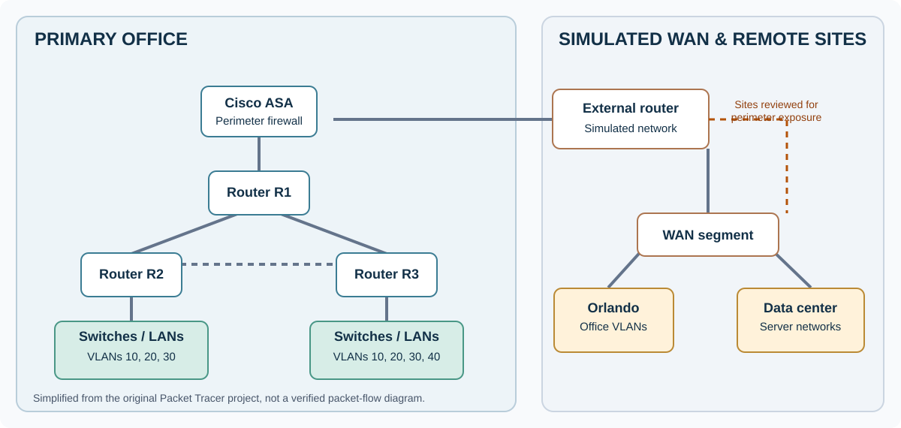

# Enterprise Network Integration, Segmentation & Security

**Cisco Packet Tracer | Network design | VLANs | Routing | DHCP | TACACS+ | Cisco ASA | Access control**

## Overview

I worked with a three-person team on a simulated corporate network integration. The design connected a primary office, an Orlando office, and a data center while supporting separate departmental networks, shared services, and remote-access requirements.

My main responsibilities were the IP addressing plan and configuration of the primary site's routers and switches. I also worked on centralized authentication, firewall configuration, troubleshooting, and the network security review.

This was a Packet Tracer project, not a production deployment.

## Network layout

The diagram shows the major sites and routing relationships from the project. It is a simplified architecture view, not a record of tested firewall policy or traffic flows.

## Implementation

**Addressing and switching.** I prepared the interface addressing table and worked with variable-length subnet masks to accommodate different department sizes. On the primary site I configured routers R1, R2, and R3 and switches SW1, SW2, and SW3. I created departmental VLANs, assigned switch ports, configured trunk links, and used router subinterfaces for inter-VLAN routing.

**Network services.** I configured DHCP pools for several department networks on R2 and R3, including subnet, default gateway, and DNS settings. I also configured a TACACS+ service for centralized router authentication. The project documentation includes the AAA server's configured router clients and a router login prompt.

**Perimeter controls.** I worked on a Cisco ASA firewall between the main network and the simulated external network. The team's security summary also records an ACL on R1. Firewall placement and documented ACL configuration do not, by themselves, prove that every unauthorized path was blocked.

## Verification

The original project captures show several useful checks:

| Area | Evidence recorded | What it establishes |
|---|---|---|
| VLAN configuration | `show vlan brief` lists active departmental VLANs and assigned access ports | Switch VLAN membership was configured |
| Routing | Router console shows OSPF neighbor state messages and an EIGRP neighbor event | Routing neighbor activity was observed |
| Connectivity | A workstation ping to simulated server `11.1.1.10` succeeded with four replies after an earlier failed attempt | Basic reachability succeeded in that test |
| DHCP | Router configuration screens show pools, networks, and default gateways | DHCP settings were entered, but lease allocation is not independently demonstrated |
| AAA | TACACS+ server client entries and a router login prompt | Centralized authentication was configured, but the screenshots do not isolate a complete server-side authentication test |

These results support specific configuration and connectivity checks. They do not establish complete site-to-site coverage, deny-rule enforcement, failover, or production readiness.

## Security assessment

I reviewed the topology and prepared the risk and mitigation material for the team's presentation.

| Risk identified | Recommended improvement |
|---|---|
| A single perimeter firewall could become a point of failure | Add appropriate redundancy and test failover |
| A single TACACS+ server could interrupt centralized administration | Harden the service, maintain protected fallback access, and plan for service redundancy |
| Orlando and data center routers had direct connections to the simulated external router | Apply perimeter inspection and explicit access rules to each exposed site |
| Remote administration could expose credentials or management interfaces | Use encrypted remote access, restrict management sources, and require authenticated VPN access where appropriate |

Those were **recommendations**, not changes I am claiming were deployed or verified.

## Design review and next steps

The final report describes a functioning lab, but the documentation also contains inconsistent addressing entries, including overlapping proposed subnet ranges. I would reconcile the addressing plan against each router's running configuration before treating this design as deployable.

My next validation steps would be to:

1. Resolve overlapping subnets and verify DHCP leases, gateways, and inter-VLAN routes.
2. Capture explicit permitted and denied traffic tests for the ASA and router ACLs.
3. Verify TACACS+ authentication, logging, and recovery when the AAA server is unavailable.
4. Test remote-site connectivity, redundancy, and routing convergence after a link failure.

## Tools

Cisco Packet Tracer, Cisco IOS, Cisco ASA 5506-X, VLANs, 802.1Q trunking, DHCP, TACACS+/AAA, routing protocols, and access control lists.

The original project file and credential-bearing screenshots are not published because they contain demonstration accounts and shared secrets.

[Networking projects](../) | [Project index](../../) | [Portfolio home](../../../README.md)
