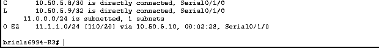

# Enterprise Network Routing and Secure Device Administration

**Cisco Packet Tracer | Cisco IOS | Multi-Area OSPF | BGP | TACACS+ | RADIUS | SSH | Cisco ASA | Syslog**

## Project overview

I worked through a connected multi-router simulation with separate departmental networks and an Internet-facing router. I replaced static routes with OSPF, introduced BGP at the edge, configured centralized authentication, and secured remote device management with SSH. I later added an ASA firewall to the perimeter scenario.

The work took place in Packet Tracer, not a production network.

## Routing and segmentation

- Configured separate VLANs, router subinterfaces, and addressing for departmental and service networks.
- Replaced static routes with OSPF and organized internal interfaces and transit links into different areas.
- Established BGP peering between the edge router and a simulated Internet router.
- Redistributed BGP routes into OSPF so internal routers could learn external prefixes.

After redistribution, the captured R3 routing table showed `11.1.1.0/24` as an `O E2` route. The lab also documented successful five-packet ICMP tests from R2 and R3 to the simulated Internet server after changes to BGP advertisements. These results show basic route learning and connectivity, not tested convergence under failure.

## Administrative access and monitoring

I configured a TACACS+ service on a dedicated VLAN for router login and worked with local fallback accounts. A separate wireless exercise used RADIUS with WPA2-Enterprise. I also configured syslog collection to observe network events.

For remote access, I changed router VTY lines from Telnet to SSH, generated 2048-bit RSA keys, and set up management access to three switches. Captured sessions showed successful SSH logins and rejected Telnet attempts after the conversion.

The screenshot is a switch CLI session from the lab. No credentials are exposed.

## ASA firewall stage

In a later phase, I placed a Cisco ASA 5506-X between the edge router and the simulated Internet connection. I configured inside and outside interfaces, route exchange using EIGRP, and an interface NAT network object. The exercise included route inspection and an Internet reachability test.

I did not document a separate test of unsolicited inbound traffic being blocked. Installing the firewall and verifying routing are not substitutes for a validated security rule set.

## Security review

The main lesson was that segmentation and secure administration depend on consistent routing, address allocation, authentication, and device configuration. For a real deployment I would:

1. Move device management away from default VLAN 1 and restrict SSH by trusted source addresses.
2. Replace shared training credentials with unique accounts, managed secrets, and centralized authorization.
3. Test TACACS+ outage recovery, denied management access, and auditing of administrative actions.
4. Validate ASA access rules and NAT behavior with explicitly permitted and denied traffic.
5. Measure routing reconvergence and test alerting after interface failure.

I have not published full device configurations because the source exercise included demonstration passwords and keys.

[Networking projects](../) | [Project index](../../) | [Portfolio home](../../../README.md)
