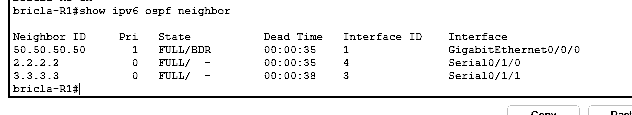
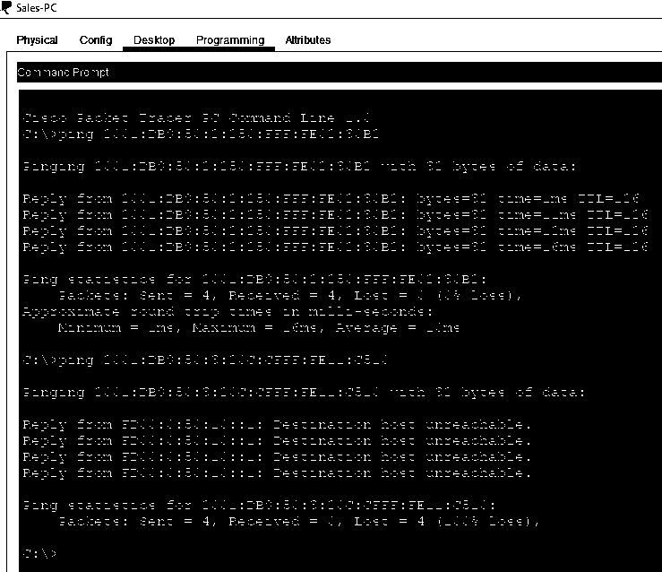

# IPv6 Routing, Firewall Policy and Layer 2 Security

**Cisco Packet Tracer | IPv6 | OSPFv3 | IPv6 ACLs | Cisco ASA | Switch Port Security**

## Project overview

I worked with routed IPv6 networks across Cisco routers and switches, then configured restrictions for access to departmental systems. The tasks included OSPFv3 routing, IPv6 access lists, an ASA perimeter device, and switch port security.

The supporting exercises used related but different IPv6 address plans. The screenshots should not be interpreted as one unchanged topology.

## IPv6 addressing and routing

The training topology included three internal routers, department VLANs, a simulated Internet router, and /64 IPv6 networks. I replaced static IPv6 routes with OSPFv3, assigned router IDs, and placed LAN and transit interfaces into the relevant OSPF areas.

I checked the result using `show ipv6 interface brief`, `show ipv6 ospf neighbor`, and `show ipv6 route`. The R1 output showed three OSPFv3 neighbors in the `FULL` state.

Full neighbor state confirms database synchronization on those links. It does not alone establish end-to-end connectivity across every subnet.

## IPv6 ACL validation

I applied IPv6 access restrictions to departmental traffic. One recorded Sales-PC test shows four successful replies from a permitted IPv6 destination, followed by four unsuccessful attempts to a different destination that returned destination-unreachable messages.

That result is consistent with the intended separation between departments. A stronger verification would include the exact active access list, direction and interface binding, and hit counters, to show that a specific deny entry caused the failed traffic.

## Firewall and access-switch configuration

I configured IPv6 interface addressing and OSPFv3 on a Cisco ASA added to the edge of a related topology. On access switches, I applied a one-MAC-address limit, sticky learning, and the `restrict` violation action. The source screenshots include `show port-security` output.

Those captures show saved settings and counters. They do not include a test connecting a second unauthorized endpoint, so I cannot claim that the violation response was independently demonstrated.

## Improvements I would make

- Record source, destination, expected action, and observed outcome for each IPv6 ACL test.
- Verify ACL hit counts and return paths after applying policy changes.
- Deliberately trigger and document a port-security violation in the isolated lab.
- Check firewall policy behavior with both permitted and denied inbound traffic.
- Save sanitized router configurations for a repeatable version of the topology.

This work reinforced the difference between creating a security control and verifying that the control caused the behavior seen in testing.

[Networking projects](../) | [Project index](../../) | [Portfolio home](../../../README.md)
