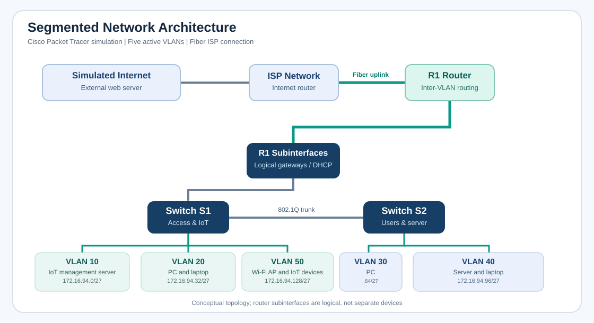

# Secure Network Design, VLAN Segmentation, IoT Integration & Routing

**Cisco Packet Tracer | Routing and switching | Network security | IoT**

[Portfolio home](../../../README.md) · [Networking projects](../) · [All projects](../../)

## Project overview

I built a small network in Cisco Packet Tracer and expanded it in stages until it supported separate user and server networks, wireless smart devices, simulated Internet access, and switch-level security controls.

The starting point was straightforward: one router, one switch, a desktop, a laptop, and a server. From there, I introduced a second switch, redesigned the IP addressing, divided the network into VLANs, connected an IoT access point and four smart devices, and added an external connection. I finished by testing how the network behaved when an unauthorized computer was connected and by comparing static routing, RIPv2, and OSPF.

The main challenge was keeping the network working while its design changed. Each phase required updating more than one piece of the configuration. A new subnet affected gateway addresses and DHCP pools; a new VLAN required the correct switch port, trunk, and router subinterface; and changing the Internet connection meant checking routing and reachability again.

This was a **simulated network**, not a production installation. The topology, configurations, and test results were recorded in Packet Tracer.

## Network at a glance

| Component | Final design |
| --- | --- |
| Network equipment | Cisco ISR 4331 router and two Catalyst 3560 switches |
| Segmentation | Five active VLANs for servers, users, and IoT devices |
| Addressing | `172.16.94.0/24` divided into `/27` subnets |
| Device addressing | Router-based DHCP pools; a fixed address for the IoT management server |
| Wireless IoT | Access point, motion detector, thermostat, and two cameras |
| External access | Simulated ISP and web server; cable connection later changed to fiber |
| Routing | Router subinterfaces, static/default routes, RIPv2, and multi-area OSPF |
| Network controls | Console and remote-access configuration, static MAC restrictions, sticky MAC learning, and shutdown-on-violation testing |

*Simplified view of the final topology. The original Packet Tracer screenshots show device-level connections and configuration evidence.*

## 1. Building the network and checking connectivity

I began with a single LAN and assigned IPv4 settings to the router, desktop, laptop, and IoT server. I used ICMP ping tests in both directions, including host-to-router and host-to-server tests, to confirm that devices could communicate on the local network.

I then added a second Catalyst switch with another desktop, laptop, and server. This introduced two distinct network segments, each connected to a separate interface on the router.

Instead of keeping the original `/24` network as one large address space, I split it into two `/25` networks. I configured the router interfaces as the default gateways, created DHCP pools, checked the assigned addresses on the endpoints, and tested connectivity between the segments.

This was the first point where I had to think beyond whether an Ethernet cable was connected. A host could have a working link and still be unreachable because of an incorrect address, subnet mask, gateway, or DHCP configuration.

## 2. Moving from subnets to VLANs

The next change was to introduce a wireless access point and smart devices while moving to VLAN-based segmentation.

I initially divided the address space into four `/26` subnets. Router subinterfaces provided the gateways, and switch ports were assigned to the appropriate VLANs. IEEE 802.1Q trunking carried tagged VLAN traffic across the relevant links.

When the simulated Internet connection was added, I redesigned the network into eight possible `/27` subnets and used five of them. Each `/27` provides 32 IPv4 addresses, including network and broadcast addresses, leaving **30 usable host addresses** per subnet.

### Final active VLANs

| VLAN | Purpose | Network | Default gateway | Examples |
| --- | --- | --- | --- | --- |
| 10 | IoT management server | `172.16.94.0/27` | `172.16.94.1` | Management server, `172.16.94.10` |
| 20 | User devices on S1 | `172.16.94.32/27` | `172.16.94.33` | Desktop, `172.16.94.34` |
| 30 | User device on S2 | `172.16.94.64/27` | `172.16.94.65` | Desktop, `172.16.94.66` |
| 40 | Server and user device on S2 | `172.16.94.96/27` | `172.16.94.97` | Server, `172.16.94.98` |
| 50 | Wireless IoT devices | `172.16.94.128/27` | `172.16.94.129` | Motion sensor, thermostat, two webcams |

VLANs 10, 20, and 50 were served from S1. VLANs 30 and 40 were served from S2. The two switches were connected by a trunk, and the local router handled traffic that needed to move between IP networks.

The practical value of this design is that devices no longer share one broadcast domain. Users, servers, and smart devices have separate logical networks even when they connect through shared infrastructure.

**Important security distinction:** VLAN separation does not automatically mean that traffic between VLANs is blocked. The router can still forward between them. Filtering would require appropriate access control lists or firewall rules, which were not established as part of the captured tests.

## 3. DHCP and address management

Every subnet needed an appropriate gateway and DHCP scope. As the network changed from `/25` to `/26` and then `/27`, I updated the router configuration and renewed addresses on the desktops, laptops, servers, and wireless devices.

The device screenshots show successful DHCP leases with the expected subnet masks and gateway addresses. I used the router's `show ip interface brief` and `show running-config` output to check the configured interfaces and DHCP pools.

I kept the IoT management server at the fixed address `172.16.94.10` in the final Internet-connected configuration. Giving a management service a stable address matters because other devices need to find it reliably.

This part of the project reinforced a useful troubleshooting habit: when a device stops communicating after a network change, check its assigned IP address, mask, gateway, and VLAN before assuming the routing protocol is broken.

## 4. Integrating and managing IoT devices

I connected a wireless access point to the switched network and added a motion detector, a thermostat, and two security cameras. These devices were grouped into VLAN 50 rather than being placed in the same subnet as the management server or user desktops.

I enabled the IoT registration service on the management server, registered the four devices to it, and checked that they appeared in the server's device list. The recorded interface showed the motion detector, thermostat, and both cameras registered and online.

I also used the management interface to interact with the thermostat, demonstrating that the server could communicate with a device across the segmented network.

For a nontechnical reader, this is similar to a small office where computers and smart-building devices use different networks but can still be managed through a designated system.

The screenshots of the wireless settings do **not** establish secure Wi-Fi authentication. In a real deployment I would use authenticated wireless access, dedicated IoT policies, restricted management access, and firewall rules that allow only the traffic those devices actually need.

## 5. Connecting the internal network to an external service

The internal network was connected to a simulated ISP environment with a modem, coaxial connection, and an external web server. I configured the local router's default route toward the ISP gateway and a return route in the simulated Internet network.

I checked the routing table, tested reachability from internal devices to the external server, and loaded the simulated server's web page from a desktop browser.

Later, I replaced the cable Internet connection with a fiber-based link through the simulated fiber repeater. I ran another reachability test from an internal computer after the change.

These tests showed the difference between **having a physical connection** and having a complete working route. The internal client needs an outbound path, and the external network needs a route back to the internal address space.

The ISP and server were Packet Tracer devices. These results demonstrate routing to the provided simulation, not access to the public Internet.

## 6. Testing switch port security

This was one of the most useful security portions of the project because I could see what happened when a device violated the access policy.

On S1, I configured an access port to accept the MAC address of the original desktop. I disconnected that desktop, connected an unfamiliar computer to the same port, and tried to obtain an address through DHCP. The new computer did not obtain a valid lease, and the switch port entered a disabled state after the violation.

On S2, I configured sticky MAC address learning, limited the permitted MAC addresses to one per access port, and selected shutdown as the violation action. I repeated the device-swap test and recorded the DHCP failure. Returning the original computer to the port was not enough by itself: the affected switch interface needed to be brought down and back up before connectivity was restored.

### What the tests established

| Test | Observed behavior | Security significance |
| --- | --- | --- |
| Original authorized computer connected | Normal access before the swap | Establishes the expected endpoint |
| Different computer connected to a restricted port | DHCP request failed and the port was disabled | MAC-based port security rejected the changed endpoint |
| Original computer reconnected | Connectivity did not immediately return | Shutdown-on-violation left the port disabled |
| Affected port reset administratively | Original host could request an address again | Demonstrates recovery after the access violation |

A MAC restriction is a useful Layer 2 control, but it is not the same as authenticating a person or device. MAC addresses can be spoofed. For a production network I would also consider IEEE 802.1X, endpoint identity checks, logging, and an incident procedure before re-enabling a port.

## 7. Comparing static routing, RIPv2, and OSPF

After using static routes to establish external connectivity, I tested two dynamic routing approaches: RIPv2 and OSPF.

With RIPv2 configured, the routing table showed the external `11.1.1.0/24` network as a RIP-learned route. I tested connectivity to the simulated Internet server after removing the original static default route.

I then configured OSPF with multiple areas and inspected the routing table again. The external network appeared as an `O IA` route, meaning OSPF had learned it from another area. I repeated the ping test using the OSPF route.

An important detail is **why the routing table selected the OSPF route**. When the same destination is offered by both protocols under standard Cisco IOS defaults, OSPF's administrative distance of 110 takes precedence over RIP's 120. Seeing an OSPF route in the table does not, by itself, prove that RIP was disabled everywhere.

This comparison made the routing table much more meaningful. Instead of just entering configuration commands, I could identify where a route came from and whether a host could actually use it.

## 8. Device access and configuration persistence

I configured local management access on the router and both switches, including console, auxiliary, and virtual terminal lines, user authentication, and privileged-mode passwords. I also saved running configurations to startup configuration so they would survive a device restart.

The device-access settings were configured in a controlled Packet Tracer environment. They included legacy password handling and Telnet as an allowed management protocol. **I would not carry those settings into a production build.** Telnet transmits data without encryption, and Cisco IOS `service password-encryption` is not a substitute for strong secret storage.

A production configuration should use SSH-only administration, unique strong credentials or centralized authentication, restricted management source networks, appropriate password hashing, and logging.

## Results and lessons from the build

- **A working network was expanded without starting over.** I went from one LAN to a two-switch design with five active VLANs.
- **Addressing and gateway changes were tested.** DHCP results and endpoint configurations were checked after the subnet changes.
- **Four smart devices were registered with a management service.** Their presence in the IoT console and thermostat control were recorded.
- **External connectivity was tested twice.** The simulated server was reachable with the original Internet connection and after the switch to fiber.
- **An unauthorized device was rejected.** The port-security tests showed a failed DHCP attempt, a disabled switch interface, and the recovery process.
- **RIPv2 and OSPF routes were inspected and tested.** The recorded tables showed the learned route and the later OSPF inter-area route.

The biggest lesson was that network changes have dependencies. VLAN membership, DHCP scopes, gateways, routing, and access rules all need to agree. A link light alone does not tell you that the design is correct.

## What I would improve in a production environment

The simulation established connectivity and demonstrated selected controls. It was not a comprehensive security audit. For a production version of this design, I would:

1. Apply inter-VLAN ACLs or firewall rules based on the services each segment actually needs, especially the IoT VLAN.
2. Secure wireless access and replace shared or default credentials with unique, properly protected credentials.
3. Limit device administration to SSH from a dedicated management network and enable centralized logging and time synchronization.
4. Add DHCP snooping, Dynamic ARP Inspection, and 802.1X where the switches and operational requirements support them.
5. Keep infrastructure and management servers on fixed addresses or DHCP reservations with exclusions to avoid conflicts.
6. Validate failure recovery, configuration backups, monitoring, and routing adjacencies before treating the design as production-ready.

## Tools and technologies

Cisco Packet Tracer · Cisco IOS CLI · ISR 4331 · Catalyst 3560 · IPv4 subnetting · DHCP · VLANs · IEEE 802.1Q · Router subinterfaces · ICMP · Static routing · RIPv2 · Multi-area OSPF · MAC-based switch port security · IoT registration server · Simulated cable/fiber ISP connection

---

[Networking projects](../) · [All projects](../../) · [Portfolio home](../../../README.md)
