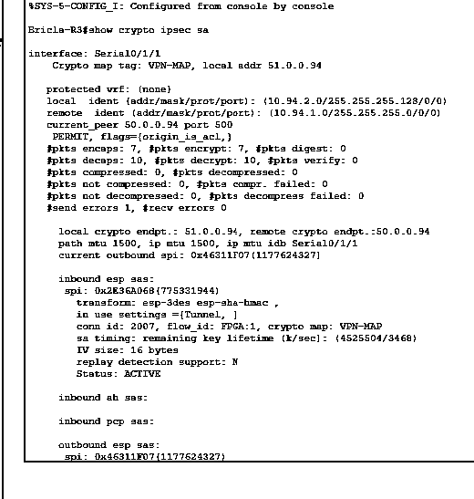
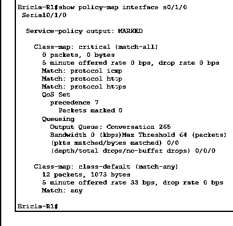

# Site-to-Site IPsec VPN and Quality of Service

**Cisco Packet Tracer | Cisco ISR | VLANs | OSPF | IPsec | IKEv1 | QoS**

## Project overview

I configured two simulated routed sites connected through a provided Internet cloud. After setting up VLANs, subinterfaces, DHCP and OSPF, I added a policy-based IPsec VPN between the site routers and inspected security association output. I also attached and inspected a QoS policy on the outgoing WAN links.

This exercise showed both working components and areas that needed more verification.

## Network topology

~~~mermaid
flowchart LR
    A["Site A VLANs and hosts"] --- R1["Router R1"]
    R1 --- WAN["Provided Internet cloud"]
    WAN --- R3["Router R3"]
    R3 --- B["Site B VLANs and hosts"]
    R1 -. "IPsec peer connection" .- R3
~~~

The two site LANs were `10.94.1.0/25` and `10.94.1.128/26` at R1, and `10.94.2.0/25` and `10.94.2.128/26` at R3. I configured VLAN access and trunk ports, router subinterfaces and OSPF before adding encryption.

## IPsec configuration

I created mirrored access lists to select cross-site traffic, configured an ISAKMP policy with pre-shared authentication, built an IPsec transform set, and attached crypto maps to the outbound serial interfaces.

The exercise used IKEv1, AES for the ISAKMP policy, Diffie-Hellman group 2, and an ESP transform set using 3DES and SHA-HMAC. These were historical training settings and are not a recommended production configuration.

I checked `show crypto ipsec sa` on both routers. The R3 capture shows active ESP security associations with seven encrypted packets and ten decrypted packets.

The R1 capture showed eleven decrypted packets but zero encrypted packets. Because the snapshots are asymmetric and were not taken as a synchronized pair, I would re-run traffic from both sites and inspect counters simultaneously before claiming that both directions had been fully verified.

## QoS policy inspection

I configured a `critical` traffic class and applied an outbound service policy. The `show policy-map interface` output confirms that the policy was attached, but the captured R1 statistics show zero matches in the critical class and traffic in `class-default`.

There is a configuration issue to correct. The exercise defined `critical` with `match-all` and separate ICMP, HTTP, and HTTPS protocol matches. A packet cannot ordinarily satisfy all three protocols simultaneously. I would change this to an appropriate `match-any` classification, generate each traffic type, and verify classification before measuring QoS under congestion. The recorded output does not establish improved performance.

## Security review and next steps

1. Replace IKEv1, 3DES, and group 2 with a supported IKEv2 design using modern authenticated encryption and stronger key exchange.
2. Use protected, unique keys or certificates instead of the exercise's simple demonstration key.
3. Validate the crypto ACLs, packet counters, replay behavior, and both tunnel directions with synchronized tests.
4. Correct the QoS classifier, select appropriate DSCP treatment and queuing, and measure behavior under controlled load.
5. Add explicit failure-recovery, event logging, and configuration review checks.

No lab shared secrets are included in the repository.

[Networking projects](../) | [Project index](../../) | [Portfolio home](../../../README.md)
