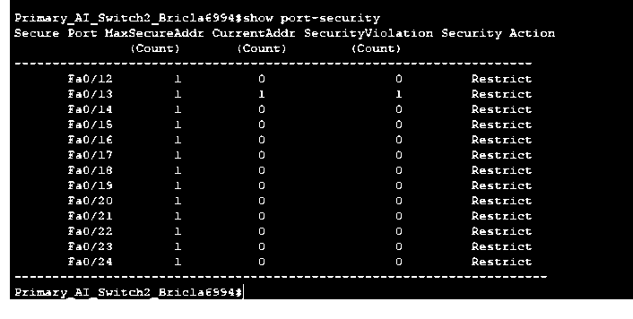

# Switch Port Security and Access Control Validation

**Cisco Packet Tracer | Cisco IOS | MAC address restrictions | Port-security violations | Network access testing**

## Overview

I configured and tested switch port security in a Cisco Packet Tracer network to see how the switches responded when an unfamiliar device was connected to an existing access port.

The work covered two approaches: assigning an approved MAC address manually and allowing a switch to learn an address with sticky port security. I also disabled unused access ports and checked their status.

## Static port security

On the first switch, I secured FastEthernet0/12 with the connected PC's MAC address. I then disconnected that PC, attached a different device, and attempted to obtain an address through DHCP.

The replacement device did not receive a normal DHCP lease. The switch's `show port-security` output recorded **one security violation** on Fa0/12 and the port's action as **Shutdown**.

After reconnecting the original PC, I reset the affected interface with `shutdown` and `no shutdown` and checked that network addressing worked again.

## Sticky port security

On the second switch, I enabled sticky MAC learning across a range of access ports, set the maximum to one secure address per port, and used the **restrict** violation action.

I generated traffic from the original PC so the switch could learn its address. I then replaced it with a different device and tried DHCP again. The replacement device failed to obtain a normal lease. The switch output showed **one violation on Fa0/13**, with **Restrict** as the configured action.

Unlike the shutdown action, restrict drops traffic from an unauthorized source without placing the entire port into the error-disabled state. After reconnecting the approved device, I could restore its DHCP connectivity without manually bouncing the port.

## Unused access ports

I shut down unused switch ports and inspected their interface status. This reduced the number of available physical connection points in the simulated network while leaving the designated connected ports in service.

## Verification

| Check | Observed result |
|---|---|
| Manual MAC restriction | Replacement device failed DHCP; Fa0/12 recorded one violation and shutdown |
| Recovery from shutdown | Original PC was reconnected; interface reset and DHCP connectivity restored |
| Sticky MAC restriction | Replacement device failed DHCP; Fa0/13 recorded one violation with restrict action |
| Unused ports | Interface status output showed unused access ports disabled |

These tests establish the behavior of the specific ports exercised in Packet Tracer. They do not establish that MAC-based controls alone are sufficient for access security in a production environment. MAC addresses can be spoofed, so a real deployment would also consider 802.1X authentication, monitoring, and appropriate switch configuration management.

## Tools and commands

Cisco Packet Tracer, Cisco IOS, DHCP, MAC address inspection, `switchport port-security`, `switchport port-security mac-address sticky`, `switchport port-security violation restrict`, `show port-security`, and `show interfaces status`.

[Networking projects](../) | [All projects](../../) | [Portfolio home](../../../README.md)
