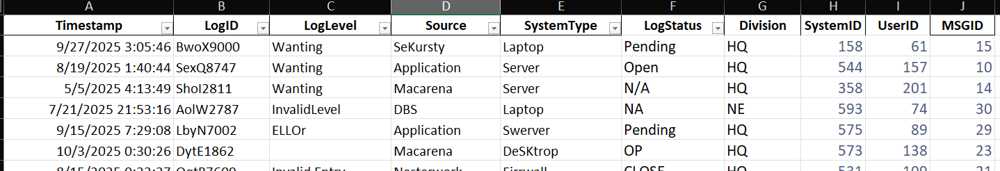
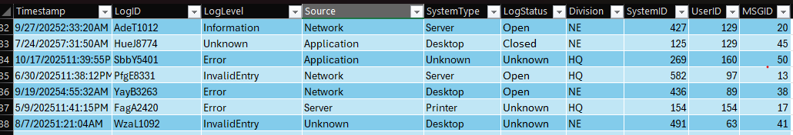
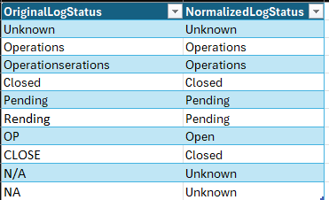
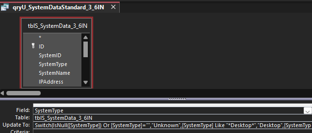
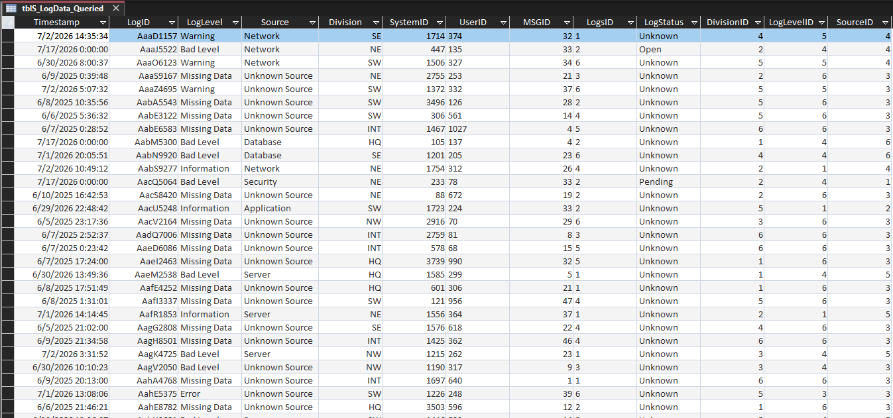
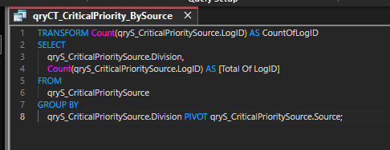
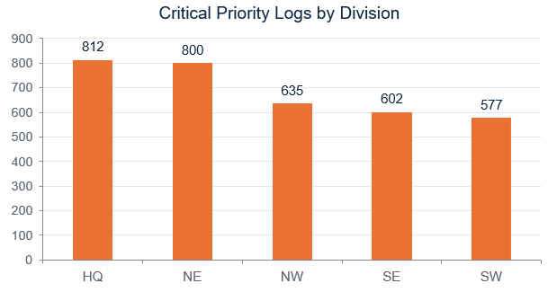
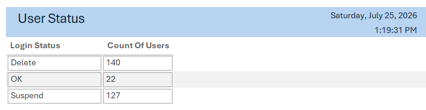
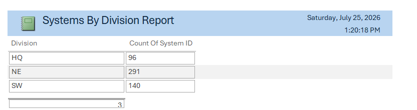

# Security Log Analysis & Relational Database Design

**Tools:** Microsoft Excel, Microsoft Access, SQL, PivotTables, VLOOKUP, data validation, and Access reports  
**Focus:** Security log analysis, data quality, relational database design, and security reporting

## Overview

I worked through a five-week data handling project for a simulated organization with six divisions. The starting point was a collection of inconsistent security logs, system records, user information, and event messages. My goal was to make that data easier to trust, connect, and analyze.

I started in Excel, where I cleaned incoming records and built summaries to identify issues worth investigating. I then moved the data into Microsoft Access, using staging tables, saved queries, and related tables to make the cleanup and reporting process more consistent.

## Cleaning and analyzing logs in Excel

The source files contained misspelled categories, missing values, inconsistent status labels, and records that could not be matched to a known user, system, or event message.

- Standardized values for log level, source, department, system type, and status.
- Used VLOOKUP and IFERROR to connect log records to user, system, and message information while identifying missing references.
- Built date-based status formulas to flag systems overdue for updates and users needing an inactivity review.
- Used PivotTables and charts to compare activity by department, system type, message priority, and division.

The missing references were particularly important. A log entry is harder to investigate when its user, system, or message ID cannot be resolved reliably.

### Excel data preparation

The log import contained inconsistent labels and formats. I standardized the relevant fields before building the analytical summaries.

*Sample from the incoming log data.*

*Log records using standardized categories.*

I also kept a reference table for status values that arrived under different names or abbreviations.

*Lookup table used to align inconsistent status labels.*

## Building the Access database

As more data was introduced, I migrated the workbook data into an Access relational database. I used staging tables so imported records could be checked before being appended to the main tables.

The database work included:

1. **Staging and cleanup:** Importing records into separate staging tables and using saved update queries to standardize fields.
2. **Duplicate and reference checks:** Checking duplicate identifiers and locating references to users, systems, or messages that were missing from the main tables.
3. **Append queries:** Moving prepared records into the permanent tables after cleanup.
4. **Relationships and normalization:** Connecting logs to users, systems, messages, divisions, and lookup tables through primary and foreign keys. Position and other repeated values were moved into reference tables.
5. **Data validation:** Applying field rules and input masks to improve consistency in names, contact details, and other structured fields.

I also worked with password-based database encryption, backup copies, a read-only copy, and a front-end/back-end split. User positions were modeled in the database, but the position lookup table itself is not an Access permissions system.

### Access queries and table structure

*Saved update query used to standardize imported system-type values.*

*Access log table with ID fields for normalized reference values. Original text fields remain visible for review.*

## Reporting and findings

I created crosstab queries and Access reports to make the data useful beyond the import process. The analysis focused on log severity, missing source information, system update status, and inactive user accounts.

In one user-status report, **140 accounts were marked Delete, 127 Suspend, and 22 OK**. These are review flags from the dataset, not proof that those accounts were disabled or compromised.

A critical-priority crosstab showed elevated counts in the HQ and Northeast divisions. Other reports exposed unknown departments, incomplete reference data, and systems flagged as overdue. I used those results to recommend better validation at import, regular account reviews, and more consistent update tracking.

### Selected results

The saved Access crosstab query groups log records by division and pivots them by source. These counts support comparisons between divisions, but do not confirm individual security incidents.

*SQL View of the saved `qryCT_CriticalPriority_BySource` query.*

*Critical-priority log counts for the divisions returned by this crosstab. These are priority labels, not confirmed incidents.*

*User-status counts generated in Access to support account review.*

*Systems-by-division report for the divisions returned by this query.*

## What I learned

The biggest challenge was keeping data consistent as each new division was added. An incorrect category or unmatched ID can affect several reports, not just one record. Staging tables and reusable queries made it easier to find those problems before they reached the main database.

This project strengthened my experience with Excel analysis, Access database design, SQL queries, data validation, and communicating security findings to nontechnical stakeholders.

---

*Academic project using a simulated company and training datasets. Status flags and priority labels identify records for review; they are not confirmed security incidents.*

[Back to Projects](../) | [Portfolio Home](../../)
