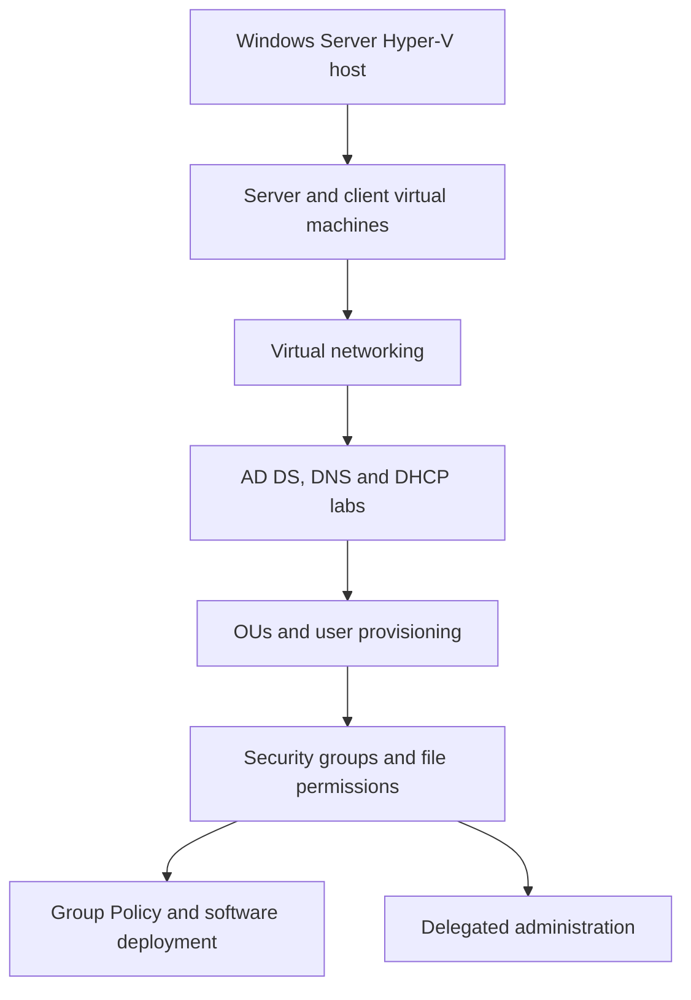

# Enterprise Windows Domain Infrastructure and Access Control

**Windows Server 2019 | Hyper-V | Active Directory | DNS | DHCP | PowerShell | Group Policy**

## Overview

I built and administered a Windows Server training environment through a sequence of infrastructure labs. I started by provisioning server and client virtual machines in Hyper-V, then worked through domain services, organizational design, bulk account creation, security groups, shared-folder permissions, Group Policy, and delegated administration.

The work focused on making a Windows domain manageable as an organization grows. Instead of assigning every setting or permission individually, I used organizational units (OUs), groups, and PowerShell to apply configurations at the right level.

The labs were completed in an isolated classroom environment. Some configurations changed between assignments, so this project documents verified work across the course rather than claiming every component was operating simultaneously.

## Infrastructure work

| Area | Implementation |
|---|---|
| Virtualization | Created Generation 2 Hyper-V virtual machines, configured memory and storage, prepared base images and differencing disks |
| Virtual networking | Configured Hyper-V switches, NAT connectivity, IP addressing, and name-resolution tests |
| Directory services | Installed AD DS, created a forest, and joined Windows clients to the domain |
| DNS and DHCP | Configured DNS zones, forwarding and records, DHCP roles, authorization, and address scopes |
| Directory organization | Organized OUs by location and department, then performed CSV-based user provisioning |
| Access control | Created and nested global and domain-local groups, configured shared folders and NTFS access |
| Group Policy | Created and linked GPOs and configured centrally managed software deployment |
| Delegated administration | Assigned OU-scoped administration and password-reset tasks to designated groups |

## Infrastructure workflow

*This is a sequence of course exercises, not a diagram of a single persistent production environment.*

## Bulk Active Directory provisioning

One exercise supplied a CSV dataset containing **449 employee records** with names, departments, locations, and account attributes. I used it to support account creation and placement into location- and department-specific OUs.

The accompanying assessment returned **38 passed, 0 failed** for checks covering OU structure, account imports and placement, and related configuration. The result verifies the conditions tested by the course script. It is not a manual audit of every imported account.

The original employee dataset is not included because individual account data is unnecessary to demonstrate the provisioning workflow.

## Access control and delegation

For shared resources, I created security groups and applied an AGDLP-style structure: accounts in global groups, global groups nested into resource-specific domain-local groups, and permissions assigned to those resource groups. I also worked with NTFS access control lists (ACLs) and SMB shares.

A later exercise delegated specific administrative tasks to groups responsible for individual OUs, including password-reset rights. This connects directory organization to a practical administrative security model.

## Selected verified results

| Assignment | Course validation |
|---|---:|
| 2.3, virtual machines from base images | 24 passed, 0 failed |
| 2.4, Hyper-V networking | 17 passed, 0 failed |
| 2.7, Hyper-V performance assessment | 35 passed, 0 failed |
| 3.5, advanced DNS | 6 passed, 0 failed |
| 3.7, Active Directory forest | 12 passed, 0 failed |
| 3.8, Windows DHCP | 13 passed, 0 failed |
| 4.4, Active Directory logical design | 38 passed, 0 failed |
| 4.5, directory objects and permissions | 33 passed, 0 failed |
| 4.6, GPO creation and linking | 3 passed, 0 failed |
| 4.8, Group Policy software deployment | 11 passed, 0 failed |
| 4.9, delegated administrative control | 4 passed, 0 failed |

The figures represent separate automated checks taken at different stages of the course. Assignment 4.7 included a failed check, while performance assessment 4.11 encountered a validation error. I have not counted either as a passing result.

## What I learned

The relationship between these technologies became clearer as I worked through the labs. DNS supports domain functionality, OU design affects policy scope, group nesting makes permissions easier to maintain, and delegated administration limits the need to share domain-wide privileges. PowerShell and CSV input also make account provisioning more consistent than creating hundreds of accounts manually.

The classroom configurations are not a production security baseline. Shared demonstration passwords, broad Remote Desktop access, and permissive share-level permissions would require changes before use in an enterprise.

## Documentation and evidence

- [Implementation details](docs/implementation.md)
- [Test results and evidence checklist](docs/validation.md)
- [Security and production considerations](docs/security-notes.md)
- [Original screenshot upload folder](screenshots/)

The screenshot folder contains a naming guide for the original lab images, which can be uploaded separately without changing project paths.

[Windows infrastructure projects](../) | [Portfolio home](../../../README.md)
