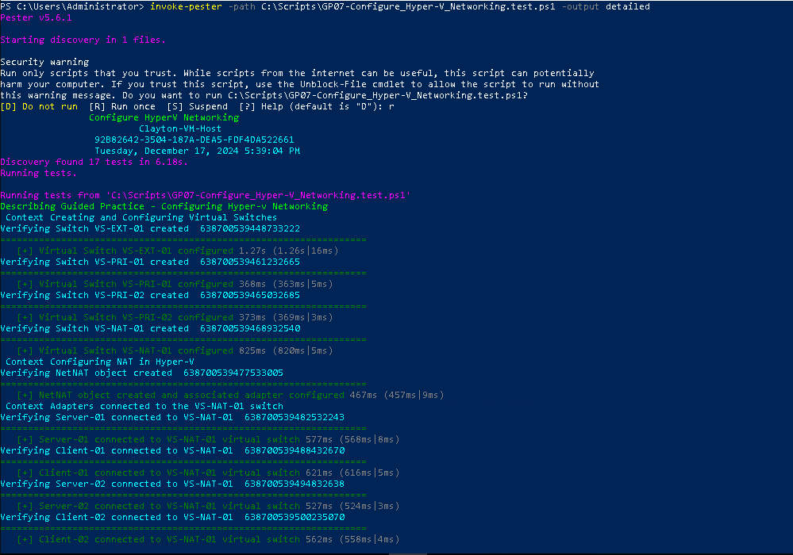
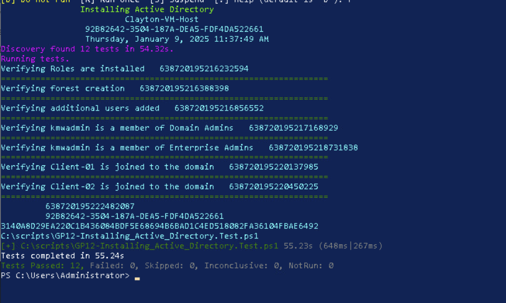
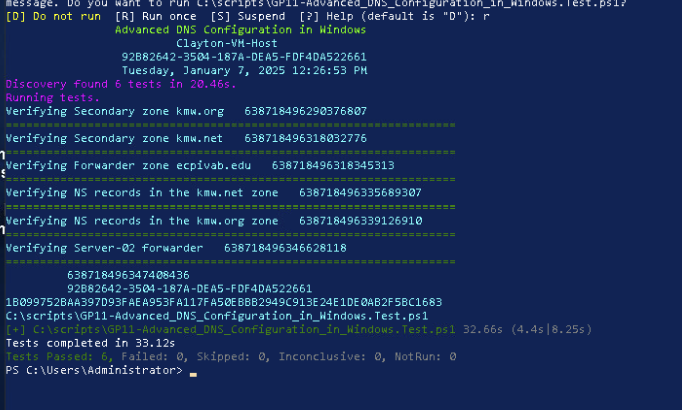
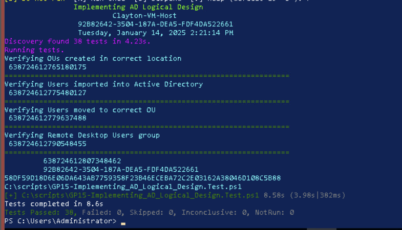
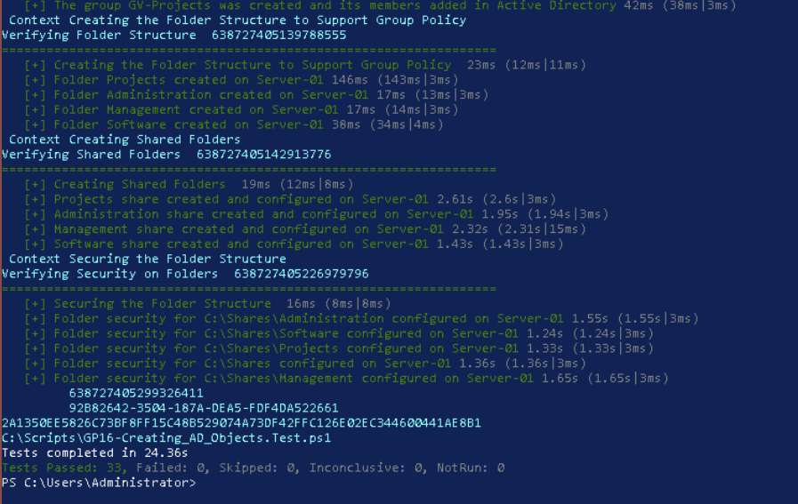
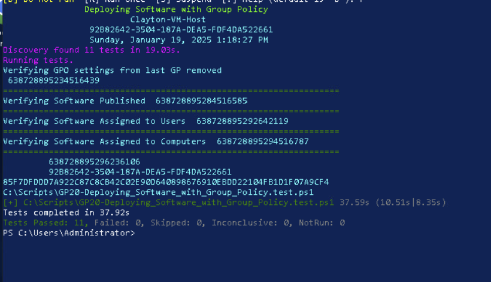
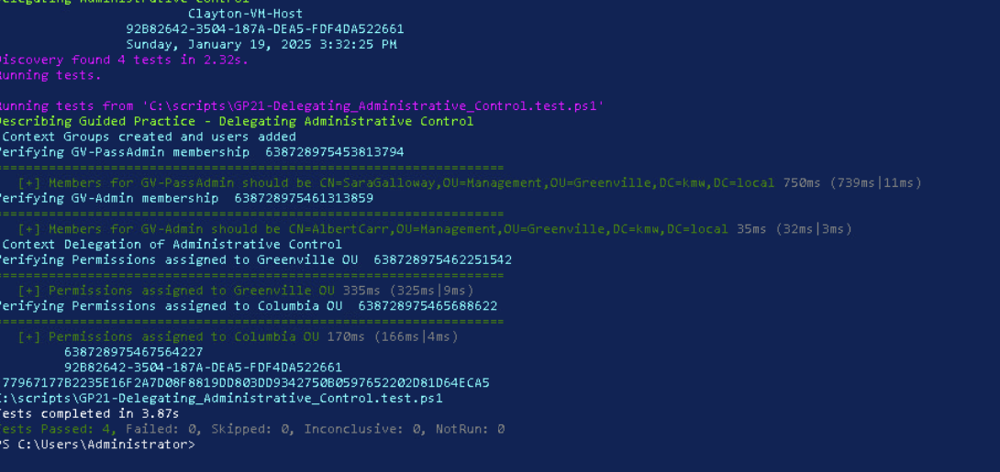

# Windows Server Infrastructure and Active Directory Administration

**Windows Server 2019 · Hyper-V · Active Directory · DNS · DHCP · PowerShell · Group Policy**

## Project overview

I built a Windows Server environment to work through the services and administrative tasks that support a business network. The environment included virtualized Windows servers and clients, Active Directory, DNS, DHCP, shared resources, and centrally managed policies.

I worked with each component directly, from creating virtual machines to organizing user accounts and assigning permissions. Some configurations were completed in separate lab environments, so this page brings the related work together rather than describing a single production deployment.

## Environment

| Component | Configuration and purpose |
|---|---|
| Hyper-V | Windows Server and Windows client virtual machines, virtual switches, and virtual disks |
| Active Directory Domain Services | Domain deployment, client domain membership, organizational units, users, and groups |
| DNS and DHCP | Name resolution, DNS zones and forwarders, DHCP authorization, scopes, and address assignment |
| Group Policy | Centralized user and computer settings, including software deployment |
| File services and access control | Shared folders, security group nesting, and NTFS permissions |
| PowerShell | Virtual machine administration, service configuration, and user provisioning |

## Virtualization and network setup

I configured Hyper-V to host Windows Server 2019 and Windows client machines. This included creating Generation 2 VMs, assigning memory and virtual disks, and preparing reusable base images with differencing disks.

I also configured virtual switches and IP settings so the machines could communicate within the lab. Working with NAT and different virtual network types helped me understand how the network design affects connectivity between hosts, guests, and other services.

## Active Directory, DNS, and DHCP

I installed Active Directory Domain Services, created a domain, and connected Windows client machines to it. From there I configured the directory structure and worked with the supporting network services.

The DNS work included secondary zones, name server records, forwarding, and name resolution. For DHCP, I installed and authorized the server role, created address scopes, and configured address exclusions. These tasks showed how closely directory services depend on a working network and reliable DNS configuration.

## User provisioning and directory organization

I organized Active Directory using organizational units based on office locations and departments. I then worked with a CSV containing 449 training employee records to provision accounts and place users in the appropriate OUs.

This was one of the most useful parts of the project because it moved beyond creating users one at a time. Consistent naming and directory structure make accounts easier to locate, manage, and apply policies to as an environment grows. The original employee records are not included in this public repository.

## Security groups and file permissions

I created security groups, nested memberships, and assigned permissions to shared resources. The access-control work followed the **AGDLP** model: accounts belong to global groups, global groups can be members of domain-local resource groups, and permissions are assigned to those resource groups.

I also configured SMB shares and NTFS permissions. This approach is more manageable than granting access separately to every user, and it supports more consistent control of departmental resources.

## Group Policy and administrative delegation

I created and linked Group Policy objects to manage settings across domain-joined systems. I also configured software distribution through Group Policy, including software published to users and assigned to computers.

For administrative delegation, I created location-specific groups and used Active Directory delegation to assign account management and password-reset responsibilities within designated OUs. That allowed the work to be divided by responsibility rather than relying entirely on domain-wide administrative privileges.

## Key takeaways

The biggest lesson from this environment was how the pieces fit together. Virtualization made the infrastructure easier to build and reset, DNS and DHCP supported network connectivity, and Active Directory gave me a central place to manage users and computers. Group Policy and security groups made it possible to control settings and access without configuring every machine and user separately.

The configurations reflect a controlled Windows Server 2019 training environment. In production, I would review delegated permissions, apply least-privilege access, protect provisioning credentials, restrict DNS transfers, and test Group Policy changes before applying them broadly.

[Windows infrastructure projects](../) · [All portfolio projects](../../) · [Portfolio home](../../../README.md)
