# Enterprise Windows Infrastructure, Active Directory and Container Services

**Hyper-V | Windows Server | Active Directory Domain Services | DNS | DHCP | Group Policy | SMB | Docker | IIS | PowerShell**

## Project overview

I built and documented a Windows infrastructure environment for Radically Secure Inc. (RSI), a fictional organization with a separate GuardianDev child domain. The work began with Hyper-V virtual machines and progressed through domain services, workstation policies, DHCP failover, shared-folder access, and Windows containers.

My focus was on how these services work together. A domain controller needs reliable addressing and DNS, users need organized directory objects and appropriate permissions, and a web container needs its own network configuration and persistent storage. I used PowerShell and the Windows administration consoles to configure the environment and inspect the results.

The screenshots are from the original lab environment. This was not a production deployment, and the Hyper-V domain network and Docker NAT network were separate configurations.

## Infrastructure at a glance

| Area | Configuration documented |
|---|---|
| Virtualization | Three server VMs and two Windows client VMs attached to the `VS-RSI-LAN` virtual switch |
| Virtual disks | Reusable base images with differencing disks; VM and disk paths inspected in PowerShell |
| Active Directory | Parent domain `BC69RSI.local` and child domain `GuardianDev.BC69RSI.local` |
| DHCP | Two authorized DHCP servers with a hot-standby failover relationship showing `Normal` state |
| Client addressing | `10.2.2.0/24` subnet with a DHCP range of `10.2.2.15` to `10.2.2.240` |
| Directory administration | Organizational units, security groups, user accounts, and domain-joined workstations |
| Workstation management | `RSI-WS-Security` and `RSI-WS-Updates` Group Policy objects |
| File services | Departmental SMB shares and NTFS access-control entries inspected on both domains |
| Containers | Windows Server Core containers, IIS, NAT configuration, published HTTP port, and host bind mounts |

### Network layout

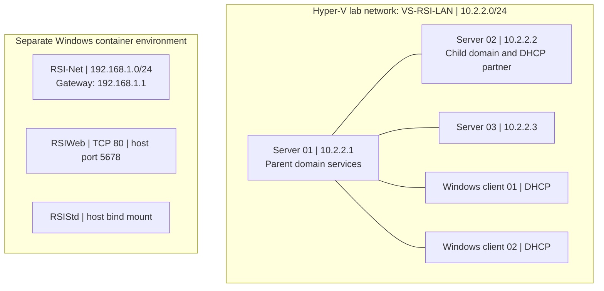

The diagram summarizes the two networks documented in the reports. It does not indicate routing between the networks or verified attachment of either container to `RSI-Net`.

## 1. Hyper-V and virtual machine deployment

I configured the Hyper-V host's storage locations and prepared reusable Windows base images. I used differencing disks for the working virtual machines so their changes could be stored separately from the parent images.

The environment included three server VMs and two client VMs. I checked VM disk paths, parent-disk relationships, switch assignments, and guest IP information in PowerShell. The network diagram and adapter output place the servers on the `10.2.2.0/24` lab network.

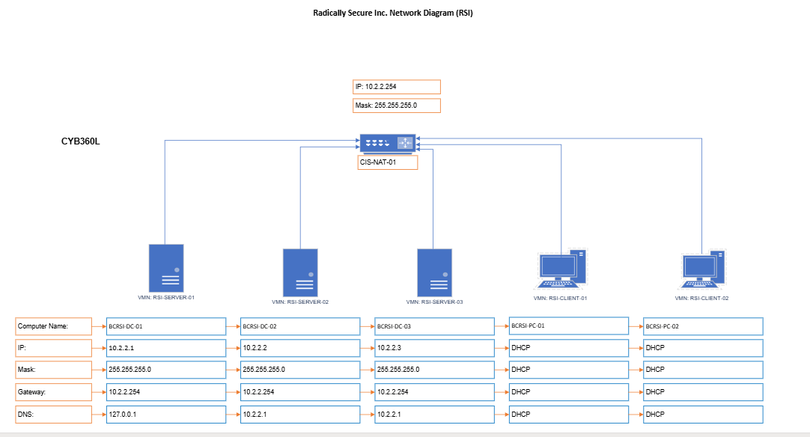

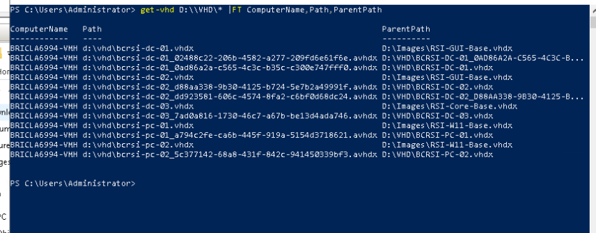

**Verification:** `Get-VMHardDiskDrive`, `Get-VHD`, and `Get-VMNetworkAdapter` exposed the virtual disk and adapter configurations. The captured output confirms disk relationships and address assignments, not a benchmark of virtual machine performance.

## 2. Active Directory, DNS and DHCP

I configured a parent Active Directory domain and a GuardianDev child domain. The directory output shows the `BC69RSI.local` forest, the child-domain reference, and domain-controller information. I also joined Windows clients to the parent domain and checked their computer objects.

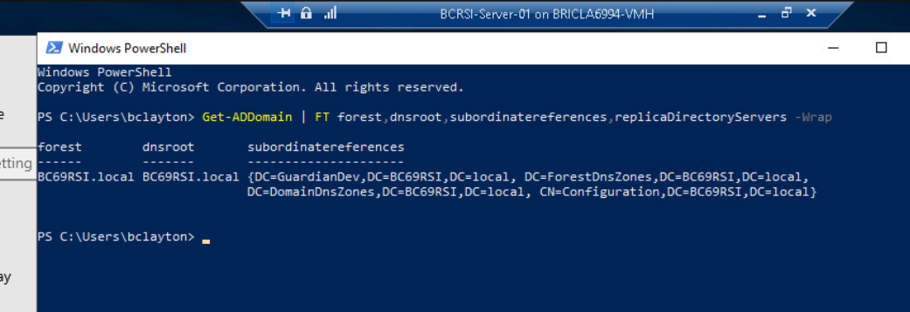

For DHCP, I authorized two servers and configured a hot-standby relationship named `RSI-DHCP-Failover`. The PowerShell output shows `HotStandby` mode, an active server role, and a `Normal` relationship state. These are configuration and health indicators. I did not document a forced failover test.

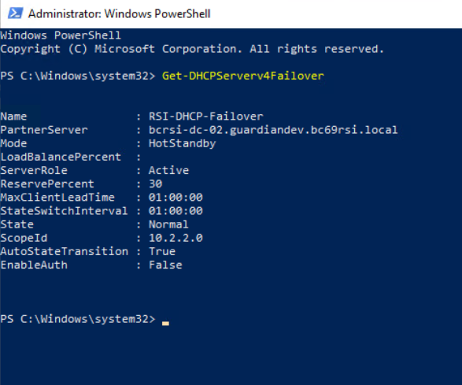

The `RSI-LAN` DHCP scope used `10.2.2.15` through `10.2.2.240`, with an eight-day lease duration. Scope options identified `10.2.2.254` as the router and `10.2.2.1` as the DNS server. I checked client leases to confirm that addresses appeared in the active lease table.

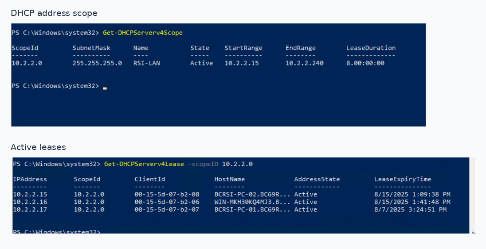

I also checked the `2.2.10.in-addr.arpa` DNS reverse-lookup zone. The DNS output documents the zone configuration, but it does not by itself prove that every reverse lookup succeeded.

## 3. Directory organization and workstation policies

I created and reviewed organizational units for the parent and child domains, with departments and workstations separated to make account administration easier. I inspected user records, group memberships, and the placement of the two Windows client objects in `RSIWorkstations`.

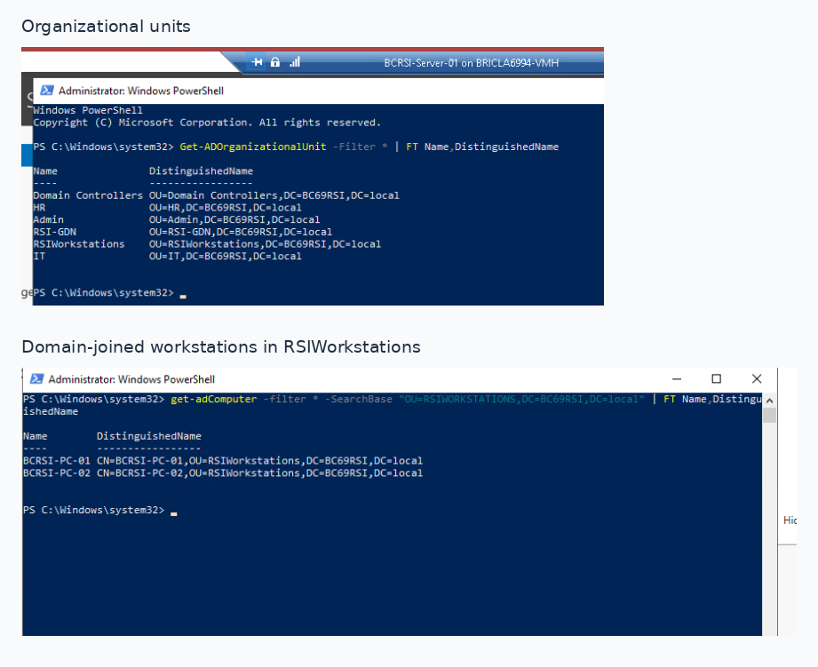

I also configured two workstation Group Policy objects:

- **`RSI-WS-Security`** included local account security options, such as disabling the built-in Administrator and Guest accounts and renaming local accounts.
- **`RSI-WS-Updates`** included Windows Update settings, including automatic update configuration and an intranet update service location.

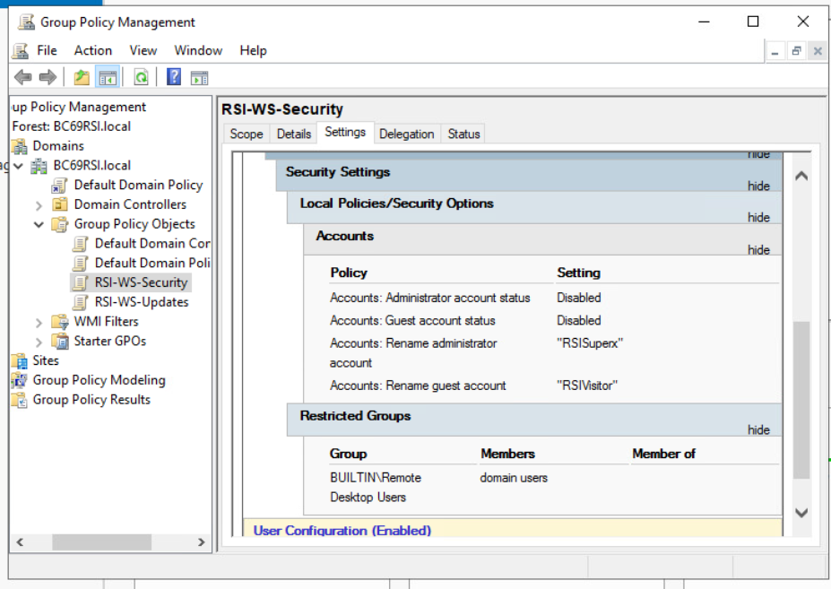

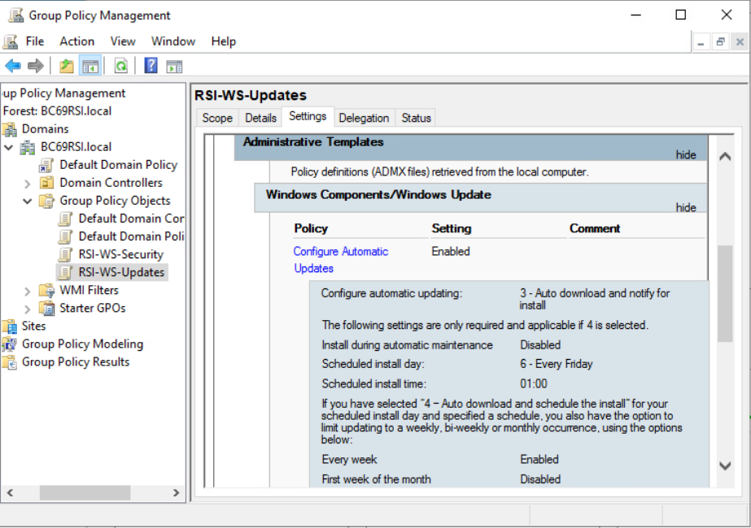

The captures show configured GPO settings. They do not include a client-side `gpresult` report, so I am not treating application of every policy as independently verified.

## 4. File shares and access control

I configured and inspected SMB shares for the RSI and GuardianDev domains. The RSI shares included Admin, Employees, HR, IT, and Managers. GuardianDev included Engineering, HR, and Operations.

I reviewed the share paths and NTFS access-control lists rather than assuming that a share name alone established the intended permissions. The RSI ACL output shows an IT-related security group with `FullControl` on several departmental folders. This is useful evidence of group-based administration, but it also deserves a least-privilege review before a similar design could be used in production.

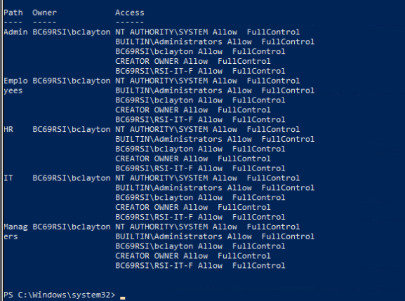

The workstation checks also showed `Domain Users` in the local `Remote Desktop Users` group on the clients. In a real environment I would restrict that membership to specifically authorized users and verify access from a test account.

## 5. Windows containers, IIS and persistent storage

In the final part of the project I worked with Windows Server Core containers. I installed the IIS Web Server role in a web template container and confirmed that the feature appeared as `Installed`.

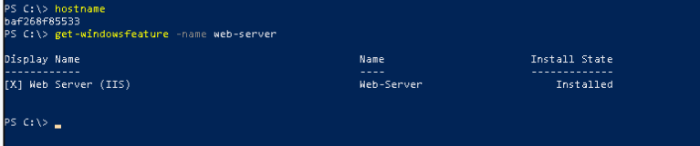

I inspected a Docker NAT network named `RSI-Net`. Its recorded subnet was `192.168.1.0/24` and its gateway was `192.168.1.1`, separate from the Active Directory lab network.

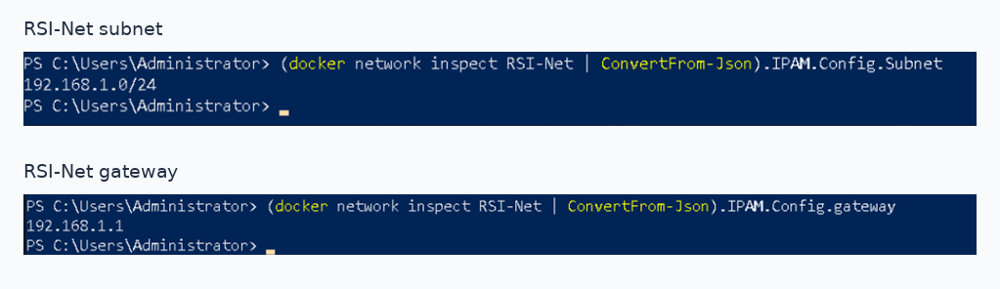

The container configuration captured these mappings:

| Container | Host-side configuration | Container-side configuration |
|---|---|---|
| `RSIWeb` | Published TCP port `5678` | TCP port `80` |
| `RSIWeb` | `D:\RSIData1` | `C:\WebData` |
| `RSIStd` | `D:\RSIData2` | `C:\StdData` |

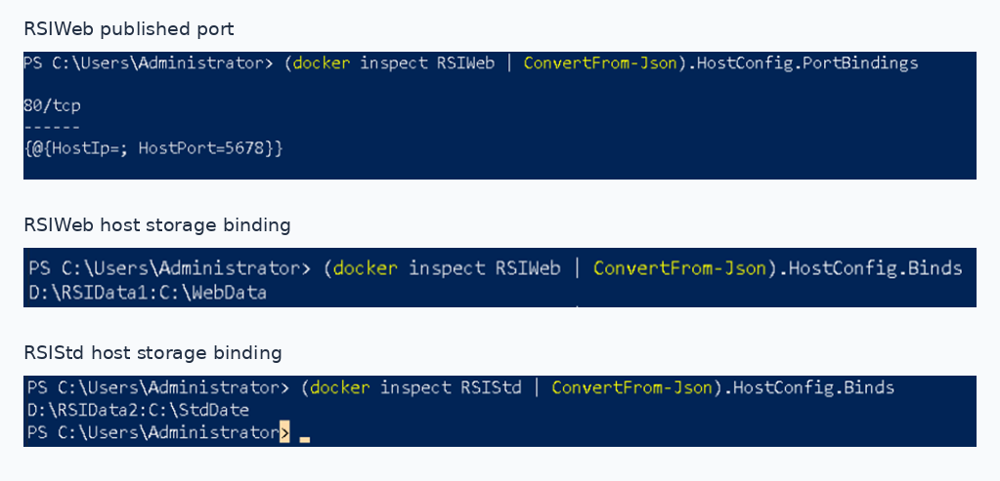

The screenshots verify the saved port and storage configurations. They do not include a successful HTTP response, an application health check, or a demonstrated file-persistence test. One network-inspection capture also displayed an empty container-membership field, so I have not claimed that network attachment was confirmed by that output.

## Security review and lessons learned

This project showed me how much Windows infrastructure depends on consistent configuration across multiple services. I also identified several checks I would add before relying on a similar environment outside a lab:

1. **Validate failover behavior.** The DHCP relationship reported `Normal`, but a controlled failover exercise would be needed to verify lease continuity.
2. **Review permissions.** Audit broad NTFS `FullControl` assignments and remove unnecessary Remote Desktop access for general domain users.
3. **Confirm policy application.** Use Group Policy Results or `gpresult` on client machines to verify that security and update settings actually apply.
4. **Test container services.** Confirm HTTP reachability on the published host port, check live network membership, and verify that files survive container replacement.
5. **Protect the environment.** Apply supported patches, restrict administrative access, and review host firewall rules and container bind-mount permissions.

My main takeaway was learning to verify the state of each component rather than treating the configuration step as proof that the whole service works. PowerShell made it possible to inspect disk relationships, domain objects, policy definitions, DHCP settings, file permissions, and container configurations directly.

## Related work

This case study covers the connected RSI environment. These separate projects provide more detailed examples of individual technologies:

- [Windows Server Infrastructure and Active Directory Administration](../enterprise-windows-domain-infrastructure/)
- [Windows Containers, Docker Networking and IIS Deployment](../windows-container-iis-deployment/)

[Windows projects](../) · [All portfolio projects](../../) · [Portfolio home](../../../README.md)