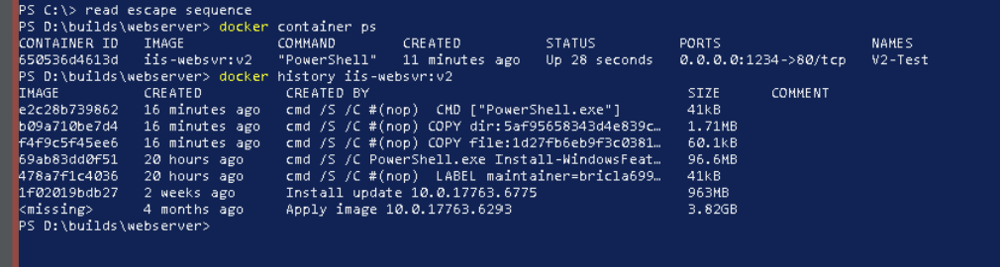
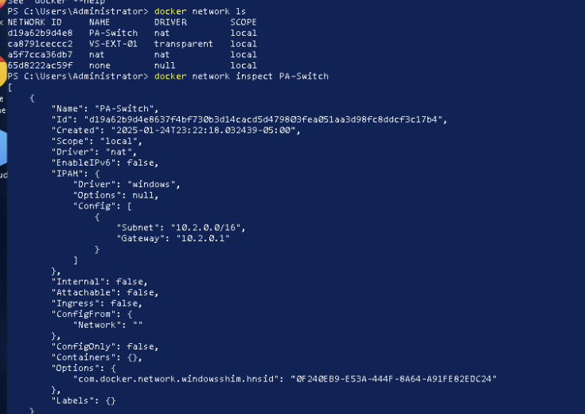
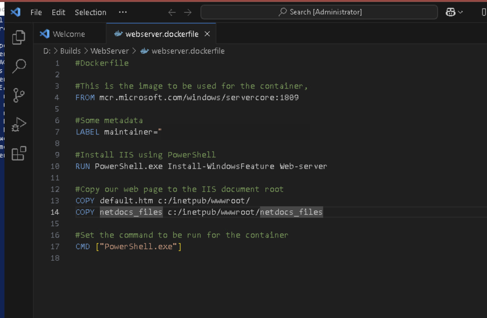

# Windows Containers, Docker Networking, and IIS Deployment

**Windows Server 2019 · Docker · Windows Server Core · IIS · PowerShell**

## Project overview

I configured Docker in a Windows Server environment and used Windows containers to run and manage an IIS web server. The work covered the container lifecycle, from choosing a base image and starting a container to managing persistent files, networking, and rebuilding a custom image from a Dockerfile.

The goal was to understand what changes when an application runs in a container instead of a full virtual machine, and how to keep the application connected and its files accessible across container restarts.

## Environment and tools

| Technology | How I used it |
|---|---|
| Windows Server 2019 | Host environment for Windows containers |
| Docker | Pulled images, created and managed containers, and built custom images |
| Windows Server Core | Base image for the containerized web server |
| IIS | Web server role installed within the container image |
| PowerShell | Managed containers, inspected configuration, and installed Windows features |
| Visual Studio Code | Edited the Dockerfile used for the image build |

## Container setup and management

I installed Docker and verified that the container engine could access and run Windows images. I then practiced pulling Windows Server Core and Nano Server images and managing their lifecycle using Docker commands.

Creating and inspecting containers helped me distinguish an **image**, which is the starting template, from a **container**, which is a running or stopped instance of that image. I also used Docker's image history and container listings to inspect what had been created.

## Persistent storage

I worked with both host bind mounts and Docker named volumes.

With a **bind mount**, I mapped a Windows host directory into the container so the application could use files stored outside its writable layer. I also created a Docker-managed volume for website files and inspected where the volume was stored.

This mattered because files written only to a container's writable layer are not a reliable way to retain application data after that container is deleted. Keeping data separate from the container makes replacement and redeployment more practical.

## Container networking

I examined the default Docker NAT network, reviewed container addressing, and created an additional NAT network with a defined subnet. I attached containers to networks, inspected their settings, and tested connections between them.

I also worked with **published ports**, where a host port is mapped to an application port inside a container. In the IIS build, host port **1234** was mapped to port **80** in the container.

## Building a custom IIS image

I used a Dockerfile in Visual Studio Code to define an IIS-based Windows container image. The file started from a Windows Server Core image, installed the Web Server feature, and copied website content into IIS's document directory.

After updating the site content, I rebuilt the image with the tag `iis-websvr:v2`. I used Docker image history to review the build layers and started a container named `V2-Test` from the updated image.

This gave me experience with a repeatable image build instead of manually configuring each new container.

## What I took away

Docker made it easier to rebuild the same application environment from a defined image. The storage and networking work was just as important as the build itself: an application needs access to its files and a clear path for traffic before it is useful.

For a production environment, I would use supported, patched base images, limit host directory access and exposed ports, scan images for vulnerabilities, and add application health checks. This project reflects the Windows Server 2019 environment used for the work, not a modern production deployment.

[Windows infrastructure projects](../) · [All portfolio projects](../../) · [Portfolio home](../../../README.md)
