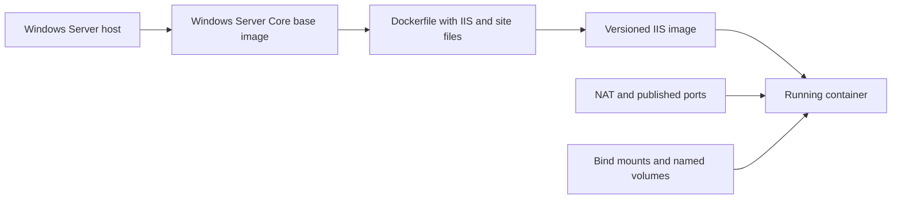

# Windows Containers, Networking, Storage, and IIS

**Windows Server 2019 | Docker | Windows Server Core | PowerShell | IIS**

## Overview

I worked through the Windows container lifecycle, beginning with Docker installation and image management and continuing into running containers, persistent storage, network configuration, and building an IIS web server image from a Dockerfile.

The project combines related CYB360 labs in an isolated Windows Server environment. Individual assignments have their own validation results. It does not represent a production application deployment.

## Implementation

| Stage | Work completed |
|---|---|
| Docker setup | Installed Docker on Windows Server and verified the locally available hello-world image |
| Container management | Pulled Windows container images and practiced creating, starting, stopping, inspecting, and removing containers |
| IIS application | Used a Windows Server Core-based image with IIS installed |
| Persistent storage | Practiced bind mounts using a host folder and Docker-managed named volumes |
| Networking | Inspected the NAT network, created additional networks, connected containers, and published ports |
| Repeatable image builds | Created a Dockerfile that installed IIS and copied website content, then built a versioned image |

## Container workflow

*Storage and networking were explored in separate exercises. The diagram does not imply every feature was used in the same running container.*

## Dockerfile image build

For assignment 5.7, I used Visual Studio Code to create a Dockerfile based on the Windows Server Core 1809 image. The file installed the IIS Web Server role and copied a default page and supporting site assets into the IIS document root.

The subsequent build was tagged `iis-websvr:v2`. My submission showed `docker history` output and a running `V2-Test` container with host port **1234** mapped to container port **80**.

The original Dockerfile and site asset files were not retained as separate files. I have preserved their configuration evidence in the submitted screenshots rather than presenting a newly reconstructed file as the original.

## Storage and network administration

The storage assignments explored the difference between an ephemeral container filesystem, a **bind mount** into a host directory, and a **named volume** managed by Docker. My revised storage submission passed all nine automated checks.

The networking exercises covered Docker network inspection, NAT networks, connectivity testing, and published container ports. Eleven network-related checks passed.

## Validation summary

| Assignment | Submitted evidence |
|---|---|
| 5.3, Docker installation | 4 passed, 0 failed |
| 5.4, using Windows containers | 9 passed, 0 failed |
| 5.5, container storage, revised submission | 9 passed, 0 failed |
| 5.6, container networking | 11 passed, 0 failed |
| 5.7, Dockerfile build | Dockerfile screenshot, image history, and running-container output |

The 5.7 material documents the image and running container. It does not independently establish a successful HTTP request or application health monitoring. The final performance assessment encountered a grading-script error and is not included as a passing validation claim.

## Security perspective

Windows Server 2019 and Server Core 1809 reflect the training environment, not a recommended modern production baseline. For a real deployment I would review supported images, restrict exposed ports and mounted host directories, avoid secrets in image layers, scan the final image, and add functional health checks and monitoring.

## Documentation and evidence

- [Implementation details](docs/implementation.md)
- [Test results and evidence checklist](docs/validation.md)
- [Container security considerations](docs/security-notes.md)
- [Original screenshot upload folder](screenshots/)

[Windows infrastructure projects](../) | [Portfolio home](../../../README.md)
